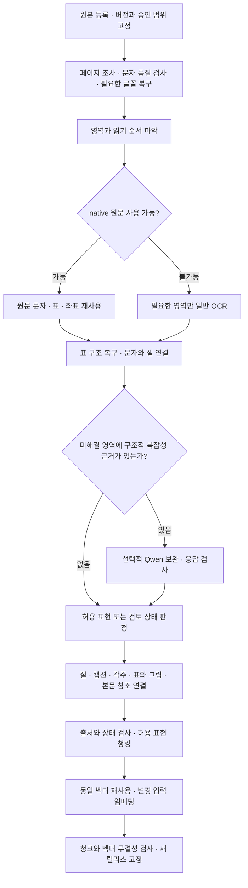

# 바이오시밀러 데이터 전처리 파이프라인 정리

작성·확인일: 2026-10-12 KST.

이 문서는 원본 등록부터 문자·표·그림 추출, 문맥 연결, 청킹, 임베딩, 데이터 릴리스 검증까지의 구현과 실행 이력을 정리한다. 각 단계에서 무엇을 처리했고, 어떤 방법론·라이브러리·코드를 사용했으며, 결과를 어디에 저장했는지 설명한다.

**실제 운영 제품 데이터는 `rag_finalization_2026-10-10_v2`이며, 10월 11일의 `rag_source_structure_2026-10-11_v1`은 운영에 반영되지 않은 개발 후보다.** 이 문서는 운영 데이터까지의 전처리 흐름과 그 이후 개발 후보의 구조 보완을 함께 정리한다. 10월 12일 공통 지침 스냅샷 갱신은 별도 경로로 기록한다. 이 문서를 작성하면서 OCR·VLM·임베딩을 재실행하거나 서비스를 변경하지 않았다.

## 1. 처리 범위와 전체 흐름

| 항목 | 기준 |
|---|---|
| 메인 작업 디렉토리 | `C:\Users\Admin\Documents\biosimilar_collection` |
| 실제 운영 제품 릴리스 | `data/versions/01_pilot_baseline_2026-10-10/embedded/rag_finalization_2026-10-10_v2/` — 10,088개 청크·벡터 |
| 제품 개발 릴리스 | `data/rag/releases/rag_source_structure_2026-10-11_v1/` |
| 제품 범위 | SB17, ABP654, CTP43, BMAB1200, BAT2206 |
| 기관 범위 | EMA/EU, FDA/US, Health Canada/CA |
| 승인 처리 범위 | 92문서·4,160페이지 |
| 개발 후보 청크·벡터 | 10,080개, BGE-M3 dense 1,024차원. 운영 데이터와 별도 |
| 평가 보호 | 기존 보류 9문서 제외 |
| 범위 명세 | [corpus_plan.json](../data/runs/corpus_update_2026-10-09/corpus_plan.json) |
| 개발 릴리스 실행 요약 | [summary.json](../data/runs/rag_source_structure_release_2026-10-11_v1/summary.json) |

전처리 엔진은 범용 구조·문자·좌표 규칙을 사용한다. 제품·기관 범위는 입력 명세에서 제한하며, 제품 ID나 질문의 정답값으로 파서 동작을 분기하지 않는다. 수집 카탈로그 전체와 이번 승인 전처리 범위는 서로 다르다.

### 1.1 실제 운영과 개발 후보의 구분

2026-10-12에 실행 중인 `http://127.0.0.1:8775/api/summary`를 읽어 확인했다. 시작 설정뿐 아니라 서버가 보고하는 릴리스 이름과 청크 해시를 운영 릴리스 메타데이터와 대조했다.

| 구분 | 실제 운영 / 확인 결과 | 개발 후보 |
|---|---|---|
| 제품 데이터 릴리스 | `rag_finalization_2026-10-10_v2` | `rag_source_structure_2026-10-11_v1` |
| 제품 청크·벡터 | 10,088개 | 10,080개 |
| 제품 청크 SHA-256 | `bc2ef2ce7211c3f37d3f3150159013c9231b5f57d67cb26601b2a214e4ca626c` | `ba8d5695075f128588c74fedd9943e4408ea09211d7aa8a9f76bc47c3c79c373` |
| RAG 코드 | `ra-research-rag-4.8.3` | 개발 실행 당시 코드 사본·해시를 따름 |
| 운영 답변 모델 | `gpt-5.6-luna` | 개발 평가 차수별 모델을 따름 |
| 임베딩 모델 | `BAAI/bge-m3` dense 1,024차원 | 동일 모델·차원 |
| 운영 공통 지침 | `ra_guidelines_native_2026-10-12_v2`, 236청크 | 제품 개발 후보와 독립된 스냅샷 |

운영 summary의 전체 10,324청크는 **제품 10,088 + 공통 지침 236**이다. 제품 임베딩 벡터가 10,324개라는 뜻은 아니다. 운영 코드는 최신 버전으로 바뀌었지만 제품 데이터 릴리스는 10월 10일 버전을 유지한다. 10월 11일 표 조각·좌표 투영 보완은 개발 후보의 변화이며 현재 운영 효과로 보고하지 않는다.

시작 스크립트 [start_ra_service.ps1](../scripts/start_ra_service.ps1)도 제품 릴리스와 지침 스냅샷을 위 경로로 지정한다. [운영 제품 임베딩 메타데이터](../data/versions/01_pilot_baseline_2026-10-10/embedded/rag_finalization_2026-10-10_v2/candidate/emb/bge-m3/meta.json)



이 흐름은 모든 자료를 매번 처음부터 실행한다는 뜻이 아니다. 사용 가능한 이전 추출·OCR·벡터를 재사용하고 변경한 구성요소만 갱신한다. 단순한 단일 열 본문은 `native_page.py`의 보수적 fast path로 모델 레이아웃 추론을 생략할 수 있다. 이미지·도형·의심스러운 문자 층이나 다단 구성 등은 일반 영역 처리로 돌린다.

## 2. 단계별 처리·방법론·라이브러리·코드·목적

아래 코드 링크는 현재 소스다. 특정 개발 릴리스 당시의 구현을 재현할 때는 해당 실행 폴더의 코드 사본과 해시를 함께 확인한다.

| 단계 | 처리 내용 | 방법론·라이브러리·모델 | 주요 코드 | 목적 |
|---|---|---|---|---|
| **1. 원본 등록·범위 확정** | 원본, 제품·기관·문서 종류·URL·버전을 등록하고 승인/보류 자료를 구분 | 카탈로그 조회, SHA-256 기반 원본·버전 식별, 명세 기반 처리 범위 제한. Python `hashlib`, JSON/JSONL, SQLite | [collect.py](../collection/collect.py), [ingest.py](../preprocess/ingest.py), [dataset.py](../preprocess/dataset.py), [corpus.py](../preprocess/corpus.py) | 다른 제품·문서 버전 혼입과 보류 자료 누출 방지 |
| **2. 페이지·영역 조사** | 페이지 크기·회전·텍스트 층·이미지·표/그림 후보와 좌표를 조사하고 렌더링 | PDF 객체·기하 기반 인벤토리, 페이지별 checkpoint. PyMuPDF, pdfplumber, Pillow | [inventory.py](../preprocess/inventory.py), [detect.py](../preprocess/detect.py), [dataset_inventory.py](../preprocess/dataset_inventory.py) | 자료 위치를 파악하고 영역 단위 후속 처리·원본 검토를 가능하게 함 |
| **3. 문자 품질 검사·복구** | 미매핑 글리프, 빠진 숫자, 숨은 문자 층, 특수 기호를 점검. 확인 가능한 글꼴 매핑만 사본에 복구 | 글리프 윤곽·폭 대조와 `/ToUnicode` 복구, 글꼴별 기호 정규화. PyMuPDF, fontTools | [text_layer.py](../collection/text_layer.py), [native_fonts.py](../preprocess/native_fonts.py) | 화면에는 있지만 추출되지 않는 숫자·기호를 복원하고 native 사용 가능성 판단 |
| **4. 레이아웃·native 추출** | 본문·제목·표·그림 영역과 읽기 순서를 잡고, 품질이 확인된 PDF 문자·표를 우선 사용 | `PP-DocLayoutV3` 영역 검출, native 우선 선택, 단순 본문의 native fast path. PaddleOCR/PaddleX API, Transformers 엔진, PyMuPDF | [cascade_worker.py](../preprocess/cascade_worker.py), [native_text.py](../preprocess/native_text.py), [native_page.py](../preprocess/native_page.py), [native_tables.py](../preprocess/native_tables.py) | 이미 정확하게 존재하는 원문을 활용하고 본문·표·캡션을 구분 |
| **5. 일반 OCR** | native로 읽기 어려운 본문·단순 표·그림 라벨을 읽고 토큰 좌표·신뢰도 저장 | 비생성 문자 검출·인식. `PP-OCRv5_mobile_det` + `latin_PP-OCRv5_mobile_rec`; crop 단위 처리. 저신뢰 토큰은 원시 결과에 유지 | [light_ocr.py](../preprocess/light_ocr.py), [light_refinement.py](../preprocess/light_refinement.py), [figure_ocr.py](../preprocess/figure_ocr.py) | 이미지 속 문자를 확보하고 셀·라벨 연결의 위치 근거 생성 |
| **6. 표 구조 복구** | 실제 격자·테두리·문자·OCR 좌표로 행·열·병합 셀을 복원. 캡션·각주는 본체와 분리 | 원본 기하에 따른 결정적 복구, 단순 열 정렬, OCR 좌표 투영, 닫힌 행 그룹. PyMuPDF, Pillow, 자체 구조 검사 | [source_grid.py](../preprocess/source_grid.py), [simple_grid.py](../preprocess/simple_grid.py), [projection_grid.py](../preprocess/projection_grid.py), [native_table_fragments.py](../preprocess/native_table_fragments.py), [grid_refinement.py](../preprocess/grid_refinement.py) | 값과 행/열 머리글 관계 보존, 모델의 임의 격자 생성 감소 |
| **7. 복잡 영역 보완** | 앞 단계로 해결되지 않은 복잡 표·그래프·도식을 선택적으로 보완 | 복잡성의 양성 근거에 따른 라우팅, 로컬 `qwen3.5:9b` VLM, 구조화 응답 계약. Ollama HTTP, Python `urllib`, JSON | [visual_router.py](../preprocess/visual_router.py), [qwen_adapter.py](../preprocess/qwen_adapter.py), [qwen_contracts.py](../preprocess/qwen_contracts.py), [planned_enrichment.py](../preprocess/planned_enrichment.py), [visual_task_inputs.py](../preprocess/visual_task_inputs.py) | OCR 문자만으로 부족한 구조 보완. 응답은 검사·채택 전까지 후보로 관리 |
| **8. 구조·문맥 연결** | 실제 절/시험 제목, 논리 부모, 물리 패널·표 조각, 캡션·각주·본문 참조를 연결 | 문서 버전·제목 계층·좌표·명시적 Table/Figure 참조에 따른 연결. 모호한 관계는 보류. 별도 영구 의미 그래프 DB는 사용하지 않음 | [visual_groups.py](../preprocess/visual_groups.py), [visual_context.py](../preprocess/visual_context.py), [table_context.py](../preprocess/table_context.py), [table_caption_ownership.py](../preprocess/table_caption_ownership.py), [document_structure.py](../rag/document_structure.py) | 검색된 본문에서 관련 시각 객체를 복원하고 제목·설명·단위 문맥 유지 |
| **9. 표현 검증·채택·보류** | native/OCR/VLM 후보와 실제 선택 표현을 보존하고 검색 허용·검토·제외 상태 판정 | 스키마·출처·원본 기하·문자 범위 검사. 셀 겹침·누락·span·미배치 토큰, 빈 칸/비공개/판독 불가를 구분 | [hybrid_validate.py](../preprocess/hybrid_validate.py), [table_quality.py](../preprocess/table_quality.py), [table_representation.py](../preprocess/table_representation.py), [queue_finalize.py](../preprocess/queue_finalize.py), [region_review.py](../preprocess/region_review.py) | 형식 통과와 원본 확인을 구분하고 불완전 표현의 무조건 채택 방지 |
| **10. 청킹·검색 헤더** | 허용 표현을 구조·토큰 경계로 묶고 헤더·부모·원문 범위 저장. 반복 페이지 장식과 중복 구성 영역을 제외 | 구조 경계와 토큰 예산을 함께 사용하는 청킹, BGE-M3 토크나이저, 제한 overlap, 표의 닫힌 블록 분할·헤더 반복, 원문 범위 재구성 | [preprocessed_chunks.py](../rag/preprocessed_chunks.py), [chunking.py](../rag/chunking.py), [build_chunks.py](../rag/build_chunks.py), [table_blocks.py](../rag/table_blocks.py), [context_units.py](../rag/context_units.py) | 검색 가능한 크기를 확보하면서 조건·표 구조·원본 위치를 복원 가능하게 유지 |
| **11. 임베딩·재사용** | `header + 실제 줄바꿈 + text`를 벡터화. 동일 입력은 기존 벡터 재사용 | `BAAI/bge-m3` dense 1,024차원, CLS pooling·정규화, cosine 유사도. Sentence Transformers, Transformers, PyTorch/CUDA, NumPy. 입력 일치와 이전 색인 계약 검사 | [embed_index.py](../rag/embed_index.py), [incremental_embeddings.py](../rag/incremental_embeddings.py) | 의미 검색 지원, 변경되지 않은 입력의 반복 계산 감소 |
| **12. 릴리스 조립·검증** | 검증한 추출·청크·벡터 구성요소를 통합하고 새 명세 저장 | 구성요소별 해시·원본 버전·청크 ID/순서·차원·유한값·정규화·입력 잘림·보류 제외 검사. 파일 기반 릴리스, NumPy `.npy` | [release.py](../rag/release.py), [search.py](../rag/search.py)의 `load_index`, [review_viewer/data.py](../review_viewer/data.py) | 청크와 벡터의 대응 및 재현성 확보, 이전 결과 보존 |
| **별도: HTML 입력** | 저장 HTML의 본문·제목·목록·표를 정리하고 로컬 PDF 파생본을 생성 | 표준 `HTMLParser`로 허용 요소 보존, 스크립트·탐색 요소 등 제거, PyMuPDF `Story` 렌더링. 외부 자원 resolver 없음 | [html_inventory.py](../preprocess/html_inventory.py), [html_render.py](../preprocess/html_render.py) | HTML을 공통 페이지 처리에 연결하고 원본 HTML과 렌더 PDF의 정체성을 별도 보존 |
| **별도: 공통 지침** | 저장 native 파싱과 문서 상태를 제품 독립 스냅샷으로 구성 | 원본·파서 해시 고정, 페이지 단위 원문, SQLite FTS5 BM25. 추가 임베딩·OCR 없이 구성 | [ra_sources.py](../rag/ra_sources.py) | 제품 심사 선례와 공통 지침을 독립 출처로 검색·인용 |

## 3. 사용 도구·모델·실행 환경

### 3.1 현재 기본 모델과 설정

설정 파일은 [configs/preprocess.local.json](../configs/preprocess.local.json)이다. 현재 기본값과 과거 실행 결과를 구분해야 한다.

| 구분 | 모델·설정 | 용도·구분 |
|---|---|---|
| 기본 파서 | `parser_backend=cascade`, `native_text=true` | native → 일반 OCR → 필요한 복잡 영역 Qwen 경로 |
| 레이아웃 | `PP-DocLayoutV3_safetensors` | 영역 종류·위치 검출 |
| 문자 검출 | `PP-OCRv5_mobile_det_safetensors` | 이미지의 문자 위치 검출 |
| 문자 인식 | `latin_PP-OCRv5_mobile_rec_safetensors` | 영어·프랑스어 등 라틴 문자 인식. 다른 문자 체계의 동등 품질을 인증한 설정은 아님 |
| VLM 보완 | Ollama `qwen3.5:9b`, `http://127.0.0.1:11434` | 선택된 복잡 영역의 구조·문자 보완 |
| 렌더링 | 기본 페이지 150 DPI, Qwen crop 300 DPI | 레이아웃/문자 처리와 상세 영역 보완에 필요한 입력 이미지 생성 |
| Qwen 입력 설정 | `num_ctx=8192`, `num_predict=3000`, 최대 이미지 변 1,800px, crop padding 12px | 입력·출력·이미지 처리 예산 제한 |
| 임베딩 | `BAAI/bge-m3`, dense 1,024차원 | SentenceTransformer의 CLS pooling과 정규화. CUDA 실행 시 half precision 사용 |
| 과거 파서 | PaddleOCR-VL-1.6, 명시적 `paddle_vl` 옵션 | 이전 실험·추출의 재현용. 현재 일반 OCR과 다른 생성형 문서 인식 경로 |
| 초기 OCR | RapidOCR·RapidTable·ONNX Runtime, `ocr_pipeline/` | 초기 수집/OCR 실행 이력. 현재 `cascade`의 기본 문자 인식 엔진은 PP-OCR |

Paddle worker와 Qwen, GPU 임베딩은 필요한 단계에서 순차적으로 메모리를 사용한다. 완료한 캐시 재사용과 코드/입력 변경 후 새 출력 생성은 구분한다.

OCR 모델의 커밋과 파일 해시는 [light_ocr_manifest.json](../models/paddle/light_ocr_manifest.json)에 있다. BGE-M3의 릴리스 메타데이터는 `revision=null`이므로 특정 Hugging Face 커밋을 확정해서 쓰지 않는다. 대신 실제 로드 가중치·토크나이저·풀링 설정의 지문을 저장한다. 해당 모델의 `loaded_state_sha256`은 `5b967a9c96c282deab4ed597747d48ce21673ff6bdfa29fe6c49713aa4eb0a82`다. [임베딩 메타데이터](../data/rag/releases/rag_source_structure_2026-10-11_v1/candidate/emb/bge-m3/meta.json)

### 3.2 실제 확인한 라이브러리

다음 버전은 **2026-10-12 현재 가상환경의 설치 메타데이터**를 확인한 값이다. 10월 11일 모든 실행의 환경 버전을 소급 인증하는 목록은 아니다. 프로젝트 의존성은 [pyproject.toml](../pyproject.toml), 초기 수집·OCR 고정 의존성은 원본 프로젝트의 `requirements.txt`에 있다(project_shared에서는 같은 고정 버전이 [pyproject.toml](../pyproject.toml)에 있어 삭제했다).

| 라이브러리·런타임 | 확인 버전 | 실제 역할 |
|---|---|---|
| Python | 두 환경 모두 3.12.14 | 공통 파이프라인·배치 실행 |
| PyMuPDF (`fitz`) | 1.26.6 | PDF 객체·문자·좌표·도형 조사, 렌더링, 글꼴 파생본 검사, HTML 렌더링 |
| pdfplumber | 0.11.8 (`.venv`) | 초기 PDF 파싱과 lines/text 기반 표 후보 조사 |
| fontTools | 4.66.1 (`.venv`) | 글꼴 글리프·문자 대응 복구 |
| Pillow | 12.3.0 | 페이지·영역 이미지 crop 및 변환 |
| NumPy | `.venv`: 2.5.3 / `.venv-paddle`: 2.3.5 | OCR 이미지 배열, 임베딩 배열·무결성 검사 |
| PaddleOCR | 3.7.0 (`.venv-paddle`) | 레이아웃·일반 문자 검출/인식 API |
| PaddleX | 3.7.2 (`.venv-paddle`) | Paddle 모델 실행 구성 |
| PyTorch | 2.14.1+cu126 | GPU 추론·임베딩 |
| Transformers | 5.18.0 | 현재 Paddle 모델의 Transformers 엔진과 임베딩 모델 로딩 |
| Sentence Transformers | 6.1.0 (`.venv`) | BGE-M3 문서·질의 인코딩 |
| tokenizers | 0.23.2 (`.venv`) | 모델 토크나이저 기반 길이 계산·관련 토크나이징 |
| RapidOCR / RapidTable / ONNX Runtime | 3.9.2 / 3.0.2 / 1.30.0 (`.venv`) | 초기 `ocr_pipeline/` 경로. 현재 기본 OCR과 구분 |
| Python 표준 라이브러리 | Python 환경에 포함 | `hashlib`: 해시, `json`: 산출물·계약, `sqlite3`: 카탈로그/FTS5, `urllib`: 로컬 Qwen 요청, `subprocess`: worker 분리 |

`qdrant-client`도 프로젝트 의존성에 있지만, 이 제품 릴리스의 벡터 저장은 `doc.npy`와 청크 ID 파일이다. 현재 문서의 릴리스 조립·검색을 Qdrant/ANN 색인 구축으로 설명하지 않는다. 답변 생성용 OpenAI 모델과 tiktoken 기반 답변 예산은 후단 RAG 기능이며 BGE-M3 전처리 모델과 별개다.

## 4. 메인 작업 디렉토리와 산출물 위치

아래 모든 상대 경로의 기준은 `C:\Users\Admin\Documents\biosimilar_collection`이다. 원본, 추출, 검색 후보, 고정 릴리스, 실행 영수증을 별도 디렉토리로 관리한다.

| 경로 | 역할 |
|---|---|
| `data/raw/` | 수집 원본. 원본 해시·출처에 연결 |
| `data/catalog/` | 제품·문서·시험·지침 카탈로그 |
| `data/parsed/` | 초기 페이지/블록 텍스트·좌표와 텍스트 층 점검 결과 |
| `data/repaired/` | 초기 글꼴 복구 PDF 사본. 새 실행의 파생본은 해당 실행 경로도 확인 |
| `data/ocr/` | 초기 OCR 원시 결과·대조 기록 |
| `data/preprocessed/` | 본문·표·그림 추출, OCR sidecar, Qwen 후보, 문맥 연결·검토 상태 |
| `data/rag/candidates/` | 구성요소별 청크와 벡터, 부분 갱신 후보 |
| `data/rag/releases/` | 검증한 구성요소를 묶은 고정 제품 데이터 릴리스 |
| `data/guidelines/` | 제품 데이터와 독립된 공통 지침 native 검색 스냅샷 |
| `data/runs/` | 실행 명세·진행·해시·코드 사본·검증 결과·모델 사용량 |
| `models/paddle/` | 레이아웃·OCR·과거 PaddleOCR-VL 모델과 파일 명세 |
| `.venv/` | 전처리 조정·청킹·임베딩 등 메인 Python 환경 |
| `.venv-paddle/` | 레이아웃·OCR worker의 별도 Python 환경 |
| `preprocess/`, `rag/`, `ocr_pipeline/` | 범용 전처리, 청킹/임베딩·릴리스, 초기 OCR 코드 |
| `tmp/` | 당시 승인 코퍼스의 부분 보완·릴리스 조립 배치 스크립트 |
| `review_viewer/` | 원본·영역·표/그림·청크·검토 사유 확인 기능 |

### 4.1 10월 11일 개발본을 만든 주요 작업 위치

| 단계·자료 | 실제 작업 디렉토리 |
|---|---|
| 승인 코퍼스 기본·선택적 보완 | `data/preprocessed/corpus_update_2026-10-09/` |
| 10월 10일 표 구조/대기 작업 최종화 | `data/preprocessed/preprocessing_completion_2026-10-10/` |
| 10월 10일 제목·절·표 문맥 갱신 | `data/preprocessed/rag_context_update_2026-10-10_v1/` |
| 10월 11일 native 표 조각 복구 | `data/preprocessed/rag_native_fragment_2026-10-11_v1/extraction/` |
| 복잡 표 영역의 일반 OCR·Qwen 점검 | `data/preprocessed/rag_complex_table_repair_2026-10-11_v1/` |
| OCR 좌표 기반 표 재구성 결과 | `data/preprocessed/rag_source_structure_2026-10-11_v1/projection/` |
| 변경 구성요소 청킹·임베딩 | `data/rag/candidates/rag_source_structure_2026-10-11_v1/1/`, `3/` |
| 실제 운영 제품 릴리스 | `data/versions/01_pilot_baseline_2026-10-10/embedded/rag_finalization_2026-10-10_v2/candidate/` |
| 운영 미반영 개발 릴리스 | `data/rag/releases/rag_source_structure_2026-10-11_v1/candidate/` |
| 개발본 실행·검증·코드 사본 | `data/runs/rag_source_structure_release_2026-10-11_v1/` |

최종 개발본은 위 두 변경 구성요소와 이전의 허용된 구성요소를 조립한 결과다. 모든 원본을 하나의 새 추출 폴더에서 다시 읽은 결과가 아니다. 정확한 구성요소 출처와 해시는 [release_manifest.json](../data/rag/releases/rag_source_structure_2026-10-11_v1/release_manifest.json)을 따른다.

## 5. 만들어진 과정과 실제 실행 코드

### 5.1 개발 흐름

| 시기 | 실행·변경 | 목적·결과 |
|---|---|---|
| 초기 수집·파싱 | 원본·카탈로그·native 페이지와 초기 OCR 생성 | 원본과 검색 입력 확보. `collect.py`, `text_layer.py`, `ocr_pipeline/` |
| 10월 6일 문자 복구 | 글꼴 매핑과 기호 정규화, 재파싱 | 추출에서 누락된 숫자·기호 복원. 원본 보존 |
| 10월 7–8일 구조·문맥 기반 구축 | 인벤토리, PaddleOCR-VL 기반 초기 추출, 선택적 Qwen, 표/그림 부모·캡션·참조 연결, 청커 연결 | 영역·출처·검토 상태를 가진 검색 표현 구축. 해당 결과 중 허용된 부분을 후속 실행에서 재사용 |
| 10월 9일 OCR cascade 전환 | native 우선·일반 PP-OCR·복잡 영역 Qwen 분리 | 일반 OCR 996영역 이력, 결정적 구조 복구 41표, 선택적 Qwen 39영역. 당시 Qwen 복잡 표 22개는 자동 채택 보류 |
| 10월 10일 표 구조 최종화 | 원본 격자·문자로 표를 복구하고 남은 큐를 완료/검토로 종결 | `preprocessing_completion_2026-10-10_v2`: 92문서·4,160페이지·10,045벡터. 해당 최종화 차수의 새 OCR/Qwen/OpenAI 호출은 0회 |
| 10월 10일 문맥·최종 릴리스 보완 | 소제목·표 제목·원문 조건 연결과 청킹 갱신 | `rag_context_update_2026-10-10_v1`: 10,083개 → `rag_finalization_2026-10-10_v2`: 10,088개 |
| 10월 11일 native 표 조각 복구 | 원본 격자·자체 헤더·완결된 행 그룹을 확인한 조각만 복구 | `rag_native_fragment_2026-10-11_v1`: 10,078개. 변경 입력 24개 임베딩 |
| 10월 11일 구조 후보 릴리스 | OCR 토큰 좌표로 복잡 표 재구성, 독립 제목 행의 닫힌 통계 블록·복합 셀 보존 | `rag_source_structure_2026-10-11_v1`: 10,080개. 추가 입력 22개(19+3) 임베딩 |

10월 11일 복잡 ROI 점검에서는 일반 OCR 1회와 로컬 Qwen 1회를 사용했다. Qwen의 선언 열 수와 실제 셀 수가 달라 응답을 완료 후보로 채택하지 않았다. 같은 OCR의 45개 토큰을 좌표·빈 공간으로 재구성한 8열×4행 표현을 원본과 확인해 사용했다. 해당 영역의 기존 HTML 형식 통과는 행·열 관계의 정확성을 뜻하지 않았다.

10월 11일 두 개발 차수의 새 BGE-M3 입력은 합계 46개다. 나머지 벡터는 동일 입력의 기존 결과를 재사용했다. 문서·청크 수 변화와 RAG 정답률 변화를 동일한 지표로 해석하지 않는다. [구조 보완 기록](rag/RAG_SOURCE_STRUCTURE_UPDATE_2026-10-11.md)

### 5.2 공통 코드와 당시 배치 실행 코드

| 코드 | 역할 |
|---|---|
| [preprocess/cli.py](../preprocess/cli.py), [__main__.py](../preprocess/__main__.py) | `inventory`, `process`, `workflow`, `validate`, `chunk`, `regroup` 등 실행 입구 |
| [preprocess/workflow.py](../preprocess/workflow.py) | 입력·추출·라벨 처리·청킹·임베딩·보고서와 재개를 연결하는 공통 조정 코드 |
| [preprocess/hybrid.py](../preprocess/hybrid.py), [paddle_adapter.py](../preprocess/paddle_adapter.py), [hybrid_config.py](../preprocess/hybrid_config.py) | native/Paddle 결과, 선택적 Qwen, 캐시·입력 설정·산출물 관리 |
| [tmp/run_light_region_batch.py](../tmp/run_light_region_batch.py) | 기존 완료 결과의 필요한 영역을 일반 OCR로 보완한 배치 |
| [tmp/complete_preprocessing_corpus.py](../tmp/complete_preprocessing_corpus.py) | 승인 코퍼스의 구조 보완·청크 준비 |
| [tmp/finalize_preprocessing_corpus.py](../tmp/finalize_preprocessing_corpus.py) | 남은 표 판정·최종화, 청킹·임베딩·릴리스 조립 |
| [tmp/build_native_fragment_candidate.py](../tmp/build_native_fragment_candidate.py) | 10월 11일 native 표 조각 후보 생성·청킹·증분 임베딩·릴리스 조립 |
| [tmp/repair_audited_complex_table.py](../tmp/repair_audited_complex_table.py) | 원본 구조 결함을 확인한 제한 ROI의 OCR→Qwen 점검 |
| [tmp/build_source_structure_release.py](../tmp/build_source_structure_release.py) | OCR 좌표 투영 복구와 native 보완 구성요소를 조립해 10월 11일 개발본 생성 |

`tmp/` 스크립트는 당시 입력 경로·구성요소·대상 영역을 고정한 실행 조정 코드다. 일반적인 표 판독·복구 방법론은 `preprocess/`의 공통 모듈에 있다. 특정 ROI를 선택한 개발 배치를 임의 새 문서에 대한 범용 실행 명령으로 사용하지 않는다.

## 6. 청킹·임베딩·산출물 계약

### 6.1 실제 개발본의 청킹 설정

| 항목 | 설정·동작 |
|---|---|
| 본문 | 목표 768·최대 1,024 BGE-M3 토큰 |
| overlap | 같은 절·페이지·표현 묶음 안에서 최대 96토큰. 다른 절·시각 영역 사이에는 만들지 않음 |
| 표·그림 | 본문 예산 각각 최대 2,048토큰 |
| 큰 표 | 원문 헤더·캡션·각주 연결을 유지하며 완전한 행·닫힌 블록 경계로 분할. 분할 불가능한 큰 행/병합 구조는 보류 |
| 검색 헤더 | 제품·기관·문서 제목·섹션 경로·페이지, 필요 캡션/연결 원문. 표 본문에 이미 들어간 캡션의 중복 가중 방지 |
| 시각 문맥 | `visual_context_mode=linked`, 제한된 헤더 문맥과 별도 연결 파일 |
| 임베딩 모델 상한 | 헤더 포함 최대 8,192토큰. 청킹의 본문 예산과 모델 상한은 별개 |
| 임베딩 형태 | dense만 사용. BGE-M3 sparse 출력을 저장한 릴리스가 아님 |
| 벡터 저장 | `emb/bge-m3/doc.npy`, ID·메타데이터 파일 |

현재 제품 검색은 BGE-M3 dense와 SQLite FTS5 BM25의 순위를 RRF로 결합한다. 검색은 전처리 이후 단계다. `dense + 0.3 × BGE sparse` 가중합이나 교차 인코더의 기본 적용으로 설명하지 않는다.

### 6.2 주요 산출물

| 파일 | 보존 내용 |
|---|---|
| `extraction_manifest.json` | 원본·문서 버전·입력 설정·실행 상태 |
| `extracted_assets.jsonl` | 본문·표·그림 자산, 페이지/bbox, 후보 표현과 선택 결과 |
| `source_units.jsonl` | 청킹에 사용할 표현 단위, 원본 참조·추출 방법·검색 허용 상태 |
| `visual_groups.jsonl`, `visual_members.jsonl` | 논리 부모·물리 패널·표 조각 관계 |
| `visual_context_units.jsonl`, `visual_context_links.jsonl`, `visual_context_targets.jsonl` | 캡션·제목·참조 문장의 실제 범위와 대상 연결 |
| `extraction_integrity.json` | 추출 산출물 해시·검증 계약 |
| `chunks.jsonl`, `chunks_summary.json`, `chunk.schema.json` | 검색 청크·출처 범위·청킹 설정·스키마·집계 |
| `contexts.jsonl`, `chunk_contexts.jsonl`, `chunk_exclusions.jsonl` | 원문 부모·청크 연결과 제외 사유 |
| `emb/bge-m3/doc.npy`, `chunk_ids.json`, `meta.json` | 벡터 배열·정확한 행 순서·모델/입력 메타데이터 |
| `embedding_reuse.json` | 재사용 벡터 쌍·새 입력·이전 색인 해시 |
| `release_manifest.json` | 구성요소의 추출·청크·임베딩 위치와 해시 |
| 실행 폴더의 `prepared.json`, `progress.json`, `summary.json`, `code_snapshot/` | 실행 준비·진행·결과·당시 코드. 파일 구성은 차수별로 다름 |

원문 범위는 저장된 표현의 문자 위치이며, PDF 바이트 위치와 같지 않다. OCR/모델 표현은 native PDF 문자로 위장하지 않는다. 원문 좌표와 표현 문자 범위를 함께 저장해 검토 화면에서 원본으로 이동할 수 있게 한다.

## 7. 파이프라인 운영 원칙

기준 문서는 [PIPELINE_PRINCIPLES.md](PIPELINE_PRINCIPLES.md)다.

1. **원본·이전 결과 보존:** 원본과 완료 추출·평가·고정 릴리스는 덮어쓰지 않는다. 변경한 입력·코드는 새 출력으로 기록한다.
2. **native 우선:** PDF에 글자가 있다는 이유만으로 신뢰하지는 않되, 검증된 원문·표를 더 약한 OCR 결과 때문에 격하하지 않는다.
3. **필요한 영역만 추가 처리:** 전체 페이지·모든 표·그림을 VLM에 보내지 않는다. 구조적 복잡성의 근거와 미해결 문제를 기록한다.
4. **문자 인식과 의미 해석 구분:** 라벨 OCR 완료를 축·범례 역할 또는 그래프 수치의 검증 완료로 바꾸지 않는다. 곡선·막대 수치를 추정해 정답 표로 만들지 않는다.
5. **표의 값과 구조 함께 보존:** 행/열 헤더·단위·병합·각주를 유지한다. 숫자 목록 일치만으로 올바른 셀 연결을 인증하지 않는다.
6. **빈 칸·비공개·판독 불가 구분:** 이전 행/페이지 값을 빈 셀에 채우지 않는다. 비공개·불명확 관계는 검토 상태로 유지한다.
7. **구조 링크와 의미 승인 구분:** 제목·시험 후보·캡션 연결은 근거와 상태를 가진다. 같은 페이지·같은 번호만으로 관계를 확정하지 않는다.
8. **토큰 크기보다 구조 경계 우선:** 절·시험·분석·목록·표 블록을 보존하고, 본문을 원문 범위에서 재구성할 수 있는지 검사한다.
9. **재사용은 계약 검사 후:** 원본·모델·설정·이미지·표현·문맥·응답 계약의 캐시 조건을 검사한다. 다른 버전의 작업이나 예전 큐를 그대로 적용하지 않는다.
10. **기본 검색 정책과 처리 대상 구분:** `default_search=False`를 전처리 제외나 OCR 난이도 판정으로 사용하지 않는다. 허용 범위 내 자료의 검색 정책은 별도 관리한다.
11. **완료 상태 분리:** 추출 실행 완료, 검색 허용, 임베딩 완료, 의미 검토, 답변 정확도, 서비스 반영은 서로 다른 상태다.
12. **평가 보호와 일반화:** 보류 문서를 개발 큐에 넣지 않고 정답값·질문 ID·페이지별 예외를 운영 규칙에 주입하지 않는다. 노출된 개발 질문의 회복을 독립 일반화로 보고하지 않는다.

## 8. 별도 지침 경로와 전처리 이후의 경계

공통 지침은 제품 릴리스에 강제로 귀속하지 않는다. `product_id=null`을 유지하며 native 페이지를 별도 스냅샷으로 검색한다.

| 스냅샷 | 내용 |
|---|---|
| `ra_guidelines_native_2026-10-11_v1` | 21문서·238페이지 청크. 기존 native 파싱 활용, native 읽기 불가 1페이지 제외 |
| `ra_guidelines_native_2026-10-12_v2` | 현재 저장 명세상 21문서·236페이지 청크. 10월 12일 지침 상태·원문 불일치 점검 후 갱신 |

10월 12일에는 철회 문서의 검색/모델 입력 제외와 저장 EMA 초안의 최종본 교체를 반영했다. 그 이력은 [지침 상태 기록](rag/GUIDELINE_STATUS_2026-10-12.md)과 [당일 작업 기록](rag/RA_TODAY_COMPLETION_2026-10-12.md)에 있다. 스냅샷의 `current_validity_verified=false`는 그대로이므로, 상태 기록을 모든 지침 적용 판단의 자동 인증으로 확대하지 않는다. [현재 지침 스냅샷 명세](../data/guidelines/ra_guidelines_native_2026-10-12_v2/manifest.json)

질문 해석·검색·원문 구간 ID 선택·답변 생성·주장별 인용/수치/조건 검증은 전처리 이후 RAG 단계다. 새 그래프 전처리나 전체 임베딩 재생성을 그 단계의 필수 조건으로 삼지 않는다. 최신 RAG 운영 버전과 모델은 [서비스 안내](../rag_service/README.md)를 따른다.

## 9. 실행 입구와 결과 확인

다음은 공통 실행 방식의 예시다. 기존 릴리스를 덮어쓰거나 당시 `tmp/` 배치를 그대로 재실행하는 명령이 아니다. 새 입력과 새 출력 경로를 사용한다.

```powershell
# 작업 기준 위치
Set-Location -LiteralPath 'C:\Users\Admin\Documents\biosimilar_collection'

# 새 PDF의 기본 추출·청킹·임베딩: Qwen 보완은 대기 상태로 남김
.\.venv\Scripts\python.exe -X utf8 -B -m preprocess workflow --input 'C:\path\document.pdf' --out data/preprocessed/new_document_001 --no-qwen

# 완료한 추출 번들의 출처·계약 검사
.\.venv\Scripts\python.exe -X utf8 -B -m preprocess validate --run data/preprocessed/new_document_001/extraction

# 별도 출력에 청크 생성
.\.venv\Scripts\python.exe -X utf8 -B -m preprocess chunk --run data/preprocessed/new_document_001/extraction --out data/rag/candidates/new_document_001

# 해당 후보의 로컬 BGE-M3 임베딩 생성
.\.venv\Scripts\python.exe -X utf8 -B rag/embed_index.py --rag-dir data/rag/candidates/new_document_001 --model bge-m3 --local-only
```

`workflow` 자체가 후보 색인까지 만들 수 있으므로 마지막 두 명령은 단계를 따로 실행할 때의 예시다. 기존 색인을 다시 만드는 선행 조건이 아니다. 선택적 보완·재개·검토 화면 실행은 [전처리 README](../preprocess/README.md), [검토 화면 README](../review_viewer/README.md)를 따른다.

## 10. 검증 범위와 남은 한계

제품 개발본의 92문서·10,080벡터, 1,024차원, 구성요소·청크·벡터 해시는 실행 요약과 릴리스 명세에서 확인된다. 코드 회귀 통과 수는 해당 실행 차수의 기록이며 문서 전체의 전사 정확도나 RAG 정답률이 아니다.

표 구조·셀 문자·원문 연결이 확인된 범위와 보류 범위를 함께 보존한다. 연속 표의 미완성 경계, 모호한 병합·캡션, 미판독·비공개 셀, 생성 그림 설명을 완료된 수치 근거로 승격하지 않는다. 구조 후보가 모든 시험·분석·시점·주체의 의미를 자동 확정하는 것도 아니다.

정확한 원문이 이미 청크에 있는 검색/문맥/답변 실패는 OCR 재작업과 분리해서 진단한다. 처리 실행 완료나 입력 잘림 0이라는 결과만으로 답변의 관계·조건·완전성을 인증하지 않는다.

## 11. 근거 문서·명세

- [운영 원칙](PIPELINE_PRINCIPLES.md)
- [RA 문서 적재 파이프라인](collection/INGESTION_PIPELINE.md)
- [PDF 문자 층 복구](preprocessing/TEXT_LAYER_REPAIR.md)
- [일반 OCR과 VLM 분리](preprocessing/OCR_CASCADE_UPDATE_2026-10-09.md)
- [문맥 연결 구현](preprocessing/VISUAL_CONTEXT_IMPLEMENTATION_2026-10-08.md)
- [전처리 완료 실행](preprocessing/PIPELINE_COMPLETION_2026-10-10.md)
- [10월 11일 원문 구조 개발 릴리스](rag/RAG_SOURCE_STRUCTURE_UPDATE_2026-10-11.md)
- [개발 릴리스 명세](../data/rag/releases/rag_source_structure_2026-10-11_v1/release_manifest.json)
- [개발 릴리스 실행 요약](../data/runs/rag_source_structure_release_2026-10-11_v1/summary.json)
- [임베딩 메타데이터](../data/rag/releases/rag_source_structure_2026-10-11_v1/candidate/emb/bge-m3/meta.json)

이 문서의 버전·수치가 후속 실행과 달라지면 해당 릴리스 명세와 실행 영수증을 먼저 확인하고 이 문서를 갱신한다.
