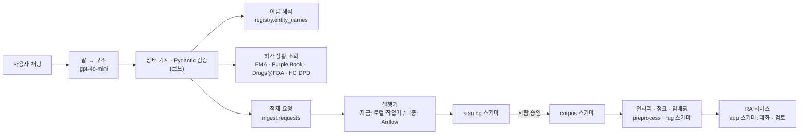
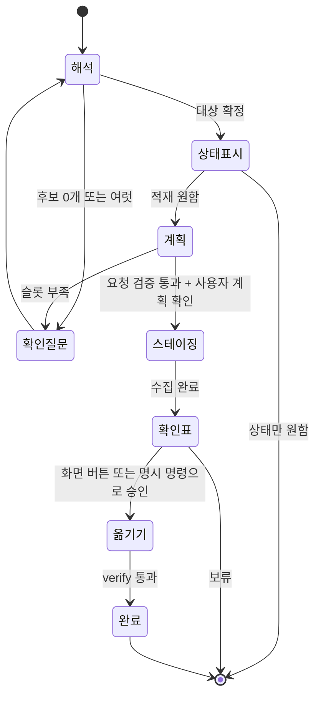

# 적재 요청 에이전트 · PostgreSQL/pgvector · Airflow 대비 전체 계획

- 작성: 2026-10-14 02:40 KST
- 수정: 2026-10-14 03:15 KST (12절 사용자 결정 반영: 이 PC Docker, 한국(식약처) 허가 조회 추가·문서는 받지 않음, OpenAI 전송 허용, 스테이징은 계획 확인 1회. 한국어 이름은 식약처 공식 기록에서만 가져와 `names_ko.json`으로 시작. 5.2·6.1·6.5·8·10절 수정)
- 상태: **계획**. 수집 코드·데이터·서비스는 바꾸지 않았다. 새 파일은 `names_ko.json`(한국어 이름 시드)뿐이다.
- 근거: 2026-10-14에 다시 읽은 코드. `product_search/discover.py`(이름 검색), `collect.py`(수집 단계), `rag/openai_chat.py`·`rag/ra_models.py`(LLM 호출과 Pydantic 계약), `rag_service/conversations.py`·`reviews.py`·`inventory.py`(세션·검토·자료 목록), `data/rag/releases/`(청크·임베딩 파일), EMA 의약품 JSON과 Purple Book CSV 원본.
- 함께 읽을 문서: [RA 문서 적재 파이프라인 총정리](INGESTION_PIPELINE.md)

### 2026-10-17 KST — 승인 전에 이 작업 폴더의 스테이징 확인

Imuldosa(DMB3115) 요청 `3f6b4c92…`는 원래 프로젝트 폴더 `biosimilar_collection`에서 스테이징됐다(10-14 04:22 KST, 스테이징 자료는 그 폴더의 `product_search/data`). 두 폴더가 같은 PostgreSQL을 써서 `project_shared` 화면에도 확인표 검토 대기로 보였고, 10-16 17:38 KST 그 화면에서 승인되자 등록 작업이 `project_shared`에서 확인표를 다시 만들다 `DMB3115 is not in product_search/data`로 실패했다. 옮겨진 자료는 없다.

수정: 스테이징 이벤트(`staged`)에 스테이징한 폴더 `stage_root`를 기록한다. 승인(`/approve`, 화면 승인 버튼)은 승인 기록 전에 이 폴더의 스테이징으로 확인표를 다시 만들어(`ingestion.worker.check_here`) 승인하려는 해시와 비교한다. 없거나 다르면 승인하지 않고 스테이징한 폴더를 알려 주며, 요청은 확인표 검토 대기로 남는다. 실패한 요청은 이력으로 두고, 이 폴더에서 새 수집 요청으로 다시 스테이징한다.

### 2026-10-15 17:32 KST — 실제 화면 연결

초기 계획 상태 표시는 당시 기록이다. 실제 RA 서비스의 `자료 수집·적재` 창을 기존 `ingestion.agent.Agent`에 연결했다. `rag_service/ingestion_api.py`가 DB 세션/대화 복원, 자연어 요청, 명시적 후보 선택·수집 시작, 확인표 조회·등록 승인, 요청 이벤트·로그를 제공한다. 후보 선택/시작은 구조화된 `/actions` 요청이며 LLM을 호출하지 않는다. 새 제품명·성분명 등 자연어 요청의 해석은 기존 gpt-4o-mini 경로를 유지한다.

`rag_service/web/data-manager.js`는 연결 상태와 현재 요청을 5초마다 조회하고, 입력 초안과 오류를 보존하며 마지막 대화를 복원한다. 상태 조회는 모델 호출이나 새 대화 턴을 만들지 않는다. 화면에서 본 계획 해시가 일치할 때만 수집을 시작하고, 확인표 해시·요청 상태가 맞을 때만 자료 등록을 승인한다. CLI/UI 승인 경쟁을 다시 확인하고, 작업 프로세스 시작 실패는 `failed` 이벤트로 남긴다. 실제 전처리·임베딩·검색 배포 자동화는 추가 범위다. 수집 대상은 비교·참고 자료이며 자사 개발 파이프라인과 제품 소속을 공유하지 않는다.

검증: 별도 일회성 PostgreSQL DB에서 실제 Agent/API의 선택·시작·폴링·확인표·승인·중복 방지·프로세스 시작 실패를 검사했다. 테스트의 수집/등록 프로세스는 대체하여 실제 자료를 옮기지 않았다. 화면 DOM 검사에서 버튼별 API, 자동 상태 갱신, 승인 전 확인표, 초안·오류·세션 복원을 확인했다. 이 DOM 검사는 브라우저 렌더링 검사가 아니다. 기존 운영 Imuldosa 검토 대기 요청은 연결 작업 중 승인하거나 변경하지 않는다.

운영 연결 확인: 8775 서비스를 같은 설정으로 재시작하고 실제 HTTP로 DB 연결, 기존 검토 대기 세션·로그 조회, 새 대화의 `SB17 수집 현황 알려줘`, 대화 재조회·복원을 확인했다. 자연어 해석 결과는 `coverage`, 실제 모델은 `gpt-4o-mini-2024-07-18`이다. 모델 호출은 총 2회(처음 PowerShell 파이프가 한글을 `?`로 바꿔 전달하여, Unicode escape로 전송을 고친 뒤 정상 확인)다. 이 두 턴은 운영 DB에 남아 있다. 수집 요청·기존 요청 상태·등록 승인에는 변화가 없으며 실제 새 자료 수집·등록은 시작하지 않았다.

## 0. 요약

1. **DB는 처음부터 전체를 설계하고, 옮기는 것은 영역별로 한다.** 대상은 수집 카탈로그, 이름 사전·허가 상태, 적재 요청, 전처리, 청크·임베딩(pgvector), 세션·검토 기록이다. 영역마다 "파일 → DB 적재 → 일치 검사 → 읽기 경로 전환" 순서를 밟는다.
2. **에이전트의 첫 단계는 이름 해석이다.** 사용자가 성분, 대조약, 바이오시밀러 브랜드, 개발코드, 회사명 중 무엇을 말할지 모른다. 공식 목록으로 만든 이름 사전에서 코드가 후보를 찾고, 모호하면 사용자에게 고르게 한다.
3. **허가 상황은 공식 목록을 그때 조회해서 답한다.** EMA JSON, Purple Book, Drugs@FDA, HC DPD, 식약처(의약품안전나라)를 쓴다. 한국은 허가 상태만 보고 문서는 받지 않는다. 답에는 늘 기준일·출처·원본 해시를 붙인다. 모델이 기억하는 내용으로는 답하지 않는다.
4. **gpt-4o-mini로 충분하다.** 단, 모델은 말을 구조화하고 문장을 다듬는 일만 한다. 대상이 무엇인지, 허가 상태가 어떤지, 실행해도 되는지는 코드와 Pydantic 검증이 정한다(8절).
5. **Airflow는 지금 도입하지 않는다.** 대신 수집 단계를 상태 없는 태스크 함수로 정리한다. 지금은 로컬 작업기가 그 함수를 실행하고, 나중에는 DAG가 같은 함수를 부른다.

## 1. 요구사항

| 번호 | 요구 | 설계에 주는 조건 |
|---|---|---|
| R1 | 처리 데이터를 백엔드 DB에 올린다. 나중에 임베딩과 세션도 PostgreSQL·pgvector로 간다 | 스키마 전체를 한 번에 그리고, 같은 키(`document_id, version_id, pdf_page`)로 이어지게 한다 |
| R2 | 사용자가 무엇을 요청할지 모른다 | 이름 해석을 독립 단계로 두고, 모호하면 반드시 확인한다 |
| R3 | 지금 허가 상황을 알려준다 | 공식 목록을 실시간으로 조회하고 기준일을 표시한다. 수집 당시 상태와 비교한다 |
| R4 | 툴 호출처럼 동작하는 저수준 요청 채팅이다. 필요한 정보가 모이면 실행한다 | Pydantic 모델이 "실행 가능" 여부를 정한다. 쓰기 작업은 사람 확인을 거친다 |
| R5 | Airflow를 고려하되 지금 적용하지는 않는다 | 태스크 계약(입력·출력·멱등 키)을 먼저 고정한다 |

## 2. 출발점 — 지금 코드에서 확인한 것

| 영역 | 지금 있는 것 | 빈 곳 |
|---|---|---|
| 이름 검색 (`discover.search`) | 성분명(EMA 바이오시밀러의 유효성분), EMA 제품명, Purple Book 제품명으로 찾는다. 두 번째 EU 허가명(Usrenty)으로도 제품을 찾는다 | 정규화 후 **완전 일치만** 본다. 다음은 찾지 못한다: 개발코드만 입력(`SB17`, `CT-P43`), 접미사가 붙은 미국 일반명(`ustekinumab-auub`), 캐나다에서만 쓰는 이름(Jamteki), 한국어 이름, 오타. **EMA에서 `Authorised`인 것만** 보므로 철회·거절·심사 중인 제품은 보이지 않는다. 성분으로 검색하면 제품마다 EPAR PDF를 받아 개발코드를 읽으므로, 제품이 많은 성분에서는 무겁다 |
| 허가 상태 원천 | EMA JSON에 `medicine_status` 11가지가 있다(2026-10-07 원본: Authorised 1,876, Withdrawn 425, Application withdrawn 286, Refused 69, Opinion 26 등). 날짜 필드(허가일, 의견 채택일, 철회일, 최근 절차)도 있다. Purple Book CSV에는 허가 유형, 승인일, 상호교환 승인일, Marketing Status, 독점권 만료일이 있다 | 수집에는 일부만 쓰인다(제품 레코드의 `us_licensure`, 기준월 2026-09). 조회만 하는 용도의 도구가 없다 |
| LLM 호출 | `rag/openai_chat.py`: strict JSON schema 구조화 출력, 일별 사용량 장부(`data/runs/model_quota/`), 허용 모델 gpt-4o-mini·gpt-4.1·gpt-5.6-luna. `rag/ra_models.py`: `strict=True, extra='forbid'` Pydantic 계약 | 함수 호출(tools) 방식은 쓰지 않는다. 구조화 출력만 쓴다 |
| 저장 | 카탈로그 JSONL + SQLite(FTS5). 릴리스는 `chunks.jsonl` + `emb/bge-m3/doc.npy`. 대화는 대화마다 JSON 파일(`data/runs/ra_conversations/`). 검토 기록은 추가만 하는 JSON(개정 충돌 검사 있음). 사용량 장부는 날짜별 JSON | 동시에 쓰면 안전하지 않다(JSONL 전체를 다시 쓴다). 영역마다 저장 방식이 다르다 |
| 수집 실행 | `collect.py`의 단계 10개, 스테이징 → `promote` | 단계 사이가 메모리(`self.licensure`, `self.documents`)와 중간 파일로 묶여 있어, 태스크로 나누면 깨진다 |

## 3. 전체 구조



원칙은 하나다. **모델은 말을 구조로 바꾸고 문장을 쓴다. 무엇인지, 상태가 어떤지, 실행해도 되는지는 코드가 정한다.**

## 4. PostgreSQL + pgvector 목표 스키마

### 4.1 스키마와 테이블

| 스키마 | 테이블 | 지금 위치 | 옮기는 단계 |
|---|---|---|---|
| `registry` | `ingredients`, `products`, `licences`, `entity_names`(이름 사전), `licence_status_snapshots`(조회할 때마다 한 행, 추가만), `source_snapshots`(받은 목록 원본의 해시·기준일) | `targets.json`, `products.jsonl`, 기관 목록 원본 | P1–P2 (새로 만듦) |
| `corpus` | `raw_objects`(sha256, uri, 크기, 유형), `documents`, `document_versions`, `pages`(text, `tsvector`), `studies`, `study_results`, `guidelines` | `data/catalog/*.jsonl`, `collection.sqlite` | P1 |
| `staging` | `corpus`·`registry` 제품 단위 테이블과 같은 구조 | `product_search/data/` | P4 |
| `ingest` | `requests`(검증된 `IngestionRequest`), `request_events`(대화 중 슬롯 변화, 추가만), `runs`, `tasks`(단계·제품·상태·시도 수·멱등 키), `downloads`, `errors`, `approvals` | `data/runs/<run_id>.*` | P1(새로 만듦)–P4 |
| `preprocess` | `extraction_runs`, `regions`, `tables`, `figures`, `ocr_outputs` | `data/preprocessed/` | P5 이후(전처리 쪽과 합의) |
| `rag` | `releases`(불변), `release_documents`, `chunks`(본문, 메타데이터 jsonb, 원문 키), `embeddings_bge_m3`(`vector(1024)`), `active_release`(서비스가 읽는 포인터). 지침·대조약 스냅샷도 `releases.kind`로 둔다 | `data/rag/releases/`, `data/guidelines/` | P5 |
| `app` | `conversations`, `turns`, `jobs`(보고서 jsonb + 해시), `reviews`(추가만, 개정 번호), `model_calls`(사용량 장부) | `data/runs/ra_conversations/` 등 | P5 |

### 4.2 설계 규칙

1. **키 사슬을 외래키로 묶는다.** `(document_id, version_id, pdf_page)`에 영역·청크 번호를 붙여 내려간다. `version_id`(원본 SHA-256)는 바뀌지 않는다.
2. **원본 바이트는 DB 밖에 둔다.** DB에는 `sha256`과 `uri`만 둔다. 지금은 로컬 경로를 쓰고, 나중에 오브젝트 스토리지로 바꿔도 `uri`만 달라진다.
3. **릴리스는 불변이다.** 서비스는 `rag.active_release` 포인터만 읽는다. 지금 시작 스크립트에 적힌 릴리스 경로를 이 포인터가 대신한다.
4. **임베딩은 모델마다 테이블 하나**를 둔다. 차원이 고정되기 때문이다. bge-m3는 `vector(1024)`에 HNSW(코사인)를 건다. 지금 규모(약 1만 청크)에서는 정확 검색도 충분히 빠르다. 이관 일치 검사는 정확 검색으로 한다.
5. **BM25는 처음에는 앱에 남긴다.** PostgreSQL 기본 전문 검색(`ts_rank`)은 BM25가 아니어서 순위가 달라진다. 청크는 DB에서 읽고 BM25는 지금 코드로 계산한다. DB 안에서 BM25를 할지는 따로 정한다.
6. **추가만 하는 테이블**(`reviews`, `request_events`, `licence_status_snapshots`, `model_calls`)은 UPDATE·DELETE를 권한으로 막는다.
7. **유연한 원천 메타데이터는 jsonb에 둔다**(`source_metadata`, 보고서). 검색·조인에 쓰는 키는 열로 꺼낸다.
8. **Airflow 메타데이터 DB는 앱 DB와 다른 database에 둔다.**

### 4.3 옮기는 방법 (영역마다 같다)

1. 지금 파일을 읽어 DB에 넣는 적재기를 만든다.
2. 일치 검사를 한다: 건수, 키 집합, 내용 해시. `verify.py`에 DB 검사를 더한다.
3. 읽기 경로를 DB로 바꾼다. 운영 서비스(8875)의 경로를 바꾸는 일은 사용자 승인 후에 한다.
4. 파일은 내보내기·백업으로 남긴다.

새로 생기는 `registry`와 `ingest`는 처음부터 DB에서 시작한다.

## 5. 이름 해석 — 사용자가 무엇을 요청했는지 확인하기

### 5.1 들어올 수 있는 요청

| 유형 | 예 | 지금 `discover.search` |
|---|---|---|
| 성분 (INN) | ustekinumab, 우스테키누맙 | 영어는 찾음, 한국어는 못 찾음 |
| 미국 일반명(접미사) | ustekinumab-auub | 못 찾음 |
| 대조약 브랜드 | Stelara, 스텔라라 | 영어는 찾음 |
| 바이오시밀러 브랜드 (관할마다 다름) | Pyzchiva, Wezenla(EU)·Wezlana(US), Jamteki(CA) | EU·US는 찾음, CA 전용 이름은 못 찾음 |
| 한국 허가명 | 에피즈텍(Epyztek, **SB17의 한국 이름**), 스테키마, 스텔라라 | 못 찾음 (식약처를 보지 않음) |
| 같은 제품의 두 번째 EU 허가 | Usrenty → Yesintek(BMAB1200) | 찾음 |
| 개발코드 | SB17, CT-P43, "ABP 654" | 못 찾음 |
| 회사 + 성분 | "셀트리온 우스테키누맙" | 못 찾음 |
| 묶음 요청 | "Stelara 바이오시밀러 전부", "미국에서 상호교환 받은 것" | 성분 검색으로 일부 가능 |
| 오타·표기 변형 | Pyzchiva → "Pizchiva" | 못 찾음 |
| 바이오시밀러가 아니거나 없는 것 | 아직 허가 신청 전인 제품 | "찾지 못함"만 나옴 |

### 5.2 이름 사전 `registry.entity_names`

열: `name, name_norm, name_type(inn | proper_name | brand | dev_code | company | korean), jurisdiction, ingredient, product_key, licence_id, status, source, source_url, snapshot_sha256, observed_at`

| 출처 | 넣는 이름 |
|---|---|
| EMA 의약품 JSON (사람용, **모든 상태**) | 제품명, 유효성분, INN, 허가권자, 상태 |
| Purple Book (351(a)·351(k)) | 제품명, 접미사가 붙은 일반명, 신청자, 대조약 이름 |
| GSRS | 개발코드와 그 밖의 이름(지금 `discover.gsrs_names`) |
| HC DPD | 성분별 캐나다 브랜드 |
| 수집 카탈로그 | 이미 확인된 `product_id`, `aliases`, `licences` |
| 식약처 의약품안전나라 | 한국 제품명·영문 제품명, 업체명(한·영), 주성분 한글명(우스테키누맙), 허가 상태 |
| PMDA | 사람이 확인한 것만 |

사전은 코드가 만들고, 허가 상황 조회(6절)나 주기 감시 DAG(9절)가 목록을 받을 때 함께 갱신한다.

**한국어 이름은 따로 손으로 관리하지 않는다** (2026-10-14 판단). 한국어 이름은 두 종류다.
- **공식 한국어 이름**: 한국 허가명, 업체 한글명, 성분 한글명. 식약처 기록에 있으므로 코드가 가져온다. 지금은 시드 파일 `names_ko.json`이 있고, P2의 사전 생성기가 같은 내용을 식약처에서 다시 만든다.
- **외국 브랜드의 한글 음차**(예: "피즈치바"): 공식 출처가 없다. 손으로 목록을 만들면 확인할 수 없는 값이 쌓인다. 대신 모델이 영어 후보를 제안하고 사전이 확인한다(5.3절 3번).

`names_ko.json` 시드 (2026-10-14 03:03 KST 조회, 성분 검색 "우스테키누맙", 상태 조건 없음):

| 한국 제품 | 업체 | 품목 수 | 허가일 | 상태 | 연결 | 연결 근거 |
|---|---|---:|---|---|---|---|
| 스텔라라 (정맥주사, 프리필드주, 피하주사) | (주)한국얀센 | 3 | 2011-06-21 ~ 2018-04-06 | 정상 | CNTO1275 | 영문명 "Stelara ..."가 등록 브랜드와 같음 |
| 에피즈텍 (정맥주사, 프리필드주, 프리필드펜주) | 삼성바이오에피스(주) | 3 | 2024-04-11, 펜 2026-01-13 | 정상 | SB17 | 식약처 원료약품 정보의 벡터명 `pDP5-SB17-LH`에 개발코드가 있음 |
| 스테키마 (정맥주사, 프리필드주) | (주)셀트리온 | 2 | 2024-06-12, 2024-09-27 | 정상 | CTP43 | 영문명 "Steqeyma ..."가 등록 브랜드와 같음(식약처 쪽 본문에는 CT-P43 표기가 없음) |

- 에피즈텍·스테키마의 식약처 사용상의 주의사항에는 "스텔라라 ...를 대조약으로 한 동등생물의약품"이라고 적혀 있다. 허가심사유형은 "자료제출의약품(유전자재조합의약품 및 세포배양의약품)"이다.
- ABP654, BMAB1200, BAT2206은 이 조회에서 한국 품목이 없었다.
- 항목마다 식약처 상세 페이지 URL과 페이지 SHA-256을 남겼다. 페이지 자체는 프로젝트에 저장하지 않았다.

### 5.3 해석 순서 (코드)

1. 정규화 후 완전 일치.
2. `pg_trgm` 유사도로 오타 후보를 찾는다(임계값은 벤치마크로 정한다).
3. 그래도 없으면 모델이 한국어·표기 변형을 영어 후보로 **제안**한다. 제안은 사전에서 다시 찾았을 때만 채택한다.
4. 결과를 `Resolution`으로 돌려준다. 수준(성분 / 대조약 / 바이오시밀러 제품 / 허가), 후보 목록, 근거(어느 목록의 어느 이름과 맞았는지, URL, 기준일)를 담는다.
5. 0건이면 "공식 목록에서 찾지 못함"과 어떤 목록을 찾아봤는지 보여준다.

### 5.4 모호성 규칙 (코드가 정하고, 모델은 판단하지 않는다)

- 후보가 둘 이상이면 표로 보여주고 사용자가 고른다.
- 성분 단위 요청이면 대조약과 바이오시밀러 목록을 보여준다. 각 제품에 관할별 허가 상태, 수집 여부, 검색 가능 여부(`rag_service/inventory.py`의 세 상태), 예상 문서 수를 붙인다. 사용자가 전부 또는 일부를 고른다. **EPAR을 받아 개발코드를 읽는 작업은 사용자가 고른 뒤에 한다.**
- 대조약을 넣을지는 따로 묻는다. Stelara는 88문서, 4,380쪽이었다.
- 한 제품의 다른 허가명이면 같은 제품이라고 알려준다.
- 이미 수집된 제품이면 상태 조회나 재수집을 제안한다.
- `product_id` 확정 규칙은 그대로다. 개발코드이고, 원문으로 확인해야 하며, 마지막은 사람이 확인표로 확인한다.

### 5.5 `discover.py`에서 보완할 것

개발코드 검색(GSRS와 이름 사전), 접미사 일반명, DPD 캐나다 이름, 허가 상태가 아닌 제품도 표시(상태와 함께), 성분 검색의 단계 분리(목록 → 선택 → EPAR 읽기).

## 6. 지금 허가 상황 조회

### 6.1 출처

| 관할 | 출처 | 최신성 | 보여줄 값 |
|---|---|---|---|
| EU | EMA 의약품 JSON, 제품별 EPAR 문서 목록 | 조회 시점 | `medicine_status`, 허가일, 의견 채택일, 철회·만료일, 최근 제품정보 변경 절차, 최종 갱신일 |
| US | Purple Book 월별 CSV | **월 단위**(기준월 표시) | 허가 유형(351(k) 바이오시밀러·상호교환), 승인일, 상호교환 승인일, Marketing Status, 독점권 만료일, 대조약 |
| US 보완 | Drugs@FDA 데이터 파일 | 기준월 이후도 반영 | 기준월 뒤의 보충 승인 서한·라벨 날짜 |
| CA | HC DPD API, HC 심사문서 목록 | 조회 시점 | 제품 상태, SBD·RDS 게시 여부 |
| KR | 식약처 의약품안전나라 상세검색(성분명, 상태 조건 없음)과 제품 상세 페이지. 키 없이 조회된다. 공공데이터포털 "의약품 제품 허가정보" API(실시간, 서비스키 필요)는 키를 받으면 구조화 경로로 쓴다 | 조회 시점 | 한국 제품명·영문명, 업체, 품목기준코드, 허가번호·허가일, 취소/취하 구분·일자, 제조/수입, 대조약(사용상의 주의사항의 "…를 대조약으로 한 동등생물의약품" 문장), 허가심사유형. **문서는 받지 않는다** |
| JP | 자동 조회 없음 | — | "확인 안 함"으로 표시 |

### 6.2 규칙

- 모든 값에 **기준일, 출처, URL, 원본 스냅샷 SHA-256**을 붙인다. 받은 목록 원본은 `data/raw/`처럼 해시로 저장해 같은 답을 다시 만들 수 있게 한다.
- **공식 목록만 사실로 쓴다.** 기관 보도자료나 뉴스는 "공식 목록에 아직 반영되지 않았을 수 있음"이라는 힌트로만 보여주고, 사실 칸에는 넣지 않는다.
- 목록은 하루 동안 재사용한다(지금 `discover`의 `max_age=DAY`와 같다). 사용자가 "지금 다시 조회"라고 하면 새로 받는다.
- **수집 당시 상태와 비교한다.** 카탈로그(예: `us_licensure` 기준월 2026-09)와 지금 조회한 값이 다르면 차이를 보여주고 재수집을 제안한다. 예: 새 상호교환 승인, 새 보충 승인, 철회. 9절의 주기 감시 DAG도 이 비교를 쓴다.
- 결과는 `LicenceStatusReport` 모델(관할별 행 + 비교 결과)로 만들고 `registry.licence_status_snapshots`에 쌓는다.

### 6.3 한국 허가의 제품 연결 규칙

한국은 문서를 수집하지 않으므로 `targets.json`의 수집 대상이 아니다. 허가 행을 기존 제품에 연결하는 규칙만 둔다. 원칙은 다른 관할과 같다(원문이 제품을 직접 가리킬 때만).

1. 식약처 페이지 본문에 개발코드(`aliases`의 코드)가 있으면 연결한다. 예: 에피즈텍의 벡터명 `pDP5-SB17-LH`.
2. 영문 제품명의 첫 단어가 등록 브랜드(EU·US·CA 허가명)와 같으면 연결한다. 예: Steqeyma, Stelara.
3. 둘 다 아니면 연결하지 않는다. 업체와 성분만 같은 것은 후보로만 보여준다.

제품 하나에 한국 품목(제형별)이 여러 개면 모두 같은 제품의 KR 허가로 묶는다. P2에서 `registry.licences`에 `jurisdiction='KR'`, `licence_id=품목기준코드`로 넣는다. `targets.json`의 `licences`에 넣을지는 P0의 `ProductTarget` 정의 때 정한다(수집 단계가 KR을 무시하도록 해야 한다).

## 7. 적재 요청 에이전트

### 7.1 역할 경계

| 모델(gpt-4o-mini)이 하는 일 | 코드가 하는 일 |
|---|---|
| 사용자 말을 `TurnParse`로 바꾼다(의도, 언급된 이름과 추정 유형, 관할, 고른 후보) | 이름 해석, 허가 조회, 계획 계산, 실행 |
| 한국어·표기 변형을 영어 후보로 제안한다 | 제안을 이름 사전으로 확인한다 |
| 도구 결과를 짧은 문장으로 정리한다(선택) | 사실 표(후보, 상태, 계획, 확인표)는 템플릿으로 그린다 |
| — | `IngestionRequest` 검증, 상태 전이, 승인 확인 |

### 7.2 상태 흐름



### 7.3 한 턴의 처리

1. **해석 호출**(모델 1회, strict schema): `TurnParse`를 받는다.
2. **코드**: 지금 상태에서 할 수 있는 도구만 실행하고, `IngestionRequest` 초안을 갱신한 뒤 검증한다.
3. **응답**: 사실은 템플릿 표로 그린다. 짧은 안내 문장이 필요하면 모델을 한 번 더 부른다. 입력은 도구 결과뿐이고, 출력에 도구 결과에 없는 식별자가 있으면 버린다.

호출은 턴당 최대 2회다. 대화당 상한을 두고 `data/runs/model_quota` 장부(나중에 `app.model_calls`)에 기록한다.

### 7.4 도구

| 도구 | 하는 일 | 부작용 | 실행 조건 |
|---|---|---|---|
| `resolve_entity` | 5절 이름 해석 | 없음 | 언제나 |
| `licence_status` | 6절 허가 조회와 수집 당시와의 비교 | 목록 원본 저장 | 대상이 확정되면 |
| `corpus_coverage` | 수집됨 / 검색 가능 / 없음(사유) | 없음 | 언제나 |
| `plan_ingestion` | 제품·관할별 예상 문서 수, 이미 있는 문서, 예상 시간 | 없음(목록만 읽음) | 대상과 범위가 확정되면 |
| `stage_collect` | 스테이징 수집 요청을 넣고 작업 ID를 돌려준다 | `staging` 쓰기 | `IngestionRequest` 검증 통과 + 사용자가 계획 확인 |
| `job_status` | 작업 진행 | 없음 | 언제나 |
| `promote_report` | 확인표 | 없음 | 스테이징 완료 후 |
| `promote_apply` | 프로젝트로 옮기기, 이어서 verify | `corpus`·`targets.json` 쓰기 | **확인표를 보여준 뒤, 화면 버튼이나 정해진 명령으로 승인.** 모델이 "예"라고 해석한 것으로는 실행하지 않는다 |

처음에는 도구가 지금 CLI(`discover`, `collect_products`, `promote`)를 로컬 작업기로 부른다. P4 이후에는 태스크 함수를 부른다.

### 7.5 Pydantic 모델 (초안)

```python
class Contract(BaseModel):                      # rag/ra_models.py와 같은 기준
    model_config = ConfigDict(strict=True, extra='forbid')

class Mention(Contract):
    text: str                                   # 사용자가 쓴 그대로
    guessed_type: Literal['inn', 'brand', 'dev_code', 'company', 'proper_name', 'korean', 'unknown']

class TurnParse(Contract):                      # 모델 출력
    intent: Literal['licence_status', 'ingest', 'refresh', 'add_guideline', 'coverage', 'select', 'cancel', 'other']
    mentions: list[Mention]
    jurisdictions: list[Literal['EU', 'US', 'CA', 'JP']]
    selected_keys: list[str]                    # 화면에 보여준 후보 키 중 고른 것

class Evidence(Contract):
    source: str; url: str; matched_name: str; as_of: str; snapshot_sha256: str

class ProductTarget(Contract):                  # targets.json 항목 그대로. targets.json 검증에도 쓴다
    product_id: str; kind: Literal['reference', 'biosimilar']; reference_product_id: str | None
    ingredient: str; development_code: str | None
    ema_name: str | None; us_brand: str | None; ca_brand: str | None
    aliases: list[str]; study_ids: list[str]; pmda_general_list_ids: list[str]; licences: list[Licence]

class IngestionRequest(Contract):               # "실행 가능"을 정하는 모델
    kind: Literal['new_product', 'refresh', 'new_guideline']
    ingredient: str
    products: list[ProductTarget]               # 해석·선택이 끝난 것만
    include_reference: bool                     # 대조약을 넣을지 사용자가 명시
    jurisdictions: set[Literal['EU', 'US', 'CA', 'JP']]
    provenance: dict[str, Evidence]             # 식별자마다 근거
    # model_validator:
    #  - 개발코드, NCT, BLA, PMDA ID는 도구 결과나 사용자 원문에 그대로 있어야 한다 (모델이 만든 식별자 거부)
    #  - JP를 고르면 사람이 확인한 pmda_general_list_ids가 있어야 한다
    #  - new_product는 targets.json에 없는 제품, refresh는 있는 제품
    #  - 개발코드 정규화와 중복 금지 (verify.py와 같은 규칙)
```

`ProductTarget`으로 `targets.json` 전체를 검증하면, 지금 `verify.py`에 흩어져 있는 등록 규칙 일부가 이 모델로 들어온다.

### 7.6 대화 예

- "우스테키누맙 넣어줘" → 성분 단위다. 대조약 1개와 바이오시밀러 목록을 보여준다(관할별 상태, 수집·검색 여부, 예상 문서 수). "이미 6개가 수집돼 있습니다. 새로 넣을 제품을 고르세요."
- "SB17 지금 미국 허가 상태" → 개발코드 → Pyzchiva. 상태만 보여준다. Purple Book 기준월을 표시하고, 수집 당시(2026-09)와 다르면 차이를 보여준다.
- "에피즈텍 국내 허가 현황" → 한국 허가명 → SB17. 식약처 품목 3개(정맥주사·프리필드주 2024-04-11, 프리필드펜주 2026-01-13, 모두 정상)를 보여주고, EU·US 이름은 Pyzchiva라고 알려준다.
- "Jamteki" → 캐나다 브랜드 → AVT04(Uzpruvo). "스테이징에 시험 수집본이 있고 프로젝트에는 없습니다. 확인표를 볼까요?"
- "아달리무맙 바이오시밀러 다 넣어줘" → 새 성분이고 제품이 많다. 목록과 예상 규모를 보여준 뒤 고르게 하고, 대조약을 넣을지 묻는다.

### 7.7 화면 위치

처음에는 CLI(`python -m ingest_agent`)로 만든다. 그다음 3분할 화면의 스킬 "적재 요청"으로 넣는다([UI 계획](../rag/UI_3PANE_AND_RA_FEATURES_PLAN_2026-10-13.md) 7장의 스킬 틀). 옮기기 승인 버튼은 화면에 둔다. 에이전트는 **"수집됨 ≠ 검색 가능"**을 늘 표시한다. 전처리 범위는 따로 정해진다.

## 8. gpt-4o-mini에 대한 의견

**충분하고 적절하다.** 근거는 이렇다.

- 맡는 일이 작다. 한국어·영어 문장 하나를 정해진 스키마로 바꾸고 짧게 안내하는 일이다. 여러 단계 계획은 상태 기계가 맡는다.
- 프로젝트에 이미 쓰는 경로가 있다. strict JSON schema 구조화 출력, API 키, 사용량 장부, 허용 모델 목록이다.
- 비용이 작다. 턴당 수천 토큰이다. 지금까지 관측된 한도(약 200k TPM, 하루 약 2M 토큰)에 비하면 무시할 수준이다.

한계와 대응:

| 한계 | 대응 |
|---|---|
| 학습 시점(2023년) 이후 허가된 제품(Yesintek, Starjemza 등)을 모르고, 개발코드·BLA를 지어낼 수 있다 | 사실은 모두 도구에서 가져온다. `IngestionRequest`의 근거 검증이 모델이 만든 식별자를 거부한다 |
| 한국어 표기를 영어로 바꿀 때 틀릴 수 있다 | 제안은 이름 사전에서 다시 찾았을 때만 채택한다 |
| "네"를 승인으로 오해할 수 있다 | 쓰기 승인은 화면 버튼이나 정해진 명령으로만 받는다 |

**검증 방법**: 요청 문장 벤치마크를 만든다. 한국어·영어 60~80문장에 의도, 언급, 기대하는 해석 결과를 사람이 붙인다. 지금 스테이징의 AVT04·DMB3115와 위 7.6절 사례를 넣는다. 통과 기준은 의도·언급 정확도와 **지어낸 식별자 0건**이다. 실패하면 해석 단계만 다른 모델(래퍼가 이미 허용하는 gpt-5.6-luna)로 바꾼다. 계약이 같으므로 설정만 바꾸면 된다. 판정은 코드와 사람 라벨이 하며 모델에게 맡기지 않는다.

**함수 호출(tools) 대신 구조화 출력을 권한다.** 모델은 `TurnParse`만 내고, 어떤 도구를 실행할지는 상태 기계가 정한다. 사용자 입장에서는 툴 호출과 같아 보이지만 실행 결정은 코드가 쥔다. 지금 래퍼를 그대로 쓸 수 있다는 장점도 있다.

**요청 문장의 OpenAI 전송**: 허용한다(2026-10-14 사용자 결정). 비공개 개발코드나 제품명이 들어가도 된다.

## 9. Airflow를 고려한 설계 (적용은 나중에)

### 9.1 태스크 함수로 정리

각 함수는 Pydantic 입력을 받고, 결과를 DB에 쓰고, 멱등 키를 가지며, 메모리를 공유하지 않는다.

`resolve`, `fetch_list(source)`, `licence_snapshot(source)`, `collect(product, source)`, `parse(document_version)`, `stage_catalog(run)`, `verify_staging(run)`, `promote(product, approval)`, `build_indexes`, `verify`, `coverage`

`collect.py`에서 고칠 곳:
- `purple`이 만든 `self.licensure`와 모든 단계의 `self.documents`가 메모리에만 있다가 `finish_catalog`에서 합쳐진다. 단계 결과를 `ingest.tasks`와 `staging` 행으로 남긴다.
- `ema → ema_documents`, `fda → fda_reviews/fda_letters`가 중간 JSONL 파일로 이어져 있다. 이를 `fetch_list` 결과 행으로 바꾼다.
- 카탈로그 JSONL 전체를 다시 쓰는 방식을 행 단위 upsert로 바꾼다.

### 9.2 Airflow 전 실행기

로컬 작업기 하나가 `ingest.tasks`에서 `queued` 행을 가져와 같은 함수를 차례로 실행한다. 에이전트는 요청 행만 넣는다. 나중에 Airflow로 바꿔도 에이전트와 함수는 그대로다.

### 9.3 DAG (나중)

| DAG | 실행 | 내용 |
|---|---|---|
| `licence_watch` | 주기(예: 매일 목록, 매월 Purple Book) | 목록 받기 → 이름 사전·허가 스냅샷 갱신 → 지난번과 비교 → 변경 사건 기록(새 바이오시밀러, 상태 변경, 새 보충 승인). **자동 적재는 하지 않고 적재 요청을 제안만 한다** |
| `ingest_to_staging` | `conf = IngestionRequest` | 목록 → 제품·출처별 수집(동적 매핑) → 문서별 파싱(매핑) → 스테이징 카탈로그 → 스테이징 검증 → 승인 대기 |
| `promote` | 승인 행이 생기면 실행 | 옮기기 트랜잭션 → build_indexes → verify → coverage |
| `preprocess_release` | 전처리 범위가 승인되면 | GPU 작업은 slot 1개 pool로 직렬 처리. 전처리 쪽 계획을 따른다 |

사람 승인은 며칠씩 기다리는 센서 대신, DAG를 나누고 승인 행이 생기면 다음 DAG를 트리거하는 방식으로 처리한다. Airflow는 Windows에서 네이티브로 돌지 않으므로 Docker(WSL2)나 리눅스 서버가 필요하다.

## 10. 실행 환경 (권장)

- **이 PC의 Docker**에서 실행한다(2026-10-14 사용자 결정). 확인 결과 Docker Desktop 29.7.2가 WSL2(Ubuntu) 위에서 동작 중이다.
- `docker compose`로 PostgreSQL을 띄운다(pgvector가 들어 있는 `pgvector/pgvector` 이미지). 나중에 Airflow도 같은 compose에 더한다. 팀 서버로 옮길 때도 compose를 그대로 쓴다.
- 포트는 Windows 예약 범위를 피한다. 이 PC는 부팅할 때마다 TCP 포트 범위를 다시 예약한다(2026-10-13에 8653~8852). PostgreSQL 기본 5432를 쓰기 전에 `netsh interface ipv4 show excludedportrange protocol=tcp`로 확인한다.
- 원본 파일은 지금 경로에 두고, DB에는 `uri`로 기록한다.
- 확장: `vector`, `pg_trgm`.

## 11. 단계별 계획

| 단계 | 만드는 것 | 완료 기준 | 운영 서비스 영향 |
|---|---|---|---|
| **P0 계약·평가셋** | Pydantic 모델(`ProductTarget`, `GuidelineSeed`, `TurnParse`, `Resolution`, `LicenceStatusReport`, `IngestionRequest`, `TaskResult`), DDL 초안, 요청 문장 벤치마크, 이름 해석 정답셋 | `targets.json`이 `ProductTarget`으로 검증된다. 벤치마크 파일과 채점기가 있다 | 없음 |
| **P1 PostgreSQL 기반** | compose, `registry`·`corpus`·`ingest` 스키마, JSONL → DB 적재기, `verify.py` DB 일치 검사 | 카탈로그와 DB가 건수·키·해시로 일치한다. SQLite는 유지한다 | 없음 |
| **P2 이름 사전·허가 조회** | `entity_names` 생성기(식약처 포함, `names_ko.json` 시드 대체), `licence_status` 도구와 스냅샷(EU·US·CA·KR), `pg_trgm` 해석기, `discover` 보완(5.5절) | 이름 해석 정답셋을 통과한다(모델 없이) | 없음 |
| **P3 에이전트(CLI)** | 상태 기계, gpt-4o-mini 해석, 도구 연결(지금 CLI를 로컬 작업기로 실행) | 요청 문장 벤치마크 통과, 지어낸 식별자 0건, 스테이징까지 처음부터 끝까지 실행(AVT04 사례) | 없음 |
| **P4 수집 태스크화** | 상태 없는 단계 함수, DB 스테이징, 옮기기 트랜잭션 | 프로젝트 사본에서 지금과 같은 `document_id`·`version_id` 집합이 나온다 | 없음 |
| **P5 RAG·세션 이관** | 릴리스·청크·임베딩(pgvector), 대화·검토·작업·사용량 장부 | 평가 질문에서 npy 검색과 정확 검색 결과가 같다. 파일과 DB 기록이 일치한다 | **있음. 경로 전환은 사용자 승인 후** |
| **P6 Airflow** | DAG 4개(9.3절), `licence_watch` 주기 실행 | 같은 요청을 DAG와 로컬 작업기로 실행한 결과가 같다 | 없음 |

순서는 P0 → P1 → P2 → P3 → P4 → P6이다. P5는 P1 이후 따로 진행할 수 있다. 가장 먼저 쓸 수 있는 결과는 P2의 허가 상황 조회와 P3의 에이전트다.

## 12. 사용자 결정 (2026-10-14)

| 항목 | 결정 | 반영 |
|---|---|---|
| 실행 위치 | 이 PC의 Docker | 10절 |
| 관할 범위 | 한국(식약처)을 허가 조회에 추가한다. 문서는 받지 않는다. 일본은 넣지 않는다 | 5.2, 6.1, 6.3절 |
| OpenAI 전송 | 요청 문장을 보내도 된다 | 8절 |
| 스테이징 확인 | 권장안: 계획을 한 번 확인하면 스테이징 수집까지 실행한다. 옮기기는 확인표를 본 뒤 승인한다 | 7.4절 |
| 한국어 이름 | Claude가 먼저 확인해 넣는다. 필요성은 확인 후 판단 | 5.2절: 공식 이름은 식약처에서 자동으로 가져오고, 음차 목록은 만들지 않는다. 시드 `names_ko.json` |

남은 준비: 공공데이터포털 "식약처 의약품 제품 허가정보" API 서비스키. 없어도 P2는 의약품안전나라 조회로 진행할 수 있다. 키가 있으면 구조화된 응답을 쓸 수 있다.

## 13. 구현 기록

### 13.1 2026-10-14 03:22 KST — P0 계약, P1 PostgreSQL 기반

사용자 지시로 식약처 부분은 미루고 구현을 시작했다. `names_ko.json`은 시드로 남겨 두었고 아직 어떤 코드도 읽지 않는다.

**P0 계약** (`ingestion/contracts.py`, 계약 버전 `ingestion-contracts-1`)
- 등록 파일: `ProductTarget`·`Licence`·`TargetsFile`, `GuidelineSeed`·`GuidelinesFile`. `targets.json`(6제품)과 `guidelines.json`(14종)이 그대로 통과한다. `verify.py`의 등록 규칙을 같이 검사한다: 바이오시밀러는 같은 성분의 대조약을 가리킴, `product_id` = 문장부호를 뺀 개발코드, 개발코드 중복 금지, 한 허가명은 한 제품에만, 대표 EU 허가 = `ema_name`, 모르는 필드 거부.
- 에이전트: `TurnParse`(모델 출력), `Mention`, `Evidence`, `Candidate`, `Resolution`, `LicenceStatusRow`·`LicenceStatusReport`.
- `IngestionRequest`: 검증할 때 `context={"evidence_text": [...]}`(도구 결과와 사용자 문장)를 받아야 한다. 개발코드·NCT·PMDA ID가 그 안에 없으면 지어낸 것으로 보고 거부한다. 식별자마다 출처(`provenance`)가 있어야 하고, JP는 사람이 확인한 PMDA 페이지가, 대조약은 `include_reference`가 있어야 한다.
- 태스크: `TaskKey`(멱등 키), `TaskResult`.
- 아직 안 한 것: 요청 문장 벤치마크와 이름 해석 정답셋. P2 해석기와 함께 만든다.

**P1 PostgreSQL** (이 PC Docker)
- `ingestion/db/compose.yaml`: PostgreSQL 17.11 + pgvector 0.8.7(이미지 digest 고정), `127.0.0.1:5432`, 볼륨 `biosim_pgdata`. 확장 `vector`, `pg_trgm`.
- `ingestion/db/migrations/001_base.sql`: `registry`(ingredients, products, licences), `corpus`(raw_objects, downloads, documents, document_versions, pages + `tsvector` GIN, studies, study_results, guidelines), `ingest`(runs, run_downloads, run_errors, requests, request_events, tasks, approvals). `request_events`·`approvals`는 트리거로 UPDATE·DELETE를 막는다. `rag`·`app`·`preprocess`·`staging`은 다음 마이그레이션에서 만든다.
- `ingestion/db.py`: 접속(`BIOSIM_DATABASE_URL`, 기본은 로컬 compose)과 마이그레이션(파일마다 한 번, 적용 후 바뀐 파일은 오류).
- `ingestion/load_catalog.py`: JSONL 카탈로그와 파싱 쪽 파일을 한 트랜잭션으로 다시 적재한다. `ingest.requests` 등 요청 쪽 테이블은 건드리지 않는다. 적재 시간 약 7초.
- `ingestion/db_verify.py`: 일치 검사. 실패하면 종료 코드 1.
- 의존성: `psycopg[binary]` 3.3.6 추가(`pyproject.toml`, `uv.lock`).

**결과** (2026-10-14 03:20 KST): 제품 6, 허가 18, 원본 파일 293(URL 294), 문서 버전 228, 쪽 10,632, 시험 11, 게시 결과 46, 지침 14, 실행 기록 12. 일치 검사 통과: 문서 행 전체(jsonb 왕복), 쪽마다 본문 SHA-256, 원본 파일 존재·크기, SQLite 건수, 전문 검색(`auc & cmax` 80쪽). 테스트 19개 통과(`tests/test_ingestion_contracts.py` 15, `tests/test_ingestion_db.py` 4. DB 테스트는 임시 데이터베이스를 만들어 쓰고 지운다. 서버가 없으면 건너뛴다).

**발견한 것**: PostgreSQL의 text·jsonb는 U+0000을 담을 수 없다. 유니코드 대응표가 없는 글꼴 쪽의 블록 텍스트(원시 글리프 코드)에 3문서 20쪽, 329자가 있었다. DB에서는 쪽 메타데이터 안의 U+0000만 U+FFFD로 바꾸고 `db_nul_replaced`에 개수를 남긴다. 쪽 본문에는 U+0000이 없고, 있으면 적재를 멈춘다.

**실행 방법**
```powershell
docker compose -f ingestion/db/compose.yaml up -d
uv run python -m ingestion.db migrate
uv run python -m ingestion.load_catalog
uv run python -m ingestion.db_verify
```
수집(`collect.py`, `promote`)을 실행한 뒤에는 `load_catalog`와 `db_verify`를 다시 돌린다. 이 단계에서는 JSONL이 원본이고 DB는 사본이다.

**다음**: P2 — 이름 사전(`registry.entity_names`, `pg_trgm`), EU·US·CA 허가 상황 조회와 스냅샷, `discover` 보완, 이름 해석 정답셋.

### 13.2 2026-10-14 03:42 KST — P2 이름 사전·허가 상황 조회

**DB** (`ingestion/db/migrations/002_registry_names.sql`)
- `registry.source_snapshots`: 받은 목록·페이지마다 한 행(URL, SHA-256, 받은 시각, 원천의 기준일). 원본은 `data/registry/raw/<sha256>.<ext>`에 둔다. 수집 쪽(`data/raw`, `download_cache.json`)은 건드리지 않는다.
- `registry.entity_names`: 이름 사전. `name_norm`에 `pg_trgm` GIN 색인을 건다.
- `registry.licence_status_snapshots`: 허가 상황 조회 결과. 추가만 할 수 있다(트리거).

**코드**
- `ingestion/sources.py`: 원천별 조회. EMA 의약품 JSON(사람용, 모든 상태), Purple Book 최신 월 CSV, HC DPD(브랜드·성분·제품 상태), GSRS 정확한 이름, ClinicalTrials.gov 코드 검색. 스냅샷은 기본 1일 재사용한다(Purple Book CSV 30일, GSRS 30일, CT.gov 7일).
- `ingestion/registry.py`:
  - `build`: EMA 전체 + Purple Book 전체 + `targets.json` 성분의 캐나다 제품 + 등록 제품의 별칭을 사전에 넣는다. 등록 제품은 `product_id`, 아니면 `EU:<번호>`·`US:BLA<번호>`·`CA:<브랜드>`·`CODE:<코드>`가 제품 키다. 등록되지 않은 제품도 EU·US 브랜드 전체 이름이 같으면 한 제품으로 묶는다("Adalimumab Viatris"처럼 성분명으로 시작하는 이름이 섞이지 않도록 전체 이름을 비교한다).
  - `resolve`: 완전 일치 → 없으면 즉시 조회(개발코드 모양이면 GSRS 정확한 이름과 ClinicalTrials.gov, 아니면 HC DPD 브랜드) → 그래도 없으면 trigram(유사도 0.45 이상, 최고점에서 0.08 이내). ClinicalTrials.gov로 찾은 코드는 시험 제목에 성분명이나 사전에 있는 대조약 브랜드가 적혀 있을 때만 성분을 붙인다.
  - 후보마다 수준(성분·대조약·바이오시밀러), 관할별 이름, 수집 여부, 검색 가능 여부(운영 릴리스 `rag_finalization_2026-10-10_v2`의 문서), 근거(원천·URL·기준일·스냅샷 해시)를 붙인다.
- `ingestion/licence_status.py`: EU(EMA 상태·허가일·의견일·최근 절차), US(Purple Book BLA별 허가 유형·최초 허가일·상호교환 승인일·판매 상태·독점권 만료·기준월), CA(DIN별 DPD 상태·최초 판매일)를 조회한다. 등록 제품은 수집 당시 기록과 비교한다(EU 상태, Purple Book 허가 이벤트, 상호교환 여부). JP·KR은 "확인 안 함"으로 표시한다.
- `ingestion/eval_resolver.py` + `eval/resolver_cases_v0.1.json`: 32문항(성분, 대조약, 관할별 브랜드, 두 번째 EU 허가, 미국 일반명, 개발코드와 표기 변형, 오타, 미등록 제품, 다른 성분, 없는 이름).

**결과**
- 사전 5,998행(EMA 기준 2026-10-13 조회, Purple Book 2026-09). 즉시 조회로 개발코드 3개가 추가됐다. 스냅샷 75개, 7.2 MB.
- 정답셋 32/32 통과. 단, 라벨의 절반가량은 결과를 본 뒤에 썼으므로 낙관적인 수치다. 조정에 쓰지 않은 질의 10개(Selarsdi, Otulfi, Fymskina, infliximab, Remicade, CT-P13, ustekinumab-ttwe, Yuflyma, Samsung Bioepis, Stelarra)도 확인했다. 회사명(Samsung Bioepis)만 "찾지 못함"이었고 나머지는 맞았다. 회사명 검색은 일부러 넣지 않았다.
- 허가 상황 예: Wezlana(ABP654)는 EU Authorised(2024-06-20), US BLA 761285 351(k) Interchangeable(2023-10-31, 첫 상호교환 독점권 2025-04-30 만료), CA DIN 6개 Marketed. 등록 제품 3개(ABP654, CNTO1275, BMAB1200)는 수집 당시와 바뀐 것이 없었다.
- 테스트 25개 통과(`tests/test_ingestion_registry.py` 6개 추가). 카탈로그 일치 검사도 계속 통과한다.

**고친 것**: 등록 기록이 `jsonb`를 거치며 키 순서가 바뀌어 Purple Book 이벤트가 "새로 생김"으로 잘못 나왔다. 키를 정렬해 비교하도록 고쳤다.

**알려진 한계**
- 개발코드만 아는 미등록 제품(AVT04)은 브랜드(Uzpruvo, Selarsdi, Jamteki)와 연결되지 않는다. 연결하려면 EPAR에서 개발코드를 읽어야 하며, 사용자가 제품을 고른 뒤 `discover`가 한다(5.4절).
- 캐나다 제품이 바이오시밀러인지는 DPD에 표시가 없어서 추정한다(대조약 브랜드와 첫 단어가 같지 않고, 그 성분에 바이오시밀러가 있으면 바이오시밀러).
- `discover.search`는 아직 그대로다. 에이전트(P3)는 이름 해석에 `registry.resolve`를 쓰고, 제품을 고른 뒤의 묶기·EPAR 읽기에 `discover`를 쓴다.

**실행 방법**
```powershell
uv run python -m ingestion.db migrate
uv run python -m ingestion.registry build              # 목록이 하루보다 오래됐으면 새로 받는다 (--refresh: 무조건)
uv run python -m ingestion.registry resolve Jamteki
uv run python -m ingestion.licence_status Wezlana
uv run python -m ingestion.eval_resolver
```

**다음**: P3 — 적재 요청 에이전트(CLI). gpt-4o-mini가 `TurnParse`를 만들고, 상태 기계가 `resolve` → `licence_status` → 계획 → 스테이징 수집(계획 확인 1회) → 확인표 → 승인 후 옮기기를 실행한다. 요청 문장 벤치마크를 같이 만든다.

### 13.3 2026-10-14 04:32 KST — P3 적재 요청 에이전트 (CLI)

**구성**
- `ingestion/db/migrations/003_agent_sessions.sql`: `ingest.agent_sessions`(대화 상태), `ingest.agent_turns`(턴마다 사용자 문장·모델 해석·실행한 도구·응답, 추가만), `ingest.model_calls`(모델 호출마다 모델·토큰·요청 해시, 추가만). 세션 데이터가 PostgreSQL에 들어간 첫 사례다.
- `ingestion/agent.py`: 한 턴 = gpt-4o-mini 호출 1회(`TurnParse`, strict JSON schema, `rag.llm.chat` 재사용). 나머지는 코드가 한다.
  - 해석 결과 점검(코드): 사용자 문장에 없는 이름은 버린다. 문장에 지역 단어(유럽·미국·캐나다·일본·한국/국내 등)가 없는 관할도 버린다(모델이 "셀트리온"에서 KR을 추론한 사례가 있었다). 목록 선택은 키·번호·접두어가 붙은 키를 코드가 목록과 맞춘다.
  - 흐름: 이름 해석 → (성분이면 제품 목록에서 선택) → 허가 현황 / 수집 현황 / 적재 계획 → '진행' 1회 확인 → 스테이징 수집(백그라운드) → `/status`로 확인표 → `/approve <PRODUCT_ID>` → 옮기기.
  - 옮기기는 `/approve` 명령으로만 한다. 자연어 "승인"은 거절한다. 그 세션에서 `/status`로 본 확인표의 해시가 최신 확인표와 같아야 하며, 옮기기 직전에 확인표를 다시 만들어 해시를 한 번 더 비교한다.
  - 갱신(refresh)과 지침 추가는 에이전트가 실행하지 않고 명령을 안내한다(프로젝트 전체 재수집이므로).
- `ingestion/plan.py`: 고른 제품으로 `discover`를 실행해 허가를 묶고, `IngestionRequest`를 만들어 검증한다. 식별자는 discover 결과에 있어야 한다.
- `ingestion/worker.py`: `stage`(collect_products → 확인표 → `awaiting_approval`), `promote`(확인표 해시 재확인 → `promote --apply` → 카탈로그 DB 재적재·일치 검사·이름 사전 재생성 → `done`). 기록은 `data/runs/ingest_requests/<request_id>/`와 `ingest.request_events`에 남는다.
- 계약 버전 `ingestion-contracts-2`: `TurnParse`에 `confirm` 의도, `Mention.english_guess`, `Candidate.statuses`, `other_product` 수준.

**이름 해석 보완 (P2 수정)**
- 스테이징 제품(discover가 묶고 수집한 것)의 허가명을 `CODE:<개발코드>` 한 제품으로 묶는다. Uzpruvo·Usgena·Selarsdi·AVT04가 한 제품, Imuldosa가 DMB3115가 됐다.
- 대조약 판정: 미국 351(a) 허가와 같은 브랜드일 때만 대조약이다. Upstelda(Amgen, EU 신청 철회)는 "기타"로 표시한다. 후보에 관할별 상태를 붙여 철회된 제품(Absimky, Eksunbi, Qoyvolma)이 보이게 했다.
- 한글·음차 해석을 모델에 맡기지 않는다. 
  - 자음 골격(모음 제거, Wazlena = Wezlana).
  - 한글·라틴 공통 발음 키(자음을 B·D·G·S·L·M·N 계열로). 피즈치바 = Pyzchiva = BSB, 오툴피 = Otulfi = DLB. 바이오시밀러 영역(대조약·바이오시밀러·그 성분명)에서만 찾는다.
  - 동점이면 한글 로마자 표기와 철자가 가장 가까운 이름만 남긴다.
  - 첫 벤치마크에서 gpt-4o-mini의 영어 추정은 틀렸다(피즈치바→"Fizzychiba", 오툴피→"Otilimab"). 학습 시점 이후 허가된 이름이기 때문이다. 이제 영어 추정은 보조로만 쓴다.

**검증**
- 이름 해석 정답셋 46/46 (한글 음차 12개 추가). 결과를 본 뒤 추가한 라벨이 많아 낙관적인 수치다.
- 해석 단계 벤치마크 `eval/agent_utterances_v0.1.json` 28문항: 처음 23/28 → 수정 후 28/28. 지어낸 이름은 세 번의 실행 모두 0건이다. 프롬프트와 코드를 이 문항의 실패를 보고 고쳤으므로 낙관적인 수치다. 채점: `uv run python -m ingestion.eval_agent_parse`.
- 처음부터 끝까지(2026-10-14 03:55~04:05): "우스테키누맙 바이오시밀러 하나 새로 적재하고 싶어" → 제품 16개 목록 → "11번 이뮬도사로 할게" → DMB3115 계획(EU·US·CA 허가, 시험 1건) → "응 진행해" → 스테이징 완료(새 다운로드 0, 오류 0) → `/status` 확인표(EMA 6, FDA 10, HC 1, CT.gov 2문서). **`/approve`는 실행하지 않았다.** 요청 `3f6b4c92-563e-4a23-b125-05433080b64d`가 `awaiting_approval`로 남아 있다. 자연어 "승인할게"와 확인표를 보지 않은 `/approve SB17`은 거절됐다.
- 테스트 30개 통과(`tests/test_ingestion_agent.py` 5개 추가).
- 모델 사용량(gpt-4o-mini, 2026-10-14 누적): 호출 94회(실패 0), 입력 72,249 / 출력 3,730 토큰. 대부분 벤치마크 3회 실행분이다.

**실행 방법**
```powershell
uv run python -m ingestion.agent                      # 대화형
uv run python -m ingestion.eval_agent_parse           # 해석 단계 벤치마크 (OpenAI 28회)
```
Git Bash에서 `--say "/status"`처럼 `/`로 시작하는 인자를 넘기면 경로로 바뀐다. `MSYS_NO_PATHCONV=1`을 붙이거나 PowerShell에서 실행한다.

**알려진 한계**
- 회사명만으로는 찾지 않는다.
- 캐나다 전용 이름(Jamteki)은 discover가 묶지 못해 적재 계획을 세우지 못한다(오류 메시지로 안내).
- 적재 요청을 취소하는 명령이 아직 없다(대기 중인 요청은 그대로 두면 아무 일도 하지 않는다).
- 옮기기(`promote --apply`) 경로는 실제 프로젝트에 실행해 보지 않았다(제품을 추가하는 결정이 필요하다).

**다음**: P4 — `collect.py` 단계를 상태 없는 태스크 함수로 정리.

### 13.4 2026-10-14 11:07 KST — P4 수집을 상태 없는 태스크로

**바꾼 것**
- `collect.py`: `Collector(work=...)` 인자 하나만 추가했다. 단계 사이에 넘기는 목록 파일(EMA 제품별 문서 목록, Drugs@FDA·Purple Book 선택 행, 지침 기록)이 이 폴더로 간다. 기본값은 지금과 같은 `data/catalog`라서 `collect.py`, `product_search`, `promote`의 동작은 그대로다(테스트로 확인).
- `ingestion/db/migrations/004_task_outputs.sql`: `ingest.task_outputs`(태스크가 만든 문서·EMA 제품 정보·Purple Book 허가·시험·게시 결과·지침 기록·다운로드·오류), `ingest.task_artifacts`(다음 태스크가 읽을 목록).
- `ingestion/tasks.py`:
  - (단계, 제품)마다 태스크 하나. 태스크마다 새 `Collector`와 자기 작업 폴더를 쓴다. 앞 태스크의 목록은 DB에서 꺼내 그 폴더에 써 준다(`ema → ema_documents`, `fda → fda_reviews·fda_letters`).
  - 파싱은 문서 버전마다 태스크 하나.
  - 같은 키(`run_id, step, product_id, document_version`)를 다시 실행하면 그 출력만 바뀐다.
  - `merge`: `Collector.finish_catalog`와 같은 규칙으로 카탈로그 행을 DB 출력에서 만든다. 파일은 요청할 때만 쓰고, `data/catalog`에는 쓰지 않는다.
  - `run_all`: 로컬 실행기. 기본은 오프라인(저장된 스냅샷만)이고, 오프라인에서는 카탈로그가 파싱하지 않은 버전을 파싱하지 않고 "skipped"로 남긴다. 나중에 Airflow DAG가 같은 함수를 부른다.
  - `parity <run_id>`: 합친 결과를 지금 카탈로그와 비교한다.

**결과** (실행 `20261014T020319Z`, 오프라인, 약 2분)
- 태스크 49개 + 파싱 태스크 201개, 실패 0, 새 다운로드 0.
- 일치 검사 통과: 문서 228개의 ID·버전이 모두 같고, 비교한 17개 필드(제품·출처·역할·종류·층·제목·URL·해시·경로·쪽수·성분 등)의 차이는 0이다. 제품 레코드(EMA 번호, 미국 허가, 대조약)와 시험·게시 결과도 같다.
- 오프라인으로 다시 만들어진 문서는 228개 중 200개다. 나머지 28개(Stelara 2009·2016 FDA 심사 패키지 27개, HC 제품 모노그래프 1개)는 이월됐다. `promote --apply`가 스테이징에서 문서 원본만 복사하고 패키지 목차 페이지와 DPD 조회 결과 같은 목록 스냅샷은 복사하지 않았기 때문이다. `collect.py --offline`도 같은 결과가 된다. 온라인 재수집에서는 다시 받는다.
- 테스트 34개 통과(`tests/test_ingestion_tasks.py` 4개 추가). `collect.py`를 쓰는 기존 테스트(`test_chunking`, `test_selective_reuse`)도 통과한다. `verify.py`와 DB 일치 검사도 통과한다.

**사고와 복구 (2026-10-14 10:59~11:02 KST)**
- 첫 실행에서 오프라인 파싱 태스크가 `FDA:125261s000_SumR`(패키지 목차가 없어 단독 PDF로 잡힌 같은 파일)을 파싱했다. 이 ID와 카탈로그의 `FDA:125261s000:SumR`은 파싱 파일 이름이 같다(`data/parsed/FDA_125261s000_SumR.pages.jsonl`, `document_id`의 영숫자가 아닌 글자를 `_`로 바꾸기 때문). 그래서 카탈로그의 파싱 파일이 덮어써졌다.
- 나는 이 파일을 새로 생긴 파일로 잘못 보고 지웠다. 곧바로 같은 버전을 `collect.py` 코드로 다시 파싱해 복구했다. 12쪽의 본문 SHA-256이 DB에 남아 있던 원래 값과 모두 같다. `verify.py`, DB 일치 검사, 카탈로그 파일 해시도 원래대로다.
- 고친 것: 오프라인 실행은 카탈로그에 없는 버전을 파싱하지 않는다.
- 남은 위험: 서로 다른 `document_id`가 같은 파싱 파일 이름이 될 수 있다(`:`와 `_`). 지금 카탈로그에는 겹치는 것이 없지만, 파일 이름에 `version_id`를 넣거나 겹침을 검사하는 규칙이 필요하다.

**P4에서 하지 않은 것**
- 옮기기를 DB 트랜잭션으로 바꾸는 일: JSONL이 아직 원본이므로 DB가 원본이 될 때 한다.
- 병렬 실행: `download_cache.json`을 태스크마다 읽고 새 다운로드 때 통째로 다시 쓰므로, 동시에 돌리면 서로 덮어쓴다. 캐시를 DB로 옮긴 뒤에 병렬화한다.
- `promote`가 목록 스냅샷도 복사하게 하는 일(위의 28개 이월 원인).

**실행 방법**
```powershell
uv run python -m ingestion.tasks run                    # 오프라인 (기본)
uv run python -m ingestion.tasks run --online --products SB17 --write tmp/merged   # 온라인, 합친 카탈로그는 별도 폴더에
uv run python -m ingestion.tasks parity <run_id>
```

**다음 (이번 지시 범위 밖)**: P5 RAG·세션 이관, P6 Airflow.
