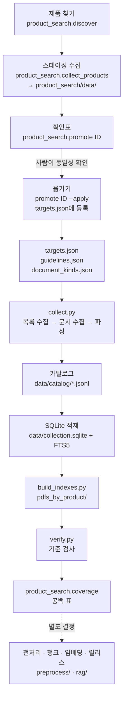

# RA 문서 적재 파이프라인 총정리

- 작성: 2026-10-13 20:10 KST
- 수정: 2026-10-14 11:07 KST (3.2절에 `Collector(work=...)`와 태스크 실행 안내 추가)
- 범위: 규제기관(EMA·FDA·Health Canada·PMDA)과 ClinicalTrials.gov의 공개 문서를 받아 `data/`에 쌓는 과정. 대상은 원본 저장, 텍스트 층 파싱, 카탈로그, SQLite 적재, 검증이다. 전처리·청크·임베딩은 [데이터 전처리 파이프라인](../DATA_PREPROCESSING_PIPELINE.md)이 다루며, 이 문서는 그 입구까지만 설명한다(8절).
- 근거: 2026-10-13에 코드(`collect.py`, `product_search/*.py`, `build_indexes.py`, `verify.py`)와 `data/catalog/`를 직접 읽어 다시 확인했다. 이전 문서의 서술과 코드가 다르면 코드를 따랐다.
- 이전 문서: 이 문서가 대체한 6개 문서는 [`temp/`](temp/README.md)로 옮겼다. 기록은 그대로 보존했다.

## 1. 한눈에 보기



| 단계 | 하는 일 | 코드 | 결과 |
|---|---|---|---|
| 0. 등록 | 제품·시험·지침 목록을 정한다. 새 제품은 스테이징에서 확인한 뒤 등록한다 | `targets.json`, `guidelines.json`, `product_search/` | 수집 대상 |
| 1. 목록 수집 | 기관의 목록·색인(EMA JSON, Purple Book CSV, Drugs@FDA ZIP, HC 목록, PMDA 제품 페이지, CT.gov API)을 **매번 새로** 받는다 | `collect.py`의 단계별 메서드 | `data/raw/`, `data/catalog/*_selected.jsonl` |
| 2. 문서 수집 | 목록에서 대상 제품 문서를 골라 받는다. 카탈로그에 이미 있는 버전은 다시 받지 않고 저장본을 쓴다 | `Collector.fetch` | `data/raw/<sha256>.<ext>`, `download_cache.json` |
| 3. 파싱 | PDF는 깨진 글꼴(ToUnicode)을 복구한 사본에서 쪽별 텍스트·블록·이미지 영역을 뽑는다. HC 웹페이지는 제목 절 단위로 나눈다 | `Collector.parse`, `text_layer.py` | `data/parsed/*.pages.jsonl`, `*.layout.txt`, `data/repaired/` |
| 4. 카탈로그 | 문서 행에 기능·작성 주체·검색 층, 성분, 대조약/바이오시밀러 구분을 붙이고 제품·시험 레코드를 쓴다 | `Collector.finish_catalog` | `data/catalog/documents.jsonl` 등 |
| 5. SQLite 적재 | 카탈로그와 쪽을 넣고, 카탈로그에 없는 옛 버전을 지우고, 전문 검색 색인을 다시 만든다 | `Collector.database` | `data/collection.sqlite` |
| 6. 사람용 사본 | 제품 폴더별 PDF 사본과 목록 | `build_indexes.py` | `pdfs_by_product/`, `data/raw/INDEX.csv` |
| 7. 검증 | 아래 5절의 [검사] 항목 | `verify.py` | 통과/실패 |
| 8. 공백 점검 | 제품×관할×문서 기능의 표 | `python -m product_search.coverage` | `product_search/data/catalog/coverage.json` |

**OCR은 이 파이프라인에 없다**(2026-10-08 결정). 텍스트 층이 없는 쪽은 그대로 남고, 검색 가능하게 만드는 일은 전처리 쪽에서 따로 정한다. `collect.py --ocr` 옵션은 남아 있지만 쓰지 않는다.

## 2. 현재 적재 상태 (2026-10-13 20:05 KST 확인)

마지막 수집은 2026-10-08 03:52 KST(실행 ID `20261007T185213Z`, UTC 표기)이고, 그 뒤로 `data/catalog/`는 바뀌지 않았다. 성분은 ustekinumab 하나다.

| 제품 (`product_id`) | 구분 | EU / US / CA 이름 | 문서 | 쪽·절 | 텍스트 없는 쪽 | 출처별 문서 |
|---|---|---|---:|---:|---:|---|
| CNTO1275 | 대조약 | Stelara | 88 | 4,380 | 1,123 | EMA 21, FDA 62, HC 5 |
| SB17 | 바이오시밀러 | Pyzchiva | 36 | 1,539 | 242 | EMA 7, FDA 19, HC 5, PMDA 3, CT.gov 2 |
| ABP654 | 바이오시밀러 | Wezenla / Wezlana / Wezlana | 25 | 1,198 | 54 | EMA 8, FDA 10, HC 3, CT.gov 4 |
| CTP43 | 바이오시밀러 | Steqeyma | 30 | 1,727 | 67 | EMA 7, FDA 12, HC 4, PMDA 5, CT.gov 2 |
| BMAB1200 | 바이오시밀러 | Yesintek | 20 | 1,178 | 135 | EMA 6, FDA 9, HC 3, CT.gov 2 |
| BAT2206 | 바이오시밀러 | Usymro / Starjemza / — | 8 | 371 | 0 | EMA 6, FDA 2 |
| (없음) | 지침 | EMA 6, FDA 7, HC 8 | 21 | 239 | 0 | 14종 지침 |
| **합계** | | | **228** | **10,632** | **1,621** | |

- 시험 11건, 게시된 시험 결과 46행(`study_results.jsonl`).
- 검색 층: core 23, supporting 59, guideline 21(이 셋이 기본 검색 대상, 103건), label 31, plan 10, risk 8, record 76.
- Stelara의 텍스트 없는 쪽은 대부분 2009~2016년 FDA 심사 스캔본이다.
- 스테이징(`product_search/data/`)에는 AVT04(Uzpruvo)와 DMB3115(Imuldosa) 시험 수집본이 있고, 프로젝트로 옮기지 않았다.
- 검증: 아래 [검증 결과](#verify-result) 참조.

## 3. 새 문서를 넣는 방법

모든 명령은 프로젝트 루트에서 실행한다. `pdftotext`가 PATH에 있어야 한다(Git for Windows의 `mingw64/bin`에 있다. `collect_products`는 없으면 스스로 PATH에 넣는다).

### 3.1 새 제품 추가 — 스테이징 → 확인 → 옮기기

새 제품을 `data/`에 직접 넣지 않는다. RAG·근거 작업이 `data/`를 쓰기 때문이다.

```powershell
uv run python -m product_search.discover <제품명 또는 성분명>        # 후보 찾기 (웹 화면: python -m product_search.app)
uv run python -m product_search.collect_products <제품명>           # product_search/data/에 수집
uv run python -m product_search.promote                             # 스테이징에 있는 제품 목록
uv run python -m product_search.promote <product_id>                # 확인표: 허가, 기관별 문서(층·쪽수·URL), 시험, 빠진 관할
uv run python -m product_search.promote <product_id> --apply        # 프로젝트로 옮기기
```

- **discover**는 EMA 의약품·EPAR 목록, Purple Book CSV, FDA GSRS 이름, ClinicalTrials.gov 검색, HC DPD에서 후보를 만든다. 결과는 후보일 뿐이다. 예를 들어 Yesintek의 개발코드를 "PASI75"로 잘못 잡은 적이 있다.
- **확인표**를 보고 사람이 4.2절의 동일성 기준으로 판단한다.
- **--apply**는 다시 다운로드하지 않는다. 원본·파싱 파일·캐시·카탈로그 행을 복사하므로 확인한 것과 같은 `document_id`·`version_id`가 들어간다. 그다음 `targets.json`에 항목을 추가하고, SQLite에 적재하고, `build_indexes.py`와 `verify.py`를 실행한다.
  - 이미 등록된 제품이거나 `document_id`가 겹치면 옮기지 않는다.
  - 바이오시밀러에 `reference_product_id`가 없으면 같은 성분의 대조약이 하나일 때 그것을 연결한다.
- 옮긴 뒤에는 프로젝트의 `collect.py`가 3.2의 규칙으로 갱신한다. 옮긴 문서는 재사용된다.

### 3.2 등록된 제품의 재수집·갱신

```powershell
uv run python -m collection.collect                         # 전체: 목록 수집 → 문서 → 파싱 → 카탈로그 → SQLite
uv run python -m collection.collect --only fda_letters,purple   # 일부 단계만. 다른 단계의 문서는 그대로 둔다
uv run python -m collection.collect --refresh               # 저장된 문서도 새로 받는다 (바뀌면 새 버전)
uv run python -m collection.collect --reparse               # 다운로드 없이 저장 원본을 다시 파싱
uv run python -m collection.collect --offline               # 네트워크 없이 저장 스냅샷으로 다시 만든다
uv run python -m collection.build_indexes
uv run python -m collection.verify
uv run python -m product_search.coverage
```

단계 이름: `ema, ema_documents, purple, fda, clinical_trials, fda_reviews, fda_letters, pmda, health_canada, guidelines`.

같은 단계를 (단계, 제품) 태스크로 나눠 실행하는 경로도 있다: `uv run python -m ingestion.tasks run`(기본 오프라인, 결과는 PostgreSQL에 기록하고 `data/catalog`에는 쓰지 않는다). `Collector(work=...)`는 단계 사이 목록 파일의 위치이며 기본값은 `data/catalog`다. 자세한 내용은 [적재 백엔드 계획](INGESTION_AGENT_DB_PLAN_2026-10-14.md) 13.4절. 실행이 끝나면 README(현재 상태·변경 이력)와 이 문서 2절을 갱신한다.

### 3.3 지침 추가

`guidelines.json`에 항목(`id, source, document_type, jurisdiction, title, landing, url` 또는 `pages`, `topics`)을 넣고 `uv run python -m collection.collect --only guidelines`를 실행한다. 상태·참조번호·날짜는 수집할 때 기관 페이지에서 읽는다. 기관 페이지가 없을 때만 항목에 적은 상태를 쓴다.

### 3.4 새 문서 종류가 생겼을 때

두 곳에 함께 넣는다.
- `document_kinds.json`의 `(source, document_type)` → `[family, author, tier]`. 없으면 `unclassified`가 되어 `verify.py`가 실패한다.
- `rag/doc_groups.json`의 `doc_group`. 없으면 RAG 청크 생성이 실패한다.

## 4. 단계별 상세

### 4.1 기관별로 받는 것

| 단계 | 출처와 찾는 방법 | 받는 문서 (`role`) | `document_id` | 받지 않는 것 |
|---|---|---|---|---|
| `ema` | EMA 의약품·문서 JSON. `ema_name`과 유효성분이 정확히 한 제품과 맞아야 한다 | 최초 공개평가보고서 1건 (`reference_assessment`). 정확히 1건이 아니면 오류 | `EMA:<문서 ID>` | — |
| `ema_documents` | 위 제품의 문서 목록 중 `targets.json`의 `ema_document_roles` 유형. 문서 이름에 제품명이 있어야 한다 | 개요, 허가 후 절차, 제품정보, 허가 제형 목록, RMP, 변경 심사보고서, 안전성 결론 | `EMA:<문서 ID>` | 제품정보 변경 추적본(Word), 회원국 조건, 소아 계획 준수 |
| `purple` | Purple Book 다운로드 페이지에서 가장 최근 월별 CSV | 문서 없음. 제품 레코드에 `us_licensure`(허가 유형·승인일·상호교환·독점권), `us_proper_name`, `reference_product` | — | — |
| `fda` | Drugs@FDA ZIP의 Products·ApplicationDocs 표에서 `us_brand`와 같은 제품 | 문서 없음. 신청번호와 문서 링크 목록 | — | — |
| `fda_reviews` | 위 링크 중 `/drugsatfda_docs/nda/` 심사 패키지. 패키지 페이지 제목에 제품명이 있어야 한다. 현재 형식(`pdfBaseName`), 2009~2016년 옛 형식(`pdfFiles`·`pdfFilenames`), 한 PDF로 된 보충 패키지를 모두 읽는다 | 패키지 안의 심사·서한·라벨 PDF 전부. 역할은 `fda_review_roles` | `FDA:<기본 이름>:<접미사>` | `fda_review_skip`의 이름·목록 파일, 소아 심사 폴더 |
| `fda_letters` | 같은 링크 중 `appletter/`, `label/` | 패키지 밖의 승인서한 전부(`regulatory_correspondence`), 최신 라벨 1건(`label`) | `FDA:letter:<파일>`, `FDA:label:<파일>` | 보충신청별 과거 라벨 |
| `clinical_trials` | `study_ids`의 NCT마다 API v2. 제목·중재·설명에 `aliases` 중 하나가 있어야 한다 | 프로토콜·SAP 첨부 PDF(`reference_protocol`·`reference_sap`), 시험 레코드, 게시된 결과(결과 항목별 원값) | `CTG:<NCT>:<파일>` | 대조약의 시험(기본 `study_ids: []`) |
| `pmda` | `pmda_general_list_ids`의 제품 페이지(사람이 확인해 넣은 것만). 성분 일본어명이 페이지에 있어야 하고, 심사보고서는 본문에 별칭이 있어야 한다 | 審査報告書(`regulatory_review`), 添付文書·IF(`label`) | `PMDA:<ID>:<종류>:<파일>` | 患者向医薬品ガイド, RMP |
| `health_canada` | HC 심사문서 포털을 성분으로 걸러 제목에 `ca_brand`가 있는 것. DPD API에서 제품 모노그래프 | SBD·RDS·SSR 웹페이지(`regulatory_review`), Product Monograph PDF(`label`) | `HC:<자원 ID>`, `HC:PM:<파일>` | — |
| `guidelines` | `guidelines.json` | 지침 PDF 또는 HC 절별 웹페이지(`guideline`, `product_id`·`ingredient`는 `null`) | `GL:<지침 ID>[:<절>]` | 기관 페이지에 없는 상태를 추정하지 않음 |

한 단계나 한 제품이 실패해도 다른 단계는 계속 진행한다. 실패는 `data/runs/<run_id>.errors.jsonl`에 남는다. 다운로드는 세 번까지 다시 시도하고 404는 바로 "없음"으로 본다. PDF는 `%PDF-`로 시작해야, ZIP은 ZIP이어야 저장한다.

### 4.2 제품 동일성 — 원문이 제품을 직접 가리킬 때만 연결한다

이름이 비슷하거나 회사가 같다는 이유로 연결하지 않는다.

| 출처 | 확인 방법 | 코드 검사 |
|---|---|---|
| EMA | 의약품 이름 일치 + 유효성분 일치, 최초 공개평가보고서 정확히 1건 | 있음 |
| FDA | Drugs@FDA·Purple Book 제품명 일치, 심사 패키지 제목에 제품명 | 있음 |
| Health Canada | 결정문서 제목·DPD 제품명에 캐나다 제품명 | 있음 |
| ClinicalTrials.gov | 제목·중재·설명에 별칭 | 있음 |
| PMDA | 심사보고서 본문에 별칭. 첨부문서·IF는 코드가 검사하지 않으므로 사람이 확인한 뒤에만 ID를 넣는다 | 일부 |

예: 일본 「YD」(3999474)는 심사보고서가 스캔본이고 IF에 원 개발사나 개발코드가 없어 BMAB1200에 연결하지 않았다.

### 4.3 제품 등록 필드 (`targets.json`)

구조는 **성분 → 대조약 → 바이오시밀러**다. 바이오시밀러는 `reference_product_id`로 같은 성분의 대조약을 가리킨다.

| 필드 | 규칙 |
|---|---|
| `product_id` | 개발코드(영숫자 대문자, 예: `SB17`, `BMAB1200`). 제품 하나 = 개발코드 하나. 개발코드가 없을 때만 제품명 |
| `development_code` | 원문 표기(`ABP 654`, `CT-P43`) |
| `kind`, `reference_product_id` | `reference` 또는 `biosimilar`. 대조약은 다른 제품을 가리키지 않는다 |
| `ema_name`, `us_brand`, `ca_brand` | 관할별 허가명. 없거나 확인되지 않으면 `null`, 이유는 `notes` |
| `licences` | 관할별 허가 목록. 같은 제품의 EU 허가가 둘이면(Yesintek·Usrenty) 하나로 묶고, EU 허가일이 가장 이른 것을 `primary`로 하여 그 문서만 받는다 |
| `aliases` | 개발코드 변형과 제품명. CT.gov·PMDA 동일성 확인에 쓴다 |
| `study_ids` | 동일성 확인을 통과한 NCT 전부(1상 포함) |
| `pmda_general_list_ids` | 사람이 원문으로 확인한 PMDA 제품 페이지 ID |
| `ingredient`, `ingredient_ja` | 최상위는 기본 성분. 다른 성분 제품은 항목에 둔다 |

최상위의 `sources`(기관 URL), `ema_document_roles`, `fda_review_roles`, `fda_review_skip`, `review_sample_pages`도 수집 동작을 정한다.

### 4.4 버전과 재수집

| 경우 | 동작 |
|---|---|
| 카탈로그에 있는 문서 URL | 저장 원본을 재사용한다. `version_id`(=원본 SHA-256), 파싱 파일, 하류 결과가 그대로 유지된다 |
| 목록·색인 | 매번 새로 받는다. 새 문서와 새 상태를 찾기 위해서다 |
| `--refresh` | 문서도 새로 받는다. 바이트가 바뀌면 새 버전이 되고, 옛 버전에서 만든 OCR·근거 단위·청크는 다시 만들어야 한다 |
| 이미 파싱된 버전 | 다시 파싱하지 않는다. `--reparse`로만 |
| 이번 실행에 다시 나오지 않은 문서 | 지우지 않는다. `last_seen_run`이 이번 실행이 아니게 된다 |
| SQLite의 옛 버전 | 적재 때 지우고 검색 색인을 다시 만든다 |

### 4.5 파싱

- **PDF**: `text_layer.repair`가 ToUnicode가 없는 글꼴을 복구한 사본(`data/repaired/<version_id>.pdf`)을 만들고, 텍스트 추출은 그 사본에서 한다. 원본은 바꾸지 않는다. 쪽마다 PyMuPDF로 텍스트·블록 좌표·이미지 영역을 저장하고, `pdftotext -layout` 사본을 따로 남긴다. 텍스트가 없는 쪽은 `text_layer.pages_needing_ocr`에 기록한다.
- **HC 웹페이지**: 제목이 있는 절마다 한 행이 된다. `pdf_page`는 절 순번이고 `locator_type: html_section`, 절 제목은 `pdf_page_label`이다.
- **EMA 최초 평가보고서**: AUC·Cmax 점수가 높은 쪽 3개에서 pdfplumber 표 후보를 뽑아 `data/tables/`에 둔다(`candidate_unreviewed`).

### 4.6 문서 메타데이터

모든 문서 행에 다음 필드가 있어야 한다 [검사].

`document_id, version_id, product_id, ingredient, product_kind, source, role, document_type, family, author, tier, default_search, title, url, sha256, raw_path, parsed_path, retrieved_at`

- `role`은 검색용으로 넓게 묶은 값이다. 문서가 무엇인지는 `document_kinds.json`이 `(source, document_type)`으로 정하는 `family`·`author`·`tier`가 말한다.
- 검색 층 `tier`: core(규제기관 자체 심사), supporting(같은 기관의 다른 심사·결정), guideline이 기본 검색 대상이다. label·plan·risk·record는 질문 유형이 맞을 때만 켠다.
- 게시된 시험 결과는 `author: sponsor`, `review_status: posted_results_not_regulator_reviewed`로 표시해 규제기관 판단과 섞지 않는다.

## 5. 검증 (`verify.py`)

[검사]로 표시한 규칙을 코드로 확인한다. 하나라도 어기면 실패한다.

- 캐시의 모든 원본 파일 크기·SHA-256.
- 제품 레코드 = `targets.json` 제품. `document_id` 중복 없음. EU 제품마다 최초 평가보고서 1건.
- 필수 필드, `document_kinds.json` 분류, 지침은 제품·성분 `null`, 제품 문서는 제품의 성분.
- 개발코드 중복 없음, 한 허가명은 한 제품에만, 대표 EU 허가 = `ema_name`.
- 대조약·바이오시밀러 연결, `product_kind`, 미국 제품의 `us_licensure`.
- `study_ids` 전부 수집, 게시 결과가 있는 시험과 결과 행이 일치.
- `guidelines.json`과 `guidelines.jsonl`의 지침 목록 일치.
- 모든 문서가 `pdfs_by_product/INDEX.csv`에 사본을 가짐.
- PDF 쪽수 = 카탈로그 쪽수 = 파싱 행 수, 쪽 번호 연속, 파싱 행의 버전·URL 일치. 최초 평가보고서는 빈 쪽이 없어야 한다.
- SQLite 무결성, 카탈로그와 문서·쪽·결과 수 일치, 고아 쪽 없음, FTS 검색 동작.

검사하지 않는 것: 표 셀, 임상적 완전성·정확성, OCR 정확도, 임베딩·답변.

<a id="verify-result"></a>**검증 결과 (2026-10-13)**: 2026-10-13 20:08 KST에 `uv run python -m collection.verify`를 다시 실행해 통과했다(`passed_with_coverage_warnings`). 원본 해시 294개를 확인했고, SQLite는 제품 6, 시험 11, 게시 결과 46, 문서 버전 228, 쪽 10,632(검색 색인 10,632)로 카탈로그와 일치했다. 경고는 텍스트 없는 쪽 1,621쪽이다(2절 표의 합계와 같다).

## 6. 저장 위치

| 경로 | 내용 |
|---|---|
| `targets.json`, `guidelines.json`, `document_kinds.json` | 수집 규칙 (프로젝트와 스테이징이 같이 씀) |
| `data/raw/<sha256>.<ext>` | 받은 원본 그대로. 파일명이 곧 버전 |
| `data/catalog/download_cache.json` | URL → 마지막으로 받은 버전 |
| `data/catalog/documents.jsonl` | 문서 카탈로그 (228행) |
| `data/catalog/products.jsonl`, `studies.jsonl`, `study_results.jsonl`, `guidelines.jsonl` | 제품·시험·게시 결과·지침 상태 |
| `data/catalog/ema_*`, `fda_*_selected.jsonl`, `purple_*_selected.jsonl` | 기관 목록에서 고른 행 (다음 단계의 입력) |
| `data/parsed/<문서>.pages.jsonl`, `.layout.txt` | 쪽별 텍스트·블록·이미지 영역, 레이아웃 텍스트 |
| `data/repaired/<version_id>.pdf` | 글꼴 복구 사본 |
| `data/tables/` | EMA 평가보고서 PK 표 후보 |
| `data/collection.sqlite` | `products, studies, study_results, document_versions, pages, page_search(FTS5), ingestion_runs` |
| `data/runs/<run_id>.downloads.jsonl`, `.errors.jsonl`, `.summary.json` | 실행 기록. 전체 실행의 요약만 `data/summary.json`에 쓴다 |
| `pdfs_by_product/<제품>/`, `GUIDELINES/`, `INDEX.csv` | 사람이 읽기 좋은 이름의 사본 |
| `product_search/data/` | 스테이징. `data/`와 같은 구조 |

## 7. 식별자 — 하류가 이어 쓸 키

| 단위 | 키 | 성질 |
|---|---|---|
| 성분 | `ingredient` | 제품·문서 행 모두에 있다 |
| 제품 | `product_id`, `kind`, `reference_product_id` | 허가가 늘어도 그대로. 문서 행에는 `product_kind` |
| 허가 | `(jurisdiction, licence_id)` | 제품 레코드의 `licences` |
| 문서 | `document_id` | 출처 고유 번호에서 만든다. 다시 받아도 같다 |
| 문서 버전 | `version_id` (= 원본 SHA-256) | 내용이 같으면 같다 |
| 쪽·절 | `(document_id, version_id, pdf_page)` | PDF는 1부터, HC 웹페이지는 절 순번 |
| 시험 | `nct_id`, `(nct_id, outcome_index)` | — |

전처리 블록·표·그림, 청크, 임베딩은 `(document_id, version_id, pdf_page)`에 자기 번호를 붙여 키로 삼는다. `version_id`가 키에 있어야 `--refresh`로 문서가 바뀌었을 때 옛 결과를 가려낼 수 있다. 원문 열기에는 `raw_path`(저장 원본), `url`(공식 출처), 쪽·절 키를 쓴다.

## 8. 하류로 넘기는 경계

적재가 끝났다고 RAG 서비스에 바로 들어가지 않는다. 서비스에 넣을 범위는 전처리 쪽에서 따로 정한다.

| 하류 | 현재 쓰는 범위 (2026-10-13) | 적재 쪽에서 할 일 |
|---|---|---|
| 전처리·청크·임베딩 ([전처리 파이프라인](../DATA_PREPROCESSING_PIPELINE.md)) | 5개 바이오시밀러의 EMA·FDA·HC 92문서, 4,160쪽. 평가 보류 9문서 제외. **Stelara와 PMDA·CT.gov 문서는 들어가지 않았다** | 없음. 새 문서는 범위 명세(`data/runs/corpus_update_2026-10-09/corpus_plan.json` 방식)에 넣어야 처리된다 |
| RAG 공통 지침 | 별도 스냅샷 `data/guidelines/ra_guidelines_native_2026-10-12_v2` (21문서, 236청크) | 없음 |
| 대조약 Stelara | 수집만 됨, RA 색인 없음. 지침처럼 별도 스냅샷으로 둘 계획이다([3분할 화면 계획](../rag/UI_3PANE_AND_RA_FEATURES_PLAN_2026-10-13.md) 4장, 아직 만들지 않음) | 없음 |
| RAG 문서 분류 (`rag/doc_groups.json`) | 새 문서 종류의 `doc_group`, 제품 라벨 | 3.4절 |
| 근거 추출 (`evidence/`) | 원래 3제품 | 없음. 새 제품은 근거 쪽에서 시험 등록부 검토 뒤 추가 |
| 평가 (`eval/`, `gold/`) | — | 없음 |

## 9. 알려진 한계와 주의

1. **지침 카탈로그와 RAG 지침 스냅샷이 다르다.** 2026-10-12 지침 상태 검토([GUIDELINE_STATUS](../rag/GUIDELINE_STATUS_2026-10-12.md))는 EMA 맞춤형 임상 접근 반성문서의 최종본(`..._en.pdf-0`)을 `collect.py` 밖에서 받아 RAG 스냅샷에만 넣었다. `guidelines.json`과 `data/catalog/`에는 아직 2026-10-07에 받은 이전 URL·버전이 있다. FDA 2015 지침 철회 같은 상태 판단도 RAG 쪽 기록에만 있다. 다음 지침 수집 전에 `guidelines.json`의 URL을 맞출지 정해야 한다.
2. **`data/summary.json`이 오래됐다.** 2026-10-08 Stelara 옮기기와 지침 수집은 부분 실행이라 요약이 `data/runs/`에만 있다. `data/summary.json`은 140건 시점(2026-10-08 02:52 KST)이다. 현재 건수는 카탈로그나 `verify.py` 출력으로 본다.
3. **텍스트 없는 쪽 1,621쪽**은 이 단계에서 검색되지 않는다(Stelara 1,123쪽 포함).
4. **자동 검색의 빈틈**: 캐나다 제품명이 EU·미국과 다르면 찾지 못한다(AVT04의 캐나다 이름 Jamteki). PMDA는 검색하지 않는다. 둘 다 확인표에 "not found"로 나오므로 필요하면 `targets.json`에 손으로 넣는다.
5. **1상 PK 시험은 CT.gov에 결과도 첨부도 없다.** PK 수치의 출처는 심사보고서뿐이다. Yesintek의 주요 PK 시험 BM12H-NHV-01-G-01은 CT.gov에 등록이 없다.
6. **출처에 없는 것**: Yesintek의 HC 결정요약(RDS), Usymro의 캐나다 허가, Starjemza의 FDA 심사 패키지(서한·라벨만 있음).
7. **주기 실행·변경 알림은 없다.** 갱신은 사람이 `collect.py`를 실행할 때만 일어난다.

## 10. 지금까지의 변천

| 시각 (KST) | 일 | 기록 |
|---|---|---|
| 2026-10-02 00:41~00:57 | 파일럿. 3제품(SB17·ABP654·CTP43)의 EMA 평가보고서 3건과 CT.gov 프로토콜·SAP 8건, 11 PDF 1,073쪽. FDA는 목록만 | [수집 계획](temp/COLLECTION_PLAN.md), [파일럿 결과](temp/PILOT_RESULTS.md) |
| 2026-10-02 ~ 10-05 | FDA 심사 패키지·HC·PMDA·EMA 기타 문서 추가, 77건. OCR 시험(이후 수집에서 뺌) | [문서 대조표](temp/COLLECTED_DOCUMENT_MAP.md), [문서 종류 안내](temp/COLLECTED_DOCUMENT_TYPES.md) |
| 2026-10-07 17:05~17:50 | 적재 점검. 공백 6가지(지침 0건, FDA 보충 서한·최신 라벨, Purple Book 상태, 게시 결과, 문서 층, 옛 버전 잔존)를 `product_search/`에서 보완 | [적재 문서 점검과 보완](temp/COLLECTION_GAP_REVIEW_2026-10-07.md) |
| 2026-10-08 02:50~03:55 | 보완을 `collect.py`로 옮기고 규칙으로 고정. Yesintek(BMAB1200)·Usymro(BAT2206) 추가, 지침 21문서, 대조약 Stelara 88건을 스테이징 → 옮기기로 추가. 228건 10,632쪽. OCR은 수집에서 뺌 | [수집 기준](temp/COLLECTION_STANDARD.md) |
| 2026-10-09 ~ 10-12 | 수집 카탈로그는 그대로. 하류에서 92문서를 전처리·임베딩하고, 지침은 별도 스냅샷으로 갱신 | [전처리 파이프라인](../DATA_PREPROCESSING_PIPELINE.md) |
| 2026-10-13 20:10 | 이 문서로 적재 과정을 다시 정리하고, 이전 6개 문서를 `temp/`로 옮김 | 이 문서 |
