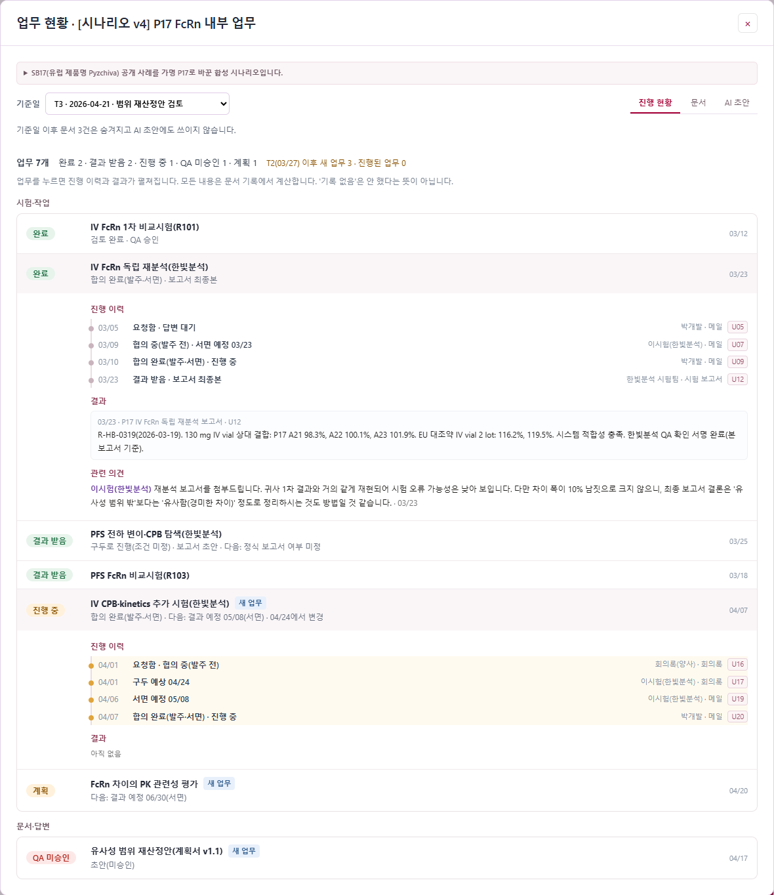
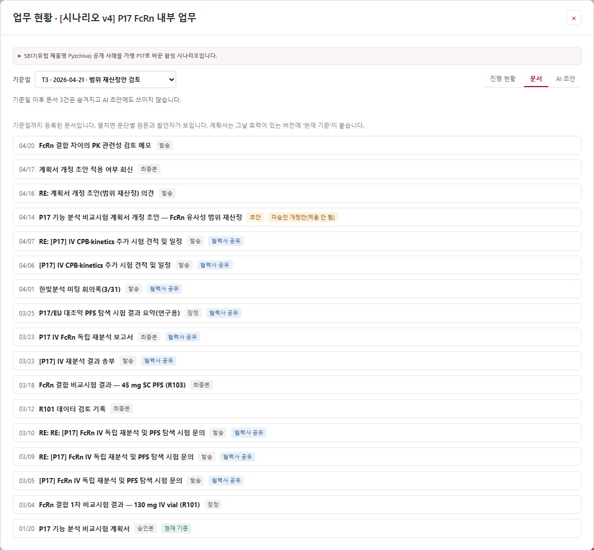
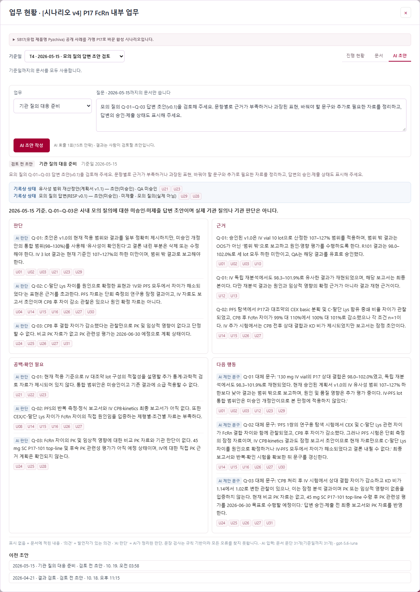

# 업무 현황·AI 초안 — 한 장 요약

2026-10-19 · 파이프라인 아래 **`업무 현황·AI 초안`** 버튼 · 데모: [8885 v4 파이프라인](http://127.0.0.1:8885/?project=41afdde4a4114c4c9dcb45e05e0e8080&stage=cmc)

## 무엇을 하는 기능인가

개발 중인 제품의 **사내·협력사 문서**(시험 보고서, 메일, 회의록, QA 기록, 답변 초안)를 모아서 세 가지를 보여 준다.

1. **진행 현황:** 지금 각 업무가 어디까지 왔는지
2. **문서:** 그 판단의 근거가 된 원문
3. **AI 초안:** 결과 검토·협력사 미팅·기관 질의 대응을 위한 검토 메모

모든 화면은 **기준일**에 맞춰진다. 기준일 이후 문서는 화면과 AI 입력에서 모두 빠진다. 그래서 "3월 27일 미팅 때 우리가 알던 것"을 그대로 재현할 수 있다.

## 핵심 아이디어: 상태는 기록에서 계산하고, AI는 그 위에서 쓴다

내부 업무에서 자주 틀리는 것은 검색이 아니라 **상태 구분**이다. 요청과 발주, 구두 일정과 서면 일정, 초안 보고서와 최종본, 담당자 의견과 QA 승인, 답변 초안과 제출본이 대표적이다. 그래서 이 기능은 다음을 지킨다.

- **상태는 사람이나 AI가 입력하지 않는다.** 문서 문단마다 "어떤 업무를 무엇으로 바꾸는 기록인가"를 붙여 두고, 서버가 날짜순으로 계산한다.
- **의견은 상태를 바꾸지 못한다.** QA 승인은 QA 기록에서만, 제출은 제출 기록에서만 나온다.
- **기준은 그날 효력이 있는 버전만 쓴다.** 최신 파일이라도 미승인 개정안이면 '적용 안 됨'이다.
- **AI는 계산된 상태를 받아 판단·근거·공백·다음 행동을 쓴다.** 모든 문장에 근거 문단이 붙고, 문장이 상태와 어긋나면 "확인 필요"로 표시된다.

## 화면

| 진행 현황 | 문서 | AI 초안 |
|---|---|---|
|  |  |  |

- **진행 현황:** 업무 목록이다. 한 줄에 **상태 하나**(완료 · 결과 받음 · 진행 중 · 요청 · 초안 · QA 미승인 등), 업무 이름, 한 줄 요약, **다음에 기다리는 것**(예: "결과 예정 05/08(서면) · 04/24에서 변경")이 보인다. 줄을 누르면 **진행 이력**(날짜 · 무슨 일 · 누가/어떤 문서 · 근거), **결과**(시험 수치 원문), **관련 의견**이 펼쳐진다. 직전 시점 이후 새로 생긴 업무와 진행된 업무에는 표시가 붙는다. 같은 상태를 다시 적은 기록은 이력에 '(재확인)'으로 남고 진행으로 세지 않는다.
- **문서:** 날짜·제목·상태가 보이고, 펼치면 문단별 원문과 발언자가 나온다. 계획서에는 '현재 기준' 또는 '미승인 개정안(적용 안 됨)'이 붙는다.
- **AI 초안:** 판단 / 근거 / 공백·확인 필요 / 다음 행동 네 칸이다. 배지가 없으면 문서에 적힌 내용이고, '의견'은 발언자가 있는 의견, 'AI 판단'·'AI 제안 문구'는 AI가 정리한 것이다. 승인·제출 상태(기록상 상태)는 AI가 아니라 기록에서 계산해 위에 보여 준다.

## 시연 시나리오 (SB17 사례를 가명 P17로)

실제 공개 사례인 SB17의 IV vial FcRn 결과(관측 98–102%, 비교 범위 107–127%)와 쟁점에서 출발했다. 문서 20건은 모두 합성이다. AI에는 실제 제품명과 실제 결론을 주지 않는다.

| 시점 | 질문 | AI가 해야 하는 일 |
|---|---|---|
| T1 03/06 | 1차 결과가 기준을 통과하나? | 범위 밖이지만 잠정이며 QA 전이다. 불합격·원인 단정 금지 |
| T2 03/27 | 협력사 미팅 준비 | 재분석은 발주·완료, PFS 탐색은 조건 미정. 협력사의 "유사함" 제안은 채택하지 않음. IV 직접 확인 시험을 새 안건으로 |
| T3 04/21 | 재산정 범위로 보고서 써도 되나? | 안 된다. 개정안은 미승인이고 소급 불가. 추가 시험 일정은 서면 05/08 |
| T4 05/15 | 답변 초안 검토 | 미승인 범위 사용, "최종 보고서"(실제는 초안), "PK 영향 없음"(근거 없음)을 지적하고 고칠 문구 제시 |

최종 코드에서 T1~T4 네 시점 모두 리뷰 기준을 충족했다. 문구를 일상어로 바꾼 뒤에도 다시 실행해 확인했다.

## 확인한 것과 한계

- **확인:** 관련 테스트 112개, 화면 DOM 검사(두 서버), 실제 브라우저 렌더링 캡처, 실제 AI 호출 24회(모두 완료, 호출 장부 기록).
- **한계:**
  - 같은 질문에도 AI 응답은 달라질 수 있다.
  - 문장 검사는 규칙 기반이라 모든 오류를 잡지 못한다.
  - 문서 묶음은 지금 사람이 JSON으로 만든다. 원본 자동 추출은 추후 과제다.
  - 시나리오는 합성이며 전문가 검토는 아직 없다.
  - 협력사 공유용 초안은 사내 판단이 필요한 안건을 만들지 못해 화면에서 숨겼다(API에는 남음).

## 용어 (화면에 나오는 것만)

| 용어 | 뜻 |
|---|---|
| 기준일 | 이 날짜까지의 문서만 보고 쓴다 |
| 업무 | 문서들이 다루는 일 하나(재분석, 추가 시험, 답변 작성 등) |
| 진행 / 합의 / 일정 | 했나 / 무엇을 하기로 정했나(발주·서면이면 합의 완료) / 언제까지(구두 예상과 서면 예정 구분) |
| 보고서 · 검토 · QA | 결과 문서가 초안인가 최종본인가 · 담당자 검토 · 품질보증팀 인정 |
| 승인 · 제출 · 기관 | 문서·답변 승인 · 기관에 냈나 · 기관이 받아들였나(모의 질의면 '실제 아님') |
| '기록 없음' | 그 기록이 문서에 없다는 뜻. 안 했다는 뜻이 아니다 |
| 현재 기준 / 미승인 개정안 | 그날 효력이 있는 계획서 / 최신이지만 승인 전이라 쓰면 안 되는 버전 |
| U03 같은 칩 | 근거 문단 번호. 누르면 원문이 보인다 |
| 확인 필요 N | AI 문장이 기록상 상태와 어긋날 수 있는 곳 N개 |

자세한 실행 과정과 보완 이력은 [01 리뷰](01_REVIEW_WALKTHROUGH.md)에 있다.
