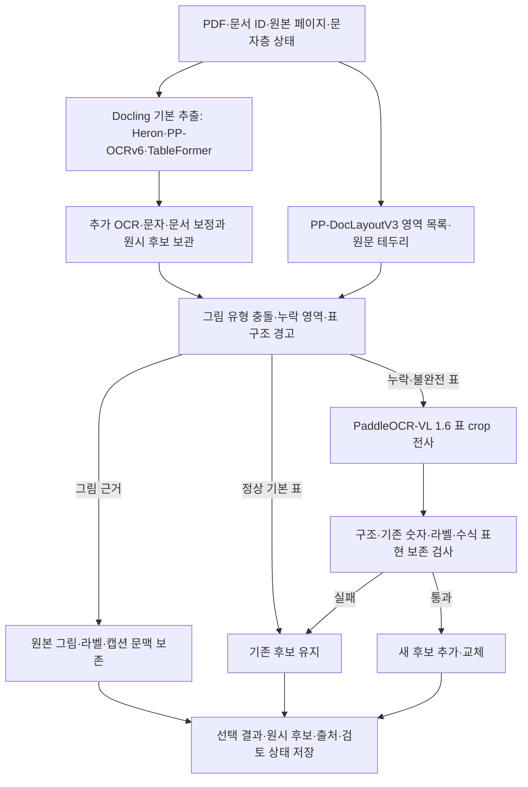

# 전처리 파이프라인 최종 선정 보고서

확정일: 2026-10-14. **H를 프로젝트에 적용할 전처리 기준 구성으로 확정한다.** 이번 확정은 비교 결과와 설계에 대한 결정이며, 운영 수집·청킹·검색 색인을 전환했다는 의미는 아니다.

확정 구성은 **Docling의 Heron 레이아웃 + 정상 PDF 문자층/RapidOCR·PP-OCRv6 + TableFormer accurate + 기존 추가 OCR·문자·문서 보정**을 기본으로 한다. **PP-DocLayoutV3와 원문 테두리 검출로 누락·유형 충돌을 확인하고, 필요한 표만 PaddleOCR-VL-1.6-0.9B로 전사한 뒤 후보를 검증**한다. 원시 그림을 보존하며 자동 그림 의미 설명·곡선 수치 생성·Qwen 표 전체 재생성은 기본 경로에 포함하지 않는다.

## 실험의 목적과 자료

목적은 개별 모델의 순위를 정하는 것이 아니라, 규제 문서의 본문·표·그림·출처를 검색에 공급할 전처리 구성을 선정하는 것이다. 모델·실행 도구·프로젝트 규칙을 기능별로 구분한다.

초기 demo_test로 코드 분리·문서 구성·그림 출력을 점검했다. 그 과정에서 생성된 그래프 좌표값을 원문 인쇄값처럼 취급할 위험, 이미지 객체/내용 그림/패널 수의 차이, 출력·평가 표기의 혼동을 확인했다. 이후 ABP654의 EMA·FDA·HC 각 5쪽, 총 15쪽으로 표본을 확대했다. 실제 이어지는 두 페이지는 함께 묶었고 4개 원본 문서에서 12개 발췌 PDF 작업을 구성했다. QA_candidates는 FDA 표본과 전사 기준 후보를 참고하는 자료로 사용했다.

15쪽의 평가 범위는 **본문 발췌 9개, 고정 셀 위치 90개, 숫자·단위·기호 구절 34개, 표 영역 18개, 논리 그림 4개**다. 그림은 내부 패널을 따로 세면 6개다. 로고·장식·스캔 페이지 전체 비트맵은 내용 그림에서 제외한다.

표본은 이미 원문과 결과를 확인한 개발 자료다. 전체 셀·전체 본문·전체 기관 문서의 정확도, 독립 일반화 성능, 검색 답변 정확도로 확장하지 않는다. 사람·독립 검수 완료를 의미하지 않는다.

## 이전 실험부터 최종 비교까지

| 단계 | 진행 내용 | 이 단계에서 확인한 것 |
|---|---|---|
| 초기 demo | 기존 프로젝트 전처리 코드의 standalone 구성, 이미지·표·그림 출력 점검 | 그림 설명과 인쇄 문자 전사의 분리 필요, 자동 그래프 수치 생성의 위험 |
| A/B/C | ABP654 15쪽에서 기존 세 완성 구성을 실제 실행 | Docling 기반 구성의 속도·표 구조 장점, 누락 표·그림 문제, native 후처리와 Qwen 채택 실패 |
| D/E | 저장된 Qwen 이전 단계와 Docling/PVL 표 후보를 재사용 | Qwen의 채택 후 이득 부재, 누락 표 보완 가능성. 새 추론·혼합 속도 측정은 아님 |
| F/G | 기본 추출과 독립 레이아웃 검출 후 선별 VL을 실제 실행 | 새 누락 표 4개 보완, 기존 통과 셀 손실 없음. E의 저장 후보 6개와 실제 선택 4개의 차이 |
| G′/H | 같은 새 기본 추출·검출을 공유하고 VLM 분기는 각각 새로 실행 | 그림 보존, comment 2개 복구, 불완전 표 교체, 후보 검증을 반영한 H의 실제 보완 효과 |

최종 비교 전에 후보 검증 구현의 수식 표기 처리를 수정했다. 예비 실행에서 `AUCinf`와 `AUC_{inf}` 등의 표현을 다른 라벨로 취급했으므로 기존 수식 정규화를 적용했다. 모델·선별 기준·90% 라벨 보존 임계값을 유지한 상태에서 최종 비교를 새로 실행했다. 예비 v1과 최종 v2 기록은 모두 보관했다. 응답 재시도로 점수가 좋은 후보를 골라 합친 실행이 아니다.

## 전체 결과표

| ID | 기능 기준 구성 | 시작 포함/공통+분기 시간 | 고정 셀 | 숫자·단위·기호 | 표 TP/정답 (출력 수) | 그림 |
|---|---|---:|---:|---:|---:|---:|
| A | PP-DocLayoutV3 + PaddleOCR-VL 1.6 + native 재구성 | 184.96초 | 49/90 | 27/34 | 18/18 (18) | 4/4 |
| B | PP-DocLayoutV3 + PP-OCRv5 + 규칙 표 복원 + Qwen3.5:9b | 306.14초 | 29/90 | 23/34 | 16/18 (16) | 4/4 |
| C | Heron + PP-OCRv6 + TableFormer + 추가 보정 | 54.22초 | 73/90 | 29/34 | 12/18 (13) | 3/4 |
| D | B의 Qwen 이전 단계: PP-OCRv5 + 규칙 표 복원 | 79.22초 | 29/90 | 23/34 | 16/18 (16) | 4/4 |
| E | C + 저장된 VL 표 후보 6개 보완 | 미측정 | 79/90 | 32/34 | 18/18 (19) | 3/4 |
| F | C의 새 실행 | 58.15초 | 73/90 | 29/34 | 12/18 (13) | 3/4 |
| G | F + 별도 PP-DocLayoutV3 + 선별 VL 4회 | 95.82초 | 79/90 | 31/34 | 16/18 (17) | 3/4 |
| G′ | 최종 비교의 현재 G 재실행 | 84.78초 | 79/90 | 31/34 | 16/18 (17) | 3/4 |
| **H** | **그림 보존 + 누락·불완전 표 선별 VL + 후보 검증** | **107.69초** | **88/90** | **32/34** | **18/18 (18)** | **4/4** |

C/F와 G/G′는 같은 구성의 서로 다른 실행 기록이다. 구성 변경에 의한 개선으로 시간 차이를 해석하지 않는다. D는 저장된 CUR 기록, E는 저장 후보 조합이다. A의 비용에는 공유 PVL 추론을 전부 부과한 보수적 native 재구성 경로 시간이 포함되므로 최적화한 native-first 경로의 독립 속도로 부르지 않는다.

G′/H는 동일한 새 Docling 기본 추출·PP-DocLayout 검출을 공유한다. 각 구성은 별도 PaddleOCR-VL 프로세스와 새 응답을 사용했다. 총시간은 공유 공통 단계와 각 분기의 선별·crop·VLM 시작/추론/종료·검증·저장 실측을 합한 것이다. 두 번의 독립 PDF 전체 시작 시간이나 반복 평균이 아니다. 비교 순서는 G′→H였고 최종 실험 전체 전처리 벽시계 시간은 128.68초였다. 점수 계산·HTML 작성 시간은 밖이다.

고정 셀 점수는 정답의 표준 행·열 위치와 내용을 함께 요구하며 병합 헤더 표현에도 영향을 받는다. 표 영역 재현과 셀 구조 정확도를 구분한다. B/D에는 빈 표 후보 12개가 있었고, E/G에는 그림을 표로 바꾼 오검출이 남아 있었다.

기존 본문 발췌 CER(수식 정규화)은 A 3.342%, B/D 0.098%, C 0.246%였다. 최종 G′/H의 본문은 같은 기본 추출 결과를 그대로 공유한다. H는 본문 OCR 개선을 주장하는 구성이 아니다.

## 선정 근거

1. **H는 E에서 확인한 누락 보완 효과를 실제 선별 실행으로 구현하고 그림 보존과 불완전 표 교체를 추가했다.** E의 속도 미측정 문제와 그림 3/4를 그대로 확정하지 않았다.
2. **G′ 대비 약 22.91초(27.0%)를 더 써서 평가 셀 9개를 개선했다.** 고정 셀 일치율은 87.8%에서 97.8%로 바뀌었으며 기존 통과 셀 손실은 0개다. 이 백분율은 고정 90개 표본에 해당한다.
3. **영역 보존이 개선됐다.** 누락 comment 2개를 포함해 표 영역 18/18을 확보하고, HC38 그림을 복구하여 그림 4/4가 됐다. 그림을 표로 만든 후보를 분리해 표 출력 18개가 모두 평가 표에 대응했다.
4. **기존 불완전 표를 선별했다.** H는 VLM 9회로 누락 영역 6개와 기존 표 3개를 처리했다. 누락 6개와 교체 후보 2개를 채택했고 HC 교체 후보 1개는 검증 실패로 원래 표를 유지했다.
5. **모델을 추가하는 것보다 후보·후처리를 정리하는 것이 유효했다.** A는 P-HANDOFF 이전 PVL 단계 71/90에서 최종 49/90으로 낮아졌다. B는 Qwen 보강에 약 218.55초를 추가했지만 네 응답 모두 구조 검증에서 미채택되어 D 대비 점수 개선이 없었다. Paddle 또는 Qwen 모델군 전체의 우열을 뜻하지 않는다.

## H의 기능별 모델·도구

| 기능 | 확정 모델·도구 | 담당 범위 |
|---|---|---|
| PDF·문자층 상태 확인 | PDF backend, PyMuPDF/pypdfium2, 페이지 라우팅 규칙 | 정상 문자층·스캔·깨진 문자층을 구분해 인식 경로 결정 |
| 기본 레이아웃 | Docling의 Heron | 본문·표·그림 영역의 기본 구조 |
| 일반 문자 인식 | RapidOCR + PP-OCRv6 det/rec small, ONNX Runtime | OCR이 필요한 페이지/영역의 문자 인식. 방향 분류는 ch_ppocr_mobile_v2.0_cls_mobile |
| 기본 표 구조 | TableFormer accurate, cell matching | 행·열·병합 셀 구조와 PDF/OCR 문자 대응 |
| 추가 인식·문서 보정 | ra_prep의 추가 RapidOCR, textfix/structure 및 표 복원 규칙 | 재검사·재판독, 깨진 문자, 반복 머리말·절·출처 정리. 원시 그림과 규칙 표 후보를 별도로 유지 |
| 독립 영역 대조 | PP-DocLayoutV3 | 누락 표 확인, chart와 기존 그림/표 후보의 유형 충돌 확인 |
| 테두리 누락 영역 | OpenCV 선·닫힌 테두리 검출 | 표로 분류되지 않은 박스 보완. 그림 인접 주석은 그림 문맥으로 보존 |
| 선별 표 전사 | PaddleOCR-VL-1.6-0.9B, Transformers/GPU | 누락 영역과 불완전 표 crop의 table 작업 |
| 후보 선택 | 프로젝트 구조·숫자·라벨 보존 규칙 | 원래 후보를 보관하고 검증 통과 후보만 추가·교체 |
| 그림 관리 | 원시 picture/chart, 원본 crop, OCR 라벨, 캡션/본문 참조 | 그림 보존·유형 충돌·중복 집계 처리. 의미 생성·곡선 좌표 추정은 기본 제외 |

ra_prep은 모델 이름이 아니라 Docling을 실행하고 추가 인식·정리를 담당하는 프로젝트 Python 코드다. 별도의 학습 모델이나 생성형 LLM을 포함하지 않는다. RapidOCR는 실행 도구, PP-OCRv6는 Paddle 계열 모델 가중치다. Docling의 레이아웃·표 구조 모델과 구분한다.

**PP-DocLayoutV3는 현재 Heron을 대체하지 않는다.** 기본 추출 후 독립 영역 목록과 대조하는 구성이다. 모든 모델이 하나의 레이아웃·OCR 증거를 공유하는 공통 앞단 교체는 실험하지 않았고 이번 확정의 전제 조건으로 두지 않는다.

## 확정 흐름

도식은 논리 관계다. 실제 모델 실행은 GPU 메모리와 프로세스 종료를 고려해 순차 진행했다.

## 초기 구현 정책을 고정할 범위

- VLM은 `table` 작업에 사용한다. crop 300dpi, padding 12px, 최대 이미지 변 1800px, 출력 최대 4096토큰, temperature=0을 현재 비교 설정으로 기록한다.
- 독립 chart와 원시 picture가 같은 영역을 가리키면 그림을 보존하고 충돌 표를 별도 후보로 보관한다. 축 숫자를 임상 수치 표로 자동 공급하지 않는다.
- 테두리 검출은 폭 40% 이상, 높이 2.5~45%, 네 변 선 보존 70% 이상 조건을 사용했다. 그림 가까운 박스는 문맥으로 연결한다. 제품·기관·페이지·정답값별 규칙을 추가하지 않는다.
- 비첫행 셀 하나에 수치와 괄호 통계 묶음이 두 개 이상 있으면 불완전 표 후보로 선별한다. 이는 오류 확정이 아니라 추가 후보를 요청하는 경고다.
- 기존 표 교체에는 비어 있지 않은 유효 구조, 기존 숫자 리터럴 종류 보존, 헤더·행 라벨 단어 90% 이상 보존, 구조 경고 감소를 요구한다. 기존 수식 정규화를 적용한다. 숫자 집합 검사는 같은 값의 출현 횟수나 치료군 위치까지 보증하지 않는다.
- 검증 실패 시 기존 표를 유지하고 새 후보와 거절 사유를 남긴다. 통과도 의미 검수 완료나 숫자 근거 자동 적격을 의미하지 않는다.
- 그림 수는 캡션·도해 단위 논리 그림, 하위 패널, 장식·PDF 비트맵을 구분한다. 현재 표본은 논리 그림 4개/패널 6개다.
- 정상 native 문자는 품질을 확인해 사용한다. native 표 전체 덮어쓰기나 생성형 표의 무조건 교체를 기본 정책으로 두지 않는다.

## 남은 문제와 이후 작업

| 남은 고정 평가 오류 | 현재 상태 | 후속 수정 범위 |
|---|---|---|
| FDA Table A 연속 조각의 FcγRIIIa | FcγRIIIa가 FcyRIlla로 전사됨 | 기호·문자 불확실성 표시와 필요한 부분의 재판독 |
| HC Table 16 연속 조각의 555 (100%) | 347 (100%)와 함께 한 셀에 남음 | 새 후보의 행 라벨 보존 검증 보완. 이번 후보는 83.3%로 90% 기준 미달하여 미채택 |

확정 후에는 H 안에서 이 오류와 문서 연결을 수정한다. 특히 치료군·값·단위 관계, FDA 체크박스와 item/regulation/comment 연결, 연속 표의 헤더·각주, 본문/표 중복, 그림 캡션·본문 참조·출처 링크를 운영 출력에 반영한다. 비교 출력의 원시 document_structure와 최종 선택된 tables/figures의 역할도 명확히 연결한다.

새로운 모델 조합의 전면 순위 비교를 먼저 진행하지 않는다. 수정 후에는 기존 통과 값 손실·영역 유형·출처 연결을 회귀 점검한다. 모델 로딩·GPU 전환과 중복 인식 최적화는 H의 품질 정책을 유지하는 범위에서 진행한다. 독립 신규 문서와 검색 답변 확인은 적용 이후의 품질 확인이며 이번 15쪽 점수와 구분한다.

## 확정 상태와 검증

확정한 것은 **전처리 구조와 비교 실행의 초기 정책**이다. 모든 표의 의미 정확도, 전체 그림 의미 이해, 운영 검색 품질을 완성했다는 결정은 아니다. 실험 코드는 비교 workspace에 있고 운영 프로젝트의 서비스·모델 설정·검색 색인은 변경하지 않았다.

최종 실행은 새 Docling 15쪽, 새 PP-DocLayout 15쪽, 두 분기 합계 새 VLM 호출 13회(G′ 4회/H 9회)다. 선택 manifest와 crop 해시는 점수 계산 전에 동결됐다. 이전 원문·평가·원시 출력 등 723개 보호 파일의 변경은 없었다. 후보 보호·수식 표현 관련 단위 검증과 15쪽×9결과×3화면=405개 DOM 조합 검증을 통과했다. DOM 검증은 실제 브라우저 화면 캡처 검사와 구분한다.

## 최종 확인 자료

- [확정 구성 및 근거 JSON](FINAL_PREPROCESSING_DECISION_2026-10-14.json)
- [9개 결과 원문·표·본문·그림 대조 화면](../../compare_study_standalone/output/abp654_design_20261014_v2/review_design.html)
- [최종 실제 실행 보고서](../../compare_study_standalone/output/abp654_design_20261014_v2/DESIGN_COMPARISON_REPORT.md)
- [최종 정확도 JSON](../../compare_study_standalone/output/abp654_design_20261014_v2/design_accuracy.json)
- [최종 시간 JSON](../../compare_study_standalone/output/abp654_design_20261014_v2/design_performance.json)
- [동결 정책](../../compare_study_standalone/output/abp654_design_20261014_v2/policy.json)
- [후보 채택·거절 기록](../../compare_study_standalone/output/abp654_design_20261014_v2/candidate_decisions.json)
- [그림 보존·충돌 기록](../../compare_study_standalone/output/abp654_design_20261014_v2/visual_decisions.json)
- [입력·이전 결과 검증](../../compare_study_standalone/output/abp654_design_20261014_v2/design_verification.json)
- [DOM 검증](../../compare_study_standalone/output/abp654_design_20261014_v2/design_ui_verification.json)
- [기존 세 구성 보고서](../../compare_study_standalone/output/abp654_15p_20261013_v1/EXPERIMENT_REPORT.md)
- [저장 후보 D/E 비교](../../compare_study_standalone/output/abp654_15p_20261013_v1/EXTENDED_REPORT.md)
- [그림 개수·HC38 원인 점검](E_DESIGN_AND_FIGURE_AUDIT_2026-10-14.md)
- [기능별 모델·도구 해석](FUNCTION_MODEL_PIPELINE_REVIEW_2026-10-14.md)
