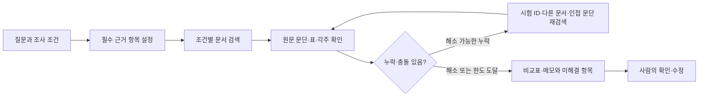

# 바이오시밀러 실무 조사와 PoC 방향 검토

작성·조회 기준: 2026-10-04 KST. 이 문서는 공개 자료와 현재 프로젝트를 대조한 조사·권장안이다. 현업 인터뷰, 상용 제품 직접 사용 비교, 시간 절감 실험은 이번 조사에서 수행하지 않았다.

## 1. 판단과 권장 방향

**프로젝트가 겨냥하는 업무는 실제 존재하며, 바이오시밀러를 첫 도메인으로 정한 선택도 합리적이다. 지금 가장 설득력 있는 제품 범위는 ‘바이오시밀러 개발팀의 선행 심사근거 조사와 검토 메모 작성 지원’이다.**

RA·규제 전략을 주 사용자로 두고, 임상개발·CMC 담당자가 같은 근거를 함께 검토하도록 구성하는 것을 권한다. 네 직무의 전체 업무를 한 번에 지원하기보다, 특정 개발 쟁점에 대해 ‘선례를 찾고 → 조건과 심사 경위를 비교하고 → 팀이 검토할 문서를 만든다’는 하나의 작업을 완성해야 한다.

| 판단 | 근거 수준 |
|---|---|
| 규제정보 조사, 선례 검토, 기관 미팅 준비, 보완답변과 부서 간 협업이 실제 업무인가 | 공식 직무 설명과 규제기관 지침으로 확인 |
| 공개 심사자료에 비교·검토할 만한 쟁점이 있는가 | SB17·ABP 654 등의 실제 보고서와 로컬 수집 자료에서 확인 |
| 검색·근거 연결·검토문서 작성이 이 팀의 큰 병목인가 | 유사 문제 사례는 있으나 대상 팀의 빈도·시간은 미검증 |
| 현재 구현이 검수 포함 시간을 줄이는가 | 미검증. 현재 측정은 검색 페이지 적중 중심 |
| Agentic RAG가 일반 RAG보다 나은가 | 미검증. 적응적 검색의 기여를 분리 평가해야 함 |
| 상용 솔루션과 차별화되거나 반복 구매할 이유가 있는가 | 미검증. 기능 설명과 실제 업무 채택은 별개 |

업무 존재를 확인한 핵심 근거는 [Amgen의 바이오시밀러 RA 공고](https://careers.amgen.com/en/job/uxbridge/eu-regulatory-affairs-manager-biosimilars/87/99705722976), [삼성바이오에피스 공식 직무 설명](https://www.samsungbioepis.com/en/careers/careers02.do), [FDA 바이오시밀러 미팅 지침](https://www.fda.gov/media/113913/download)이다. 공고는 업무 범위를 보여주며 제품 구매 의향을 보여주지는 않는다.

## 2. 노션 기획과 로컬 구현의 관계

두 노션 페이지를 모두 읽었다.

- [RA 근거 조사·미팅 준비 기획안 v2](https://app.notion.com/p/3edfaffe4cea81edaa80c4a487de66df): 규제 쟁점 조사에서 미국 FDA 미팅 질문 준비까지 연결하는 목표를 제안한다.
- [방향 재정리·MVP 범위·검증 기준](https://app.notion.com/p/3edfaffe4cea81759fe4c64298bbe8a3): EMA의 PK·면역원성 조사, 비교표와 짧은 검토 메모를 우선한다.

후자의 좁은 범위를 첫 완료 단계로, 전자의 미팅 지원을 다음 완료 단계로 연결하면 방향이 일관된다. 초기 EMA 선례는 EU 심사에서 관찰한 사실이며, FDA 기준을 설명하려면 미국 공식 근거를 별도로 연결해야 한다.

| 로컬 상태 | 이번 검토에서의 해석 |
|---|---|
| 우스테키누맙 3개 개발 제품: SB17, ABP 654, CT-P43 | 동일 성분의 시험·심사 조건을 비교하기 좋은 첫 범위 |
| 총 77개 문서, PDF 4,090페이지와 웹 92섹션 | 공개 근거 확보 가능성은 확인. 문서 수가 업무 효과를 뜻하지 않음 |
| 영어 69개 문서, 7,359개 검색 청크 | 검색 기반은 마련되어 있음. PMDA 일본어는 RAG 범위에서 제외 |
| 수집·원본 해시·파싱·OCR·페이지검색·질의 번역 구현 | 근거 보존과 조사 기반이 현재 강점 |
| RAG 답변·에이전트·사용자 화면·질문 조건 추출 미구현 | 검토 가능한 업무 산출물은 아직 완성되지 않음 |
| 정답셋 147행 모두 AI 초안이며 사람 라벨·전문가 검수는 없음 | 전문가 검수나 독립 정답 검증을 완료했다고 표현할 수 없음 |
| BM25 37/54, 하이브리드 38/54 | 정답 근거 페이지가 상위 5페이지에 포함된 질의 수. 답변 정확도·현업 절감률이 아님 |

근거: [README](C:/Users/Admin/Documents/biosimilar_collection/README.md:28), [검색 비교 결과](C:/Users/Admin/Documents/biosimilar_collection/docs/rag/RAG_POC_RESULTS.md:22), [후속 계획의 실제 데이터 문제](C:/Users/Admin/Documents/biosimilar_collection/docs/temp/project/BIOSIMILAR_PROJECT_NEXT_STEPS.md:45).

검색 평가는 정답 제품 필터를 제공한 상태에서 수행했고, 질문도 정답셋에서 만들었다. 한편 같은 사실이 다른 문서에 있으면 허용 페이지 목록 밖이라는 이유로 오답 처리할 수 있다. 따라서 성능을 과대평가하는 조건과 유효한 근거를 과소평가하는 조건이 함께 있다. 이미 수행한 평가의 의미를 정확히 제한하는 것이 포트폴리오 신뢰도를 높인다.

README 서두의 임베딩 미구현 표현, 오래된 후속 계획의 프로토콜 점검 범위 등에는 현재 상태와 다른 내용이 남아 있다. 발표 전에는 완료·미완료·후속 제안을 한 곳에서 일치시키는 것이 좋다. 이번 조사에서는 기존 기획이나 코드를 수정하지 않았다.

## 3. 실제 일은 어떤 순서로 진행되는가

아래는 공식 역할 설명, 미팅 지침과 심사 사례를 결합한 실무 흐름의 재구성이다. 모든 회사가 동일한 절차나 양식을 사용한다는 의미는 아니다.

| 업무가 시작되는 계기 | 담당자가 하는 작업 | 실제 검토 산출물의 형태 | 현재 PoC와의 연결 |
|---|---|---|---|
| 새로운 개발계획 또는 목표 시장 검토 | 목표 기관, 대조약 출처, 제형·경로, 보유 자료와 적용 지침 확인 | 개발·규제 전략 메모, 자료 차이 목록 | 프로젝트 조건 입력과 조사 범위 설정 |
| 특정 PK·면역원성·외삽 쟁점 발생 | 유사 제품의 보고서·시험자료·심사 논리 조사 | 조건 비교표, 승인 선례 메모 | 가장 직접적인 첫 사용 업무 |
| RA·임상·CMC 내부 검토 | 관찰된 차이, 신청자 설명, 기관 판단과 자사 조건 대조 | 쟁점별 검토 메모, 추가 데이터 요청 | 각 팀이 같은 출처를 검토하게 함 |
| Scientific Advice 또는 FDA 미팅 준비 | 질문을 좁히고 배경·자료·회사 입장 정리 | 질문 목록, briefing material/meeting package | 공개 선례 메모를 질문 초안에 연결 |
| 심사 중 보완요청 | 질의를 제출자료·추가 분석·담당 부서와 연결 | 질의별 답변표와 response dossier | 내부 질의서·제출자료 확보 후 후보 |
| 허가·개발 중 변경 | 최신 지침, 라벨·공정·자료 변경의 영향과 후속 조치 검토 | 영향평가, 변경·허가사항 기록 | 후속 기능. 초기에는 문서쌍 한 개만 평가 |
| 제출자료 확정·출판 | 문서 검토·승인, 제출 구성, eCTD 기술 검증 | 최종 제출자료와 출판 기록 | 기존 RIM·publishing 시스템과 연결되는 후속 단계 |

Amgen의 2026-08-31 게시 공고에는 규제 전략·기관 대응과 브리핑, 정책·경쟁정보의 영향 검토, CMC·임상·품질 협업이 명시되어 있다. 삼성바이오에피스는 RA·임상 PM·분석·공정개발을 서로 다른 직무로 설명한다. 따라서 ‘한 챗봇이 네 직무를 대신한다’보다 ‘RA가 모은 근거를 관련 팀이 검토한다’는 구성이 더 적절하다. [Amgen](https://careers.amgen.com/en/job/uxbridge/eu-regulatory-affairs-manager-biosimilars/87/99705722976), [삼성바이오에피스](https://www.samsungbioepis.com/en/careers/careers02.do)

FDA 2025-07 최종 미팅 지침 VIII.C는 질문의 배경과 지원 자료를 분야·질문별로 정리하도록 권고한다. 이것이 ‘질문–배경–근거–부족한 자료’ 형태의 산출물을 제안하는 근거다. 완성된 공식 패키지에는 프로젝트의 비공개 데이터가 추가로 필요하다. [FDA 지침](https://www.fda.gov/media/113913/download)

## 4. 페인포인트와 해결 가능한 범위

| 문제 | 확인된 근거 또는 가설 | PoC가 줄일 수 있는 작업 | 해결되지 않는 부분 |
|---|---|---|---|
| 같은 제품의 개발코드·지역 브랜드·신청·시험이 흩어짐 | 로컬 제품·문서 카탈로그에서 확인 | 제품·국가·시험·문서 위치를 연결해 근거 재탐색 | 공식 근거가 없는 매핑을 자동 확정할 수 없음 |
| 표·각주·본문의 조건을 읽어야 함 | Wezenla 이미지 PK 표, SB17 N/n, CT-P43 병합 셀·복수 분석에서 확인 | 값에 시험·비교군·단위·집단·시점과 위치를 함께 붙임 | OCR 숫자 일치가 표 관계 정확성을 보장하지 않음 |
| 초기 심사 지적과 최종 수용이 함께 기재됨 | SB17 SC→IV 외삽 사례에서 확인 | 쟁점→추가 근거→기관 최종 판단을 함께 회수 | 보완 이력이 공개되지 않은 경우 전체 경위를 복원 못함 |
| 과거 개발 관행과 현재 규제상태가 섞임 | 2024 승인 사례와 2025~26 지침 변화에서 확인 | 관할·기준일·초안/채택·대체/철회 상태를 표시 | 현재 회사 후보의 시험 필요성은 내부 자료 대조 필요 |
| 작성 후 검수에서 다시 원문을 찾아야 함 | 검수 부담이 줄 것이라는 가설 | 비교 셀·주장 옆에서 정확한 페이지·근거 확인, 수정·내보내기 | 실제 절감 여부는 사람의 검토 시간을 측정해야 함 |
| CMC 내부 실험자료가 분산됨 | Gilead 대분자 공정개발 고객 사례 | 후속 내부문서 연결의 필요성 탐색 | 현재 공개 PDF 코퍼스로 배치·시험법·원자료 분석을 수행 못함 |
| 제출 직전에 오류·재작업이 몰림 | Alvotech 제출·출판 고객 사례 | 조사 메모의 인계 품질을 평가할 수 있음 | eCTD 출판·기술검증 문제를 현재 RAG가 직접 해결하지 않음 |

마지막 두 사례는 실제 회사의 경험을 공급사가 공개한 자료다. 우리 도구의 효용 실험 결과는 아니다. [Gilead 공정개발 사례](https://www.benchling.com/customer-stories/gilead-partnering-with-benchling-to-improve-large-molecule-bioprocess), [Alvotech 제출·출판 사례](https://www.veeva.com/eu/customer-stories/alvotech-increases-submissions-efficiency-with-continuous-publishing/)

## 5. 현업의 작업 도구와 제품의 위치

‘보통 쓰는 도구’는 아래와 같은 범주로 이해하는 것이 정확하다. 제품명은 공식 기능과 공개 사용 사례를 확인한 예시이며, 국내 회사별 보급률이나 시장점유율은 조사하지 않았다.

| 도구 범주·예시 | 담당하는 업무 | 공개 사용 증거·출처 | PoC와의 관계 |
|---|---|---|---|
| Word·Excel·PowerPoint·PDF, SharePoint/Teams | 문서 작성·표·회의자료·검토·공유 | [Veeva Word 작성 설명](https://regulatory.veevavault.help/en/gr/55400/), [AstraZeneca CTMS·SharePoint 직무 공고](https://astrazeneca.wd3.myworkdayjobs.com/en-US/Careers/job/Clinical-Study-Administrator---HCM_R-254666-1) | 근거표·메모를 가져가 수정할 수 있는 출력 경로가 중요 |
| Clarivate Cortellis, IQVIA Regulatory Intelligence | 국가별 규제정보·변경 알림·해석 자료 | [Cortellis 공식 기능·고객 추천](https://clarivate.com/life-sciences-healthcare/lp/cortellis-regulatory-intelligence-solutions/), [IQVIA 기능](https://www.iqvia.com/solutions/safety-regulatory-compliance/regulatory-compliance) | 직접적인 외부 정보조사 경쟁·보완 도구 |
| Citeline Trialtrove·Sitetrove·Pharmaprojects | 임상·경쟁 개발정보, 프로토콜·시험기관 조사 | [Citeline 임상 계획 기능](https://www.citeline.com/en/solutions/clinical/clinical-planning-and-protocol-optimization) | 공개 등록정보 이상의 큐레이션을 제공. 동일 정보 범위를 확보했다고 주장할 수 없음 |
| Veeva RIM, LORENZ docuBridge/eValidator, Ennov Dossier | 허가·제출문서 관리, eCTD 조립·출판·기술검증 | [Alvotech RIM 사례](https://www.veeva.com/eu/customer-stories/alvotech-increases-submissions-efficiency-with-continuous-publishing/), [LORENZ](https://www.lorenz.cc/Solutions/), [Ennov](https://en.ennov.com/solutions/regulatory/dossier/) | 조사 결과를 공식 문서로 가져가는 후속 업무 환경 |
| EDC·CTMS·eTMF | 환자/시험 데이터, 시험·사이트 운영, 필수 문서 | [셀트리온 eTMF 도입 발표·2019](https://ir.veeva.com/news/news-details/2019/Celltrion-Adopts-Veeva-Vault-eTMF-for-Greater-Visibility-into-Trial-Activities/default.aspx), [Alvotech eTMF 운영](https://www.veeva.com/eu/customer-stories/alvotech-fast-tracks-collaboration-and-compliance/) | 임상 근거 조사와 실제 시험 운영은 구분해야 함 |
| Benchling 등 ELN, LabWare 등 LIMS | 실험 기록·샘플·시험·결과·규격·안정성·COA | [Gilead 공정개발](https://www.benchling.com/customer-stories/gilead-partnering-with-benchling-to-improve-large-molecule-bioprocess), [LabWare 제약 기능](https://www.labware.com/industries/pharmaceutical) | CMC 후속 확장의 입력 자료가 있는 환경 |
| Veeva QMS 등 품질 시스템 | 일탈·CAPA·변경관리·품질 승인과 기록 | [Alvotech QMS 선택 발표·2019](https://ir.veeva.com/news/news-details/2019/Alvotech-Selects-Veeva-Vault-QMS-to-Modernize-Quality-Processes/default.aspx) | 공개 근거 RAG와 품질 운영의 업무 경계 확인 |

2019 도입 발표는 당시 사용의 증거이며 현재 계약·구성 전체의 확인은 아니다. Alvotech의 사례는 실제 문서 확정 후 출판 담당자에게 전달하는 순차 흐름에서 뒤늦은 오류·재작업이 있었다고 설명한다. 공급사 사례의 효율 개선 수치를 이 프로젝트의 예상 절감률로 가져오면 안 된다.

경쟁 AI도 이미 있다. Clarivate는 출처가 있는 질의응답·요약·초안/최종 지침 비교를, Certara CoAuthor는 Word 안에서 RAG 기반 참조·일관성·추적성을 설명한다. 이는 공급사 설명이며 직접 성능 비교 결과가 아니다. **‘AI·RAG·인용을 제공한다’만으로 차별화는 성립하지 않는다.** [Cortellis Regulatory AI Assistant](https://clarivate.com/news/clarivate-presents-cortellis-regulatory-ai-assistant/), [CoAuthor](https://www.certara.com/coauthor/)

선택받을 이유는 특정 쟁점에서 시험·조건·심사 경위를 덜 혼동하고, 사용자 양식으로 정리하며, 검토 완료 시간을 줄이는지에서 검증해야 한다. 초기에는 외부 시스템 실제 연동보다 Word/Excel로 옮길 수 있는 출력 구조를 먼저 완성하는 것을 권한다.

## 6. 바이오시밀러를 ‘조금 단순한 분야’로 고른 판단

**질문 범위를 제한하기 좋은 도메인이라는 설명은 타당하지만, RA·CMC 업무 자체가 쉽다는 설명은 피하는 것이 좋다.** 알려진 대조약과 유사성을 입증하는 구조 덕분에 성분·시험·평가변수의 비교 틀을 고정하기 쉽다. 반면 제조공정, 품질속성, 기능적 유사성, 면역원성, 대조약 브리징과 제형·경로의 논리는 여전히 복잡하다.

Pfizer의 2021 연구는 8개 바이오시밀러의 21개 신청에서 받은 2,438개 규제기관 질의를 분석했다. 주 분류에서 CMC 비중은 FDA 83%, EMA 66%였다. 저자들은 질문 수를 심사 관심영역의 대리지표로 사용했으며 중요도·응답 복잡성을 가중하지 못했다고 설명한다. 단일 회사의 2017~2020 승인 포트폴리오이므로 이를 현재 모든 회사의 업무시간 비율로 해석하면 안 된다. [연구 원문](https://pmc.ncbi.nlm.nih.gov/articles/PMC8067310/)

최근 변화도 첫 데모의 맥락에 포함할 가치가 있다.

| 문서 | 2026-10-04 조회에서 확인한 상태 | 프로젝트에서의 의미 |
|---|---|---|
| EMA tailored clinical approach reflection paper | 채택본(Adopted), 2026-03-27 최초 공개 | 적절한 분석적·기능적 특성화 등을 전제로 임상 요구를 간소화하는 방향. 과거 3상 수행을 현재의 필수요건으로 바꾸지 않음 |
| FDA CES updated recommendations | 2025-10 Draft, Not for implementation | 비교 유효성시험 필요성 검토의 초안. 최종 확정 기준으로 답하지 않음 |
| FDA Q&A Revision 4 | 2026-03 Draft, Not for implementation | 비미국 대조약 자료와 PK 브리징 관련 제안을 확정 면제로 바꾸지 않음 |
| FDA comparative analytical assessment/quality guidance | 2025-09 Final | 임상 간소화와 별개로 비교 분석·CMC 근거가 중요 |
| MFDS 비교 유효성 임상시험 수행 결정 안내서 | 2026-03-27 안내서-1498-01, 최종본 게시 | 국내 적용은 한국 문서의 품질·임상 고려 요소를 별도로 확인 |

근거: [EMA 현재 버전](https://www.ema.europa.eu/en/scientific-guidelines/reflection-paper-tailored-clinical-approach-biosimilar-development), [FDA CES 초안](https://www.fda.gov/regulatory-information/search-fda-guidance-documents/scientific-considerations-demonstrating-biosimilarity-reference-product-updated-recommendations), [FDA Q&A Rev4](https://www.fda.gov/regulatory-information/search-fda-guidance-documents/new-and-revised-draft-qas-biosimilar-development-and-bpci-act-revision-4), [FDA 품질 최종 지침](https://www.fda.gov/regulatory-information/search-fda-guidance-documents/development-therapeutic-protein-biosimilars-comparative-analytical-assessment-and-other-quality), [MFDS 안내서](https://www.mfds.go.kr/brd/m_1060/view.do?seq=15836).

기관별 문서의 성격과 적용 조건이 다르므로 ‘3상이 모두 없어졌다’는 결론은 부적절하다. 최종 가이던스·채택 문서라는 상태도 곧 모든 내용이 법적 의무라는 뜻은 아니다. PK·면역원성 선례는 계속 유용하지만, 과거 수행한 시험 목록을 그대로 복제하는 서비스로 설명하면 최신 실무와 맞지 않는다.

## 7. 실제 원문에서 확인한 좋은 PoC 사례

### 사례 A — SB17: 처음의 자료 부족과 나중의 해소를 함께 읽기

[Pyzchiva EMA 평가보고서](https://www.ema.europa.eu/en/documents/assessment-report/pyzchiva-epar-public-assessment-report_en.pdf), EMA/106045/2024, PDF·인쇄 61페이지를 로컬 보존 원문 텍스트와 대조했다.

피하(SC) PK 자료를 정맥(IV) 제형으로 외삽하는 쟁점에서, 최초 제출에는 partial AUC 자료가 없어 당시 비교·외삽을 확립하지 못했다고 기재한다. 이어 CHMP 요청에 대한 여러 시점의 partial AUC 분석과 정당화를 통해 결과의 강건성을 설명하고 외삽을 뒷받침했다고 서술한다.

평가 질문: **‘SB17에서는 SC 자료의 IV 외삽을 어떤 근거로 검토하고 해소했는가?’**

좋은 답변은 초기 쟁점, 후속 분석, 기관의 최종 평가를 모두 회수한다. 첫 지적만 보고 최종 실패라고 답하거나, 승인 사실만 보고 어떤 추가 근거도 필요 없었다고 답하면 틀린다. 추가 검색·주변 문단 확인의 효용을 검증하기 좋은 사례다. 이 사례가 새 후보의 IV 시험 생략을 자동으로 정당화하지는 않는다.

### 사례 B — ABP 654: 낮게 보고된 ADA와 품질·임상 논리 연결

[Wezenla EMA 평가보고서](https://www.ema.europa.eu/en/documents/assessment-report/wezenla-epar-public-assessment-report_en.pdf), EMA/228742/2024, PDF·인쇄 113~114페이지를 로컬 보존 원문 텍스트에서 확인했다. 온라인 PDF 재조회는 429 제한이 있었고, 공식 검색 색인과 로컬 카탈로그의 원본 URL·해시를 함께 사용했다.

보고서는 ABP 654의 ADA 발생이 대조약보다 낮게 관찰되었다는 내용, ADA 하위집단의 PK·효능·안전성 검토와 기관의 임상적 의미 평가를 함께 다룬다. 인접한 품질 논의에서는 당쇄·전하 변이·수용체 결합 차이와 기능적 의미의 정당화도 설명한다.

평가 질문: **‘ADA 결과 차이를 어떤 조건과 추가 분석에 비춰 평가했는가?’**

좋은 산출물은 PK 시험과 환자 임상시험을 구분하고, 품질 차이의 설명과 기관 판단의 위치를 연결한다. 서로 다른 제품의 ADA 숫자만 나열해 가장 좋은 제품 순위를 만들지 않는다. 이것은 임상·CMC 협업 검토에 연결되는 사례이며, 현재 PK 중심 정답셋만으로 해당 해석 정확도를 검증한 것은 아니다.

## 8. 추천 PoC: 한 번의 조사로 검토 가능한 메모 만들기

제품 설명 제안:

> 바이오시밀러 개발 쟁점에 대해 공개 규제 문서와 승인 선례를 조사하고, 시험 조건·심사 경위·자료 공백을 출처와 함께 정리해 RA와 임상·CMC 담당자의 검토 메모 작성을 지원하는 Agentic RAG.

| 항목 | 첫 완료 단계의 제안 |
|---|---|
| 주 사용자 | RA·규제 전략 담당자. 임상개발 담당자가 공동 검토 |
| 쟁점 | 우스테키누맙 3개 제품의 PK·면역원성 선례 및 공개된 심사 쟁점 |
| 기본 자료 | 지정 버전의 EMA 평가보고서. 보유 프로토콜·SAP는 해당 시험의 조건 확인에 필요한 때 활용. 현재 확보본은 3상이며 1상 PK 설계의 정답이나 필수요건으로 사용하지 않음 |
| 입력 | 쟁점, 대상 제품, 기관, 조사 기준일. 질문의 EU/US 대조약과 문서 관할을 구분 |
| 출력 | 조건 비교표 + 1~2페이지 검토 메모 + 미확인 항목 + 주장별 원문 위치 |
| 사용자 동작 | 근거 확인, 필드 수정·확인 표시, 표·메모 내보내기 |
| CMC 범위 | 보고서에 공개된 분석적 차이와 기관 평가의 근거 조사. 자사 배치·시험법 분석은 후속 |
| 다음 완료 단계 | FDA 공식 근거를 별도 연결한 미팅 질문·배경 초안 |

아래 여섯 항목을 결과물에 고정하는 것을 권한다.

1. 질문·조사 범위·프로젝트에서 제공한 사실과 가정.
2. 제품별 시험·비교군·집단·시점·평가변수·단위의 비교표.
3. 실제 심사 쟁점, 신청자의 설명, 기관 평가의 구분.
4. 관찰된 선례를 현재 프로젝트에 적용할 때 확인해야 할 차이.
5. 비공개·검색 미발견·파싱 실패·검토 대기·해당 없음의 구분.
6. 각 주장·표 셀의 출처·문서 버전·페이지와 사람이 수정한 기록.

수치가 잘 검토된 구조화 기록에 있으면 그 기록을 조회하고, 심사 맥락은 문서 검색으로 보완하는 방식이 적절하다. 검토된 수치를 LLM이 매번 다시 계산·해석하게 할 필요는 없다. 자동 추출 후보를 쓸 경우 검토 전 상태가 결과에 남아야 한다.

화면은 질문/조사 조건, 비교표·메모, 원문 위치를 나란히 확인하는 정도로 시작할 수 있다. 기술 실행 로그는 평가에 남기고, 사용자가 원문을 확인하고 문서를 완성하는 동작을 우선한다.

## 9. 에이전트는 어디에서 가치를 만들어야 하는가

에이전트·RAG라는 프로젝트 중심은 유지하되, 하나의 상태를 관리하는 조사 흐름으로 시작하는 것을 권한다.

추가 검색의 이유가 실제 근거에 대응해야 한다. 예를 들어 분석집단이 없으면 표 각주를, 초기 심사 지적만 있으면 후속 답변·최종 평가를 찾는다. 공개 문서의 가림을 발견하면 반복 검색으로 숫자를 만들어 채우지 않는다. 쟁점별 추가 탐색 한도와 종료 사유를 기록한다.

일반 RAG 기준선은 기존 BM25·용어집 번역·명시적 조건 선택을 충분히 사용하도록 구성한다. 같은 모델·파서·자료·출력 형식·호출 예산에서 적응적 검색을 켜고 끄는 비교가 필요하다. 검색 횟수 증가가 만든 효과와 쟁점 분해·도구 선택의 효과도 구분한다.

현재 자료에서는 임베딩 모델 추가 비교보다 검토 메모의 정확도와 원문 확인 흐름을 먼저 완성하는 편이 투자 가치가 크다. 기존 문서에서 제품 필터 자동 추출은 보류된 상태이므로 이번 보고서는 변경 제안만 한다. PoC 입력 폼으로 제품·관할을 명시해도 된다. [보류와 필터 시험](C:/Users/Admin/Documents/biosimilar_collection/docs/temp/research/IDMP_ONTOLOGY_REVIEW.md:133)

## 10. 무엇을 측정하면 실제 솔루션 의미가 생기는가

초기 평가 구성 제안은 사실·조건 조회 4개, 심사 쟁점과 해소 경위 4개, 비교 제한·자료 부족 2개, 문서 상태·관할 2개 등 12개 질문이다. 수량은 인력·자료 확인 후 확정하며, 기존 개발 질문과 최종 평가 질문을 분리한다.

| 평가 단위 | 측정할 것 | 해석의 경계 |
|---|---|---|
| 검색 | 독립 검토한 필수 근거가 회수되었는가 | 페이지 적중과 답변 정확도 분리 |
| 수치·조건 | 값·단위·시험·비교군·분모·시점의 정확한 연결 | OCR 숫자 인식률과 관계 정확도 분리 |
| 심사 논리 | 초기 우려·신청자 설명·최종 판단 누락·혼동 | 출처가 있어도 주장 전체를 지지하는지 확인 |
| 상태·관할 | 과거 선례·현재 지침·초안·채택본 구분 | EU 대조약을 EU 문서 관할로 오인하지 않음 |
| 부족한 근거 | 비공개/미발견을 올바르게 보고하는가 | 빈칸을 답변으로 채우지 않음 |
| 에이전트 기여 | 추가 탐색으로 회수한 근거와 줄어든 오류 | 호출 비용·지연·실패도 함께 보고 |
| 업무 효과 | 검색부터 검토·수정 완료까지 총시간, 수정량, 채택 여부 | 초안 생성 시간만으로 절감률을 계산하지 않음 |
| 확장 비용 | 새 제품의 발견·연결·파싱·사람 보정 시간 | 평가 정답 작성 비용과 운영 수집 비용 분리 |

사람이 할 실제 과제는 ‘해당 쟁점의 비교표와 한 장 메모를 작성해 내부 검토에 쓸 상태로 만들기’처럼 완결된 산출물로 정의한다. 수작업, 일반 RAG, Agentic RAG에 같은 원문·조건·양식을 제공하고 수행 순서와 학습효과를 통제한다. 원문 대조 정답은 AI 초안에서 독립적으로 검수한다. 전문가가 없으면 규제 적용·질문 적절성은 미검증으로 보고한다.

통과 기준은 기준선 실험 전에 정한다. 새 제품·다른 시험·관할 혼입, 초안의 최종 오인, 근거 없는 면제 단정 등 치명적 오류가 평가 세트에서 없어야 한다는 기준을 제안한다. 이것은 PoC의 권장 품질 기준이며 실제 서비스의 완전성 보장이 아니다. 소수 과제에서 얻은 시간 차이는 사례 결과로 보고하고 산업 전체 절감률로 일반화하지 않는다.

현재 수집한 3개 제품만으로 완료한 결과물을 먼저 보여준 뒤, 별도 제품 하나에서 확장 비용을 측정하는 순서가 좋다. 처음 개발되는 성분은 같은 성분의 승인 선례가 부족할 수 있으므로 문서가 많은 우스테키누맙에서의 성공이 모든 개발 단계에 그대로 적용되지는 않는다.

## 11. 현직자에게 확인할 질문

RA/규제 전략 1명, 임상개발 1명, CMC·분석 담당 1명처럼 역할을 나눠 최근 실제 작업 한 건을 따라가는 소규모 검증을 제안한다. 이는 일정·인원이 확정된 계획이 아니다.

- 마지막으로 선행제품이나 국가별 기준을 조사한 계기와 실제 질문은 무엇이었는가?
- 어떤 공식 PDF·유료 DB·사내 자료를 열었고 최종 산출물은 어떤 양식이었는가?
- 검색, 조건 정리, 내부자료 확인, 작성, 원문 검수 중 어느 단계가 오래 걸렸는가?
- 동일 쟁점은 얼마나 자주 생기고 기존 표·메모를 얼마나 재사용하는가?
- Cortellis·Citeline 등 구독이 있어도 남는 수작업은 무엇인가?
- 공개 선례만으로 쓸 수 있는 결과물과 내부 데이터가 꼭 필요한 결과물은 무엇인가?
- 이 결과물을 실제 검토에 쓰려면 어떤 수정이 필요한가? 어떤 오류면 폐기하는가?
- 비용을 부담하거나 도입을 결정하는 팀은 어디이고 기존 업무 환경에 어떤 인계가 필요한가?

민감한 원자료를 요구하기보다 익명화한 질문과 빈 양식으로도 작업을 검증할 수 있다. ‘AI가 있으면 좋겠는가’라는 호감 질문보다 실제 산출물 채택과 수정 부담이 더 유효한 근거다.

## 12. 포트폴리오에서 보여줄 이야기와 다음 작업

추천 발표 논리:

1. 공식 직무·지침·심사보고서로 업무가 실제 존재함을 설명한다.
2. 이미지 표, 복수 PK 분석, 심사 초기/최종 판단 혼동 같은 구체적 문제를 원문으로 보여준다.
3. 질문에서 조건 비교표·검토 메모·원문 확인까지 한 업무를 시연한다.
4. 추가 검색이 누락을 해결한 사례와 공개자료 부족으로 종료한 사례를 함께 보여준다.
5. 강한 일반 RAG 기준선 대비 정확도·검수 포함 시간·비용을 보고한다.
6. 내부자료·CMC·실제 현업 채택에서 남은 검증을 명시한다.

현재 말할 수 있는 성과는 공개자료 수집·보존·검색 기반과 제한된 검색 비교다. ‘상용 솔루션보다 우수’, ‘RA 업무 자동화 완료’, ‘시간을 일정 비율 절감’, ‘CMC 분석 지원 검증’은 아직 성과로 말할 수 없다.

다음 작업 우선순위 제안:

| 순서 | 작업 | 완료 기준 |
|---|---|---|
| 1 | EMA PK·면역원성 선례 조사 한 업무와 메모 양식 확정 | 실제 근거가 있는 대표 질문 3개와 완성 샘플 1개 |
| 2 | 중요한 수치·조건·심사 경위의 독립 검수 | 시험·분모·단위·인용이 연결된 평가 근거 |
| 3 | 일반 RAG 답변과 원문 확인 화면 완성 | 비교표·메모·자료 공백을 검토·수정할 수 있음 |
| 4 | 누락·충돌에 따른 제한된 추가 탐색 구현 | 무엇을 추가로 찾았고 어떤 오류를 줄였는지 로그·결과로 확인 |
| 5 | 수작업/일반 RAG/Agentic RAG의 같은 과제 비교 | 검수 포함 시간·수정량·주장 근거·비용 보고 |
| 6 | FDA 근거 연결 및 미팅 질문 초안, 별도 제품 검증 | 관할·현재 문서 상태를 보존하고 추가 수작업 비용 기록 |

**권장 투자 방향은 자료·모델 종류를 계속 늘리는 것보다, 이미 확보한 근거로 실무 검토 문서 한 건을 완성하고 평가하는 것이다.** 솔루션으로서의 의미는 이 결과물을 실제 담당자가 사용할 수 있을 때 생긴다. 포트폴리오에서도 같은 지점이 설득력을 만든다.

## 13. 주요 출처와 확인 범위

아래 외부 자료는 2026-10-04 조회 기준이다. 노션·로컬 문서는 프로젝트의 기획·상태 증거이며, 외부 현업 수요의 증거로 사용하지 않았다.

| 출처 | 날짜·확인 범위 | 증거 성격 |
|---|---|---|
| [Amgen Biosimilars RA 공고](https://careers.amgen.com/en/job/uxbridge/eu-regulatory-affairs-manager-biosimilars/87/99705722976) | 2026-08-31, R-252420 본문 | 실제 직무 설명 |
| [삼성바이오에피스 직무 설명](https://www.samsungbioepis.com/en/careers/careers02.do) | 게시일 미표시, 직무별 설명 | 실제 조직·업무 범위 |
| [FDA BsUFA 미팅](https://www.fda.gov/media/113913/download) | 2025-07 최종, VIII.C | 공식 권고·산출물 맥락 |
| [Pfizer 질의 분석](https://pmc.ncbi.nlm.nih.gov/articles/PMC8067310/) | 2021 연구, 2017~2020 신청 자료 | 실무 자료 기반 연구, 단일 포트폴리오 |
| [Pyzchiva EPAR](https://www.ema.europa.eu/en/documents/assessment-report/pyzchiva-epar-public-assessment-report_en.pdf) | 2024, p61 로컬 보존본 대조 | 실제 공개 심사 논리 |
| [Wezenla EPAR](https://www.ema.europa.eu/en/documents/assessment-report/wezenla-epar-public-assessment-report_en.pdf) | 2024, p113~114 로컬 보존본 대조; 온라인 재조회 제한 | 실제 공개 심사 논리 |
| [EMA tailored clinical approach](https://www.ema.europa.eu/en/scientific-guidelines/reflection-paper-tailored-clinical-approach-biosimilar-development) | 2026-03-27 공개 채택본 | 공식 문서 상태·임상 접근 |
| [FDA CES](https://www.fda.gov/regulatory-information/search-fda-guidance-documents/scientific-considerations-demonstrating-biosimilarity-reference-product-updated-recommendations) | 2025-10 초안 | 공식 문서 상태 |
| [FDA Q&A Rev4](https://www.fda.gov/regulatory-information/search-fda-guidance-documents/new-and-revised-draft-qas-biosimilar-development-and-bpci-act-revision-4) | 2026-03 초안 | 공식 문서 상태 |
| [FDA 비교 분석·품질](https://www.fda.gov/regulatory-information/search-fda-guidance-documents/development-therapeutic-protein-biosimilars-comparative-analytical-assessment-and-other-quality) | 2025-09 최종 | 공식 품질 권고 |
| [MFDS CES 고려 사항](https://www.mfds.go.kr/brd/m_1060/view.do?seq=15836) | 2026-03-27, 안내서-1498-01 게시 페이지·최종본 표기 | 국내 문서 존재·주제·상태 확인. 세부 조항 적용 판단은 하지 않음 |
| [Alvotech 제출·출판](https://www.veeva.com/eu/customer-stories/alvotech-increases-submissions-efficiency-with-continuous-publishing/) | 2022 RIM·2024 Publishing 도입 이력 | 공급사가 공개한 실제 고객사 경험 |
| [Celltrion eTMF](https://ir.veeva.com/news/news-details/2019/Celltrion-Adopts-Veeva-Vault-eTMF-for-Greater-Visibility-into-Trial-Activities/default.aspx) | 2019 발표 | 당시 도입 증거 |
| [Gilead 공정개발](https://www.benchling.com/customer-stories/gilead-partnering-with-benchling-to-improve-large-molecule-bioprocess) | 게시일 미표시 | 공급사 고객 경험, 바이오시밀러 전용 사례 아님 |
| [Cortellis AI](https://clarivate.com/news/clarivate-presents-cortellis-regulatory-ai-assistant/) · [CoAuthor](https://www.certara.com/coauthor/) | 조회 당시 공식 기능 설명 | 경쟁 기능 주장, 직접 비교 미수행 |

보강 출처는 5절 도구표에 직접 연결했다. 일부 제품 사이트는 직접 열기 제한이 있어 공식 검색 색인을 보조로 사용했다. 상용 도구는 직접 체험하지 않았고 가격·시장점유율·각 회사의 현재 전체 시스템 구성을 확인하지 않았다.
