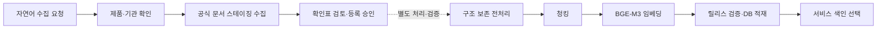
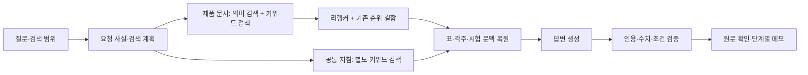

# 프로젝트 발표 내용 선정안

- 작성: 2026-10-16 10:50 KST
- 최종 수정: 2026-10-16 14:36 KST (RA 업무 pain point 구체화, 메인 LLM GPT-5.6 Luna 선정 반영)
- 용도: PPT 제작 전 내용 선정. 12~15분 발표를 가정한 제안이며 실제 슬라이드 파일은 아니다.
- 검토 범위: 기존 Markdown 108개를 목록화하고, 그중 설계·운영·선정·평가 문서 39개에서 주요 내용과 최신 변경 기록을 중심으로 대조했다. 실행·응답 산출물 Markdown 69개는 개별 결과보다 집계 평가 문서를 우선했다.
- 기준: 2026-10-16 로컬 문서와 관련 설정 코드. 실행 중 서버의 현재 상태나 외부 모델 사양을 새로 조회한 결과는 아니다.

## 1. 발표의 중심 메시지

**바이오시밀러 규제 문서의 표·시험 조건·출처를 보존하고, 질문에 필요한 근거를 찾아 검토 가능한 답변과 메모로 연결하는 RAG 시스템을 구축했다.**

제목 제안: **바이오시밀러 규제 문서 기반 근거 추적 RAG 구축**

부제 제안: **문서 수집부터 구조 보존 전처리, 검색·재순위화, 원문 검증까지**

발표는 다음 세 질문에 답하면 된다.

1. RA 담당자는 어떤 조사·비교·검토 업무에서 어려움을 겪는가?
2. 그 문제에 맞춰 각 단계와 모델을 어떻게 구성했는가?
3. 어떤 개선을 확인했고, 무엇을 더 검증해야 하는가?

### RA 업무의 주요 pain point

발표는 RA 담당자가 수행하는 `자료 탐색 → 선례 비교 → 적용 조건 검토 → 내부 공유`에서 시작한다. 아래 항목은 프로젝트 문서와 공개 심사자료 검토에서 정리한 업무 문제다. 현업 인터뷰로 빈도·소요시간을 정량 검증한 결과는 아니다.

| Pain point | 담당자가 겪는 구체적인 어려움 | 프로젝트가 지원하는 부분 |
|---|---|---|
| 자료가 기관·제품별로 분산 | 같은 성분도 개발코드·지역별 브랜드·문서 종류가 달라 필요한 선례를 반복 탐색 | 제품·기관·문서 역할을 연결한 수집과 통합 검색 |
| 비교 조건을 수작업으로 맞춰야 함 | 용량·경로·비교약·대상군·분석집단·시점을 맞춰야 제품 간 결과를 비교할 수 있음 | 시험 범위를 유지한 문맥 공급과 조건별 답변 |
| 심사 경위와 적용 범위 해석 | 신청자의 제안, 추가 자료, 기관 최종 판단이 섞여 있고 과거 선례를 현재 요건에 그대로 적용하기 어려움 | 문서 역할·발언 주체·지침 상태와 미확인 조건 표시 |
| 조사 결과의 검수·재탐색 | 요약이나 숫자를 받아도 검토자가 원문 페이지·표·각주를 다시 찾아 확인해야 함 | 주장별 인용과 원문 영역 바로 보기 |
| 조사 내용을 팀의 검토 기록으로 축적 | 찾은 사실·적용 조건·남은 질문을 개발 단계별로 정리하고 수정 근거를 공유해야 함 | 근거가 연결된 단계별 메모와 수정 이력 |

도입부에 쓸 문장: **“RA 조사에서는 선례를 찾은 뒤에도 비교 조건을 맞추고, 원문을 검수하고, 팀의 검토 기록으로 정리하는 작업이 이어집니다.”**

설명용 업무 예시: “두 제품의 건강인 PK 시험을 비교해 달라”는 요청에는 각 시험의 용량·경로·비교약·대상군·추적 기간을 찾고, 체중·BMI가 선정 기준인지 실제 분포인지 구분한 뒤 각각의 원문을 확인하는 작업이 포함된다.

발표 연결: **RA 업무의 어려움 → 이를 유발하는 문서·데이터 문제 → 해결 워크플로우 → 검토 가능한 산출물** 순서로 전개한다.

근거: [실무 조사와 PoC 방향 검토 §3~4](BIOSIMILAR_WORKFLOW_AND_POC_REVIEW_2026-10-04.md).

### 선정한 메인 LLM

**GPT-5.6 Luna (`gpt-5.6-luna`)를 메인 LLM으로 선정했다.** 질문 해석·조사 계획, 근거 기반 답변 생성, 내부 주장 검토를 담당한다. 발표에서는 이 세 업무를 먼저 설명하고 해당 단계에 선정 모델을 표시한다. 수집 요청 해석에 쓰는 gpt-4o-mini는 별도의 보조 모델로 소개한다.

## 2. 전체 워크플로우: 두 흐름으로 설명

### 자료를 준비하는 흐름

점선 구간은 현재 수집 창에서 전처리·임베딩·서비스 배포까지 자동으로 이어지는 기능이 완성되지 않았다는 뜻이다. 등록 후의 처리 도구와 릴리스 절차는 존재한다.

### 질문에 답하는 흐름

리랭커는 로컬 코드의 최신 기본 설정을 반영했다. 공통 지침까지 모두 같은 임베딩·리랭커 경로를 쓰는 것으로 표현하지 않는다.

## 3. 본 발표 12장 구성

### 01. RA 업무의 pain point — 자료 탐색부터 검수·공유까지

**핵심 메시지:** RA 담당자는 자료 탐색, 비교 조건 정리, 원문 검수와 내부 공유를 이어서 수행해야 한다.

슬라이드 문구:

- 기관·제품·문서별로 흩어진 심사 선례를 반복해서 찾아야 한다.
- 시험별 용량·비교군·대상군을 맞추고 심사 판단의 적용 조건을 해석해야 한다.
- 조사 결과를 검수할 때 원문 페이지·표·각주를 다시 확인해야 한다.
- 확인한 근거와 남은 질문을 팀의 검토 메모로 정리해야 한다.

발표 멘트: “RA 업무에서는 자료를 찾은 뒤에도 조건을 맞춰 비교하고, 원문으로 검수하고, 검토 기록으로 남겨야 합니다. 이 프로젝트는 그 과정에 필요한 근거와 출처를 연결합니다.”

시각자료: `자료 탐색 → 조건 비교·해석 → 원문 검수 → 내부 공유` 4단계에 각각 `자료 분산 / 조건 차이 / 근거 재탐색 / 기록 축적`을 표시한다.

근거: [실무와 PoC 방향 검토](BIOSIMILAR_WORKFLOW_AND_POC_REVIEW_2026-10-04.md).

### 02. 데이터의 어려움 — 숫자만 맞아도 답은 틀릴 수 있다

**핵심 메시지:** 문서의 구조와 귀속 관계가 답변 품질을 좌우한다.

슬라이드 문구:

- PDF 문자층 오류, 스캔, 병합 셀과 연속 표가 섞여 있다.
- 같은 숫자도 시험·군·단위·시점에 따라 뜻이 달라진다.
- 시험 계획, 실제 결과, 기관 판단과 일반 지침을 구분해야 한다.

발표 멘트: “값을 읽는 것뿐 아니라 그 값이 어느 시험의 어떤 조건인지 유지하는 것이 핵심 과제였습니다.”

시각자료: 실제 표 한 개에서 `값 + 군 + 단위 + 각주 + 원문 위치`를 색으로 표시. 검토한 원문 crop을 사용한다.

근거: [전처리 선정](../preprocessing/FINAL_PREPROCESSING_DECISION_2026-10-14.md), [문맥 연결 감사](../rag/CONTEXT_LINK_AUDIT_2026-10-16.md).

### 03. 시스템 전체 구성 — 자료 준비와 질의응답

**핵심 메시지:** 자료를 검색 가능하게 만드는 과정과 질문에 답하는 과정을 나눴다.

슬라이드 문구:

- 자료 준비: 수집 → 전처리 → 청킹 → 임베딩 → 검증·적재.
- 질의응답: 질문 해석 → 검색·리랭킹 → 문맥 구성 → 생성·검증.
- 두 과정에 문서 버전·제품·기관·원문 위치가 이어진다.

발표 멘트: “각 단계가 만든 결과뿐 아니라 그 결과가 어떤 원문에서 왔는지도 다음 단계로 전달합니다.”

시각자료: 위의 두 흐름을 상·하단에 배치. 모델 이름은 각 단계 아래 작게 넣는다.

### 04. 수집·적재 챗봇 — 자연어 요청을 확인 가능한 작업으로

**핵심 메시지:** 모델은 요청을 해석하고, 실제 대상 확인과 실행은 코드가 관리한다.

슬라이드 문구:

- 제품명·성분명으로 요청하고 공식 목록·이름 사전에서 대상을 확인한다.
- 스테이징 수집 결과를 기관별 문서 확인표로 보여준다.
- 사용자가 확인한 자료를 등록하고 작업 상태·이력을 남긴다.

보조 모델 설명: **gpt-4o-mini**는 수집 창에서 자연어를 정해진 요청 형식으로 바꾸는 제한된 작업에 사용한다. 기존 구조화 출력 경로를 재사용하며, 사실 확인과 등록 승인 판단을 모델 밖에 둔다. 메인 RAG의 선정 LLM은 GPT-5.6 Luna다.

발표 멘트: “말로 수집을 요청할 수 있지만, 어떤 제품인지와 어떤 자료를 등록하는지는 확인 가능한 절차로 관리합니다.”

시각자료: `요청 → 대상 선택 → 수집 → 확인표 → 등록` 카드 또는 실제 수집 창.

근거: [적재 에이전트 계획·구현 기록](../collection/INGESTION_AGENT_DB_PLAN_2026-10-14.md), [서비스 README](../../rag_service/README.md).

### 05. 전처리 — 기본 추출 후 필요한 표만 보강

**핵심 메시지:** 본문·표 구조를 먼저 추출하고 누락·불완전 영역에 추가 인식을 집중했다.

슬라이드 문구:

- 정상 PDF 문자층은 활용하고, 필요한 부분에 OCR을 적용한다.
- Docling의 레이아웃·표 구조 추출을 기본으로 사용한다.
- 독립 영역 점검 후 필요한 표를 PaddleOCR-VL로 보강하고 검증한다.

모델 선정 설명: **Docling/Heron + TableFormer**를 기본으로, **PP-DocLayoutV3**를 누락 점검에, **PaddleOCR-VL 1.6**을 선별 표 전사에 사용한다. 15쪽 개발 비교에서 표 구조·영역 보존의 개선을 확인해 H 구성을 선정했다.

발표 멘트: “모든 페이지를 생성형 모델로 다시 읽기보다, 기본 추출을 유지하면서 문제가 있는 표에 추가 처리를 적용했습니다.”

시각자료: `기본 추출 → 누락 점검 → 선별 보강 → 후보 검증` 4단계. OCR 세부 모델·임계값은 부록으로 둔다.

근거: [최종 전처리 선정 보고서](../preprocessing/FINAL_PREPROCESSING_DECISION_2026-10-14.md).

### 06. 청킹 — 의미를 유지하는 단위로 나누기

**핵심 메시지:** 길이를 맞추면서 절·시험·표의 관계를 유지한다.

슬라이드 문구:

- 본문은 절과 시험 경계를 우선해 분할한다.
- 표는 헤더·행 묶음·단위·각주를 함께 보존한다.
- 각 청크에 제품·기관·문서 버전·원문 위치를 연결한다.

발표 멘트: “표의 숫자만 잘라 보내면 비교군이나 단위를 잃을 수 있어, 함께 읽어야 하는 구조를 청킹 기준으로 삼았습니다.”

시각자료: 긴 문서가 `본문 청크 / 헤더가 반복되는 표 조각 / 캡션이 연결된 그림 표현`으로 나뉘는 예.

선택적으로 작은 글씨에만 표시: 본문 목표 768토큰, 최대 1,024토큰. 표·그림 표현 최대 2,048토큰. 숫자는 BGE-M3 토큰 기준이다.

근거: [청킹·임베딩 가이드 §4~5](../rag/RAG_PIPELINE_CHUNK_EMBEDDING_GUIDE_2026-10-14.md).

### 07. 임베딩·저장 — 의미 검색과 버전 관리의 기반

**핵심 메시지:** 문맥을 포함한 청크를 벡터화하고 원문 연결과 함께 저장한다.

슬라이드 문구:

- BGE-M3로 문서·질의를 같은 벡터 공간에 표현한다.
- 제품·문서 제목·절 정보와 본문을 함께 임베딩한다.
- PostgreSQL + pgvector에 청크·벡터·릴리스를 적재한다.

채택 배경 설명: 로컬 임베딩으로 외부 임베딩 API 없이 자료를 처리하고, 기존 1,024차원 색인·검색 경로를 유지한다. 현재 실패 분석은 표 회수와 문맥·검증 단계 개선을 우선할 근거를 제공한다. **여러 임베딩 모델 비교에서 BGE-M3가 우승했다는 기록은 확인되지 않았다.**

발표 멘트: “의미 검색용 벡터와 원문 추적 정보를 함께 관리하고, 릴리스 단위로 서비스가 읽을 자료를 선택합니다.”

시각자료: `문맥 헤더 + 본문 → BGE-M3 → 청크·벡터·출처 저장`.

설명 범위: 현재 DB 백엔드는 청크·벡터를 읽어 서비스 메모리에서 검색한다. pgvector에 저장됐다는 사실을 서비스가 DB의 HNSW로 직접 검색한다는 의미로 설명하지 않는다.

근거: [임베딩 가이드 §6](../rag/RAG_PIPELINE_CHUNK_EMBEDDING_GUIDE_2026-10-14.md), [DB 인수 안내 §5](../../storage/HANDOFF.md).

### 08. 검색·리랭커 — 의미와 정확한 용어를 함께 찾기

**핵심 메시지:** 의미 검색과 키워드 검색의 후보를 모으고, 요청 사실에 맞춰 순서를 조정한다.

슬라이드 문구:

- BGE-M3는 의미가 가까운 문맥을, BM25는 시험명·표현 등 키워드를 찾는다.
- 리랭커 질의에 **제품 + 기관 + 요청 사실**을 포함한다.
- 리랭커 순위와 기존 검색 순위를 RRF로 결합한다.

모델 선정 설명: **BAAI/bge-reranker-v2-m3**를 로컬 교차 인코더로 사용한다. 최신 개발 기록에서 요청 사실 중심 질의와 순위 결합의 효과를 확인했다. 다른 리랭커 모델과의 최종 우열은 아직 확정하지 않았다.

발표 멘트: “리랭커를 단순히 추가하는 것보다, 어떤 제품의 어떤 사실을 찾는지 분명히 하고 기존 검색의 장점을 함께 유지하는 것이 효과적이었습니다.”

시각자료: `의미 검색 + BM25 → 후보 → 사실별 리랭커 → 순위 결합 → 근거 선택`. 후보 풀 40·그룹별 상위 8개는 부록 숫자로 둔다.

근거: [질문 처리 변경 기록, 2026-10-16 07:42~09:37](../RA_QUERY_HANDLING_LOG.md).

### 09. 답변 생성·검증 — 주장마다 원문을 연결

**핵심 메시지:** 근거를 읽어 답변하고 인용·수치·조건을 다시 확인한다.

슬라이드 문구:

- 질문을 조사 항목과 요청 사실로 나누고 필요한 문맥을 공급한다.
- 답변은 원문 인용 구간 ID를 선택하며 작성한다.
- 코드 검사와 내부 모델 검토로 주장·수치·단위·시험 귀속을 확인한다.
- 확인되지 않은 항목은 미확인 또는 부분 충족으로 남긴다.

선정 LLM: **GPT-5.6 Luna (`gpt-5.6-luna`)**. 질문의 복합 요청을 조사 계획으로 정리하고, 검색한 원문을 바탕으로 답변을 생성하며, 주장과 인용의 지지 관계를 내부 검토하는 메인 모델로 사용한다.

발표용 선정 설명: “질문 해석부터 근거 기반 생성·검토까지 담당할 메인 LLM으로 GPT-5.6 Luna를 선정했고, 같은 모델을 유지하며 전처리와 검색 구성의 개선 효과를 평가했습니다.”

발표 멘트: “인용문이 존재하는지와 그 인용이 실제 주장을 뒷받침하는지를 함께 확인하되, 전문가 검토가 필요한 범위를 남깁니다.”

시각자료: `주장 → 인용 구간 → 문서·쪽·표 위치` 연결 예. 모델 호출 횟수·프롬프트 모듈 이름은 생략한다.

근거: [RAG 가이드 §9~10](../rag/RAG_PIPELINE_CHUNK_EMBEDDING_GUIDE_2026-10-14.md), [생성 프롬프트 모듈](../rag/RA_PROMPT_MODULES_2026-10-15.md), [문맥 연결 수정](../rag/CONTEXT_LINK_FIX_2026-10-16.md).

### 10. 사용자 화면 — 답변에서 원문 확인과 메모까지

**핵심 메시지:** 조사 결과를 확인하고 다시 활용할 수 있게 연결했다.

슬라이드 문구:

- 자료·검색 범위 / 질문·답변 / 근거 원문의 3단 화면.
- 인용에서 원문 페이지·표·영역으로 이동.
- 자사 개발 파이프라인의 단계별 메모와 수정 이력을 저장.
- 자료 수집 창에서 별도의 비교·참고 자료 저장소를 관리.

발표 멘트: “답변을 읽은 뒤 바로 원문을 확인하고, 검토 내용을 개발 단계별 메모로 남길 수 있습니다.”

시각자료: 실제 화면 한 장에 `범위 선택 / 근거 확인 / 메모 저장` 세 곳만 강조.

데모 순서: 저장된 질문 열기 → 인용 클릭 → 원문 확인 → 연결된 단계 메모 보기. 수집 창은 요청·확인표 조회까지만 시연해도 흐름을 설명할 수 있다.

근거: [서비스 README](../../rag_service/README.md), [워크스페이스 구현 기록](RA_WORKSPACE_IMPLEMENTATION_PLAN_2026-10-15.md).

### 11. 검증 결과 — 전처리·검색·답변을 구분해 보기

**핵심 메시지:** 단계별로 개선을 확인했으며 서로 다른 실험의 점수를 구분한다.

| 평가 대상 | 확인한 변화 | 발표에 붙일 조건 |
|---|---|---|
| 전처리 H 선정 | 최종 G′ 대비 고정 셀 일치 79/90 → 88/90 | ABP654 15쪽 개발 표본, 전체 문서 정확도 아님 |
| 전처리 색인 변경 | 질문 완전 충족 8/17 → 11/17 | 같은 코드·Luna 설정의 개발 비교, 단회 생성 변동 포함 |
| 요청 사실 중심 질의 + 리랭커·RRF | recall@8 0.715 → 0.804; 답변 루브릭 점수 278/384 → 311/384 | 고정 개발셋·복합 구성 변경, 모델 단독 기여나 독립 정확도 아님 |

발표 멘트: “추출 품질과 근거 검색, 최종 질문 충족을 나눠 확인했습니다. 개발셋의 개선이며 별도 문서·질문과 전문가 검증이 남아 있습니다.”

시각자료: 세 개의 작은 전후 비교 차트. 각 차트 바로 아래 평가 범위를 한 줄씩 표시. 시간이 짧으면 본문에서는 뒤 두 개만 사용한다.

근거: [H 선정](../preprocessing/FINAL_PREPROCESSING_DECISION_2026-10-14.md), [H v2 개발 평가](../rag/H_V2_RAG_DEVELOPMENT_EVAL_2026-10-14.md), [질문 처리 변경 기록](../RA_QUERY_HANDLING_LOG.md).

### 12. 남은 과제 — 근거 보존과 실제 업무 효과 검증

**핵심 메시지:** 올바른 근거가 최종 답변에 남는지와 실제 검토 업무에 도움이 되는지를 더 확인한다.

슬라이드 문구:

- 연속 표·시험 경계와 각주 연결을 보완한다.
- 맞는 값이 인용·검증 과정에서 빠지는 문제를 줄인다.
- 여러 제품·기관을 묻는 질문의 누락과 지연을 함께 개선한다.
- 독립 문항·RA 전문가 검토와 실제 검토 시간을 평가한다.
- 자료 등록 이후 전처리·검색 반영의 운영 연결을 완성한다.

발표 멘트: “이후에는 검색 성공뿐 아니라 검토자가 필요한 사실을 빠짐없이 확인하고 활용할 수 있는지를 평가할 계획입니다.”

시각자료: `근거 품질 → 답변 충족 → 검토 업무 효과` 후속 과제 3개 묶음.

## 4. 모델 선정 이유를 한 장으로 정리할 때

| 역할 | 구성 | 발표에서 설명할 이유 | 근거 수준 |
|---|---|---|---|
| 기본 전처리 | Docling / Heron / TableFormer | 빠른 기본 추출에 표 구조 보존을 결합하고 선별 보강으로 누락을 보완 | 전처리 구성 비교 있음 |
| 누락 점검·선별 전사 | PP-DocLayoutV3 / PaddleOCR-VL 1.6 | 전체 재생성 대신 필요한 영역의 보완과 후보 검증에 집중 | H 구성의 개발 표본 비교 있음 |
| 임베딩 | BGE-M3 dense | 로컬 처리, 기존 색인·검색 경로 활용, 현 단계 병목에 맞춘 개선 우선순위 | 구현·운영 배경. 모델 간 최종 비교 없음 |
| 리랭커 | bge-reranker-v2-m3 | 제품·기관·사실을 담은 질의로 후보 관련도를 재평가하고 기존 순위와 결합 | 구성 전후 비교 있음. 모델 간 최종 선정은 진행 중 |
| 메인 LLM: 계획·생성·검토 | **GPT-5.6 Luna (`gpt-5.6-luna`)** | 복합 질문의 조사 계획, 원문 기반 답변, 주장·인용 내부 검토를 담당. 동일 모델로 파이프라인 개선을 평가 | 사용자 확정 선정 모델·구현 및 개발 평가 기록 |
| 보조: 수집 요청 해석 | gpt-4o-mini | 제한된 구조화 작업과 기존 호출 경로 재사용. 코드가 사실·실행을 검증 | 설계 이유·구현/벤치마크 기록 있음 |

모델 이름은 저장소 표기를 따른다. 외부 제품의 최신 명칭·가격·순위 설명을 이 문서에서 추가하지 않았다. 모델 스펙이 필요하면 발표 제작 시 별도로 확인한다.

## 5. 본문에서 줄이고 부록에 둘 내용

| 본문에 남길 것 | 부록으로 옮길 것 |
|---|---|
| 각 단계가 해결하는 문제와 연결 순서 | Python 모듈·함수명, CLI, 환경 설치 |
| H 선정의 이유와 대표 결과 | A~H 모든 실험 구성과 세부 시간표 |
| 절·시험·표를 지키는 청킹 | overlap 동작·임계값·스키마 필드 전체 |
| 의미 검색·키워드 검색·리랭커 역할 | RRF 수식·pool/k 비교·인코더 설정 |
| 원문 인용·조건 검증 | 검증 함수와 단위 정규화 구현 |
| 핵심 개선과 남은 한계 | 날짜별 테스트 수·커밋·호출량·장애 이력 |

8~10분이면 04 수집 창과 07 임베딩·저장을 각각 한 문단으로 줄이고, 10 화면은 짧은 데모로 보여준다. 20분 이상이면 05 전처리 비교 또는 08 리랭커의 실패→개선 사례 중 하나를 별도 장으로 확장한다.

## 6. 발표 전 상태·수치 확인 메모

- 현재 서비스용으로 지정된 데이터는 `04_pipeline_h_supplement_2026-10-14`, **111문서·15,682청크**다. 이전 92문서·10,088청크를 현재 규모로 제시하지 않는다.
- 5개 바이오시밀러, EMA·FDA·Health Canada 자료를 중심으로 설명한다. 보충 릴리스에는 ClinicalTrials.gov 프로토콜·SAP가 포함되며 계획 자료로 구분한다. 공통 지침은 별도 검색 경로다.
- 4,160쪽, PDF 4,102쪽 + DOM 미리보기 99쪽은 과거 92문서 처리 범위의 서로 다른 집계다. 현재 111문서의 총 원문 페이지 수로 합쳐 발표하지 않는다.
- 리랭커는 최신 로컬 코드에서 기본 활성화돼 있다. 과거 가이드의 “미사용” 설명은 당시 상태다. 실행 중 서비스의 로드 설정은 데모 전에 별도 확인한다.
- 문맥 연결 수정은 코드·로컬 재현 검증 완료 기록이며, 해당 문서는 서버 재시작·색인 변경을 하지 않았다고 명시한다. 현재 모든 서비스에 적용됐다고 단정하지 않는다.
- “수집·등록 완료”는 “전처리·임베딩·검색 배포 완료”와 구분한다.
- 64.7%, recall@8 0.804, 311/384는 서로 다른 평가다. 하나의 서비스 정확도로 묶지 않는다.
- 업무 시간 절감, 전수 의미 검증, 전문가 인증은 아직 측정·완료됐다고 제시할 근거가 없다.

세부 이슈와 문서 간 시점 차이는 [발표 이슈·근거 정리](PRESENTATION_ISSUE_REVIEW_2026-10-16.md)에 모았다.
