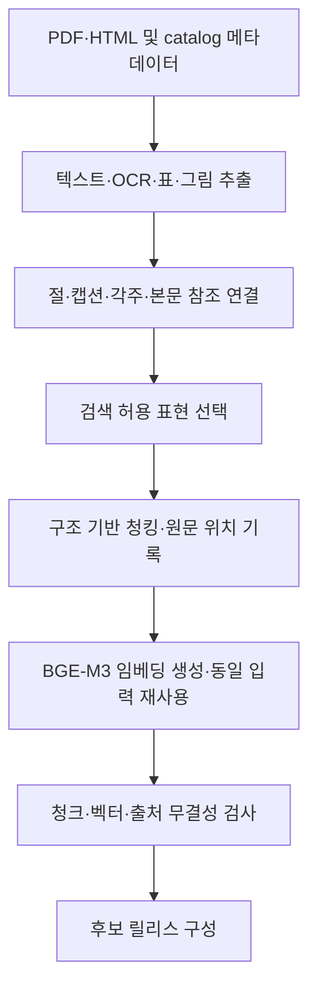
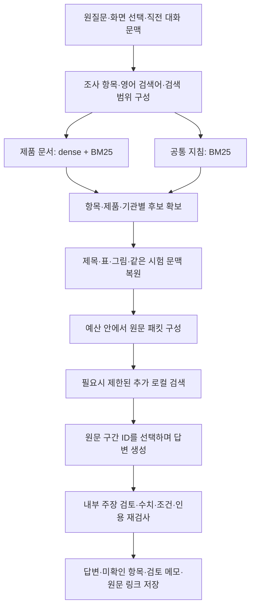

# 현재 RAG 파이프라인 상세 설명

> 이 문서는 2026-10-14 오전 관측 기록이다. 이후 H v2가 92문서·11,536벡터로 완료됐고 Luna 개발 평가와 코드 4.9.3 개선을 진행했다. 최신 결과는 [H v2 개발 평가·개선](H_V2_RAG_DEVELOPMENT_EVAL_2026-10-14.md)을 참고한다. 아래 H 실패·서버·코드 상태는 당시 관측이며 현재 실행 상태를 뜻하지 않는다.

- 확인일: 2026-10-14 KST
- 대상 프로젝트: `biosimilar_collection`
- 기준: 현재 디스크의 코드, 운영 서버 `http://127.0.0.1:8875/api/summary`, 운영 색인 파일, 새 H 실행 산출물
- 범위: 전처리 → 청킹 → 임베딩 → 검색 → 문맥 구성 → 답변·인용 검사

이 프로젝트의 RAG는 문서의 절·표·그림과 원문 위치를 보존한 뒤, 질문별로 필요한 근거를 검색하고 주장별 출처를 붙여 답하는 구조다. 제품 문서는 **BGE-M3 dense 검색 + BM25**, 공통 지침은 **별도 BM25 검색**을 사용한다. 답변에는 현재 운영 설정의 **gpt-5.6-luna**를 사용한다.

**운영 RAG와 새 H 전처리 후보는 서로 다른 상태다.** 운영은 기존 10,088벡터 색인을 사용한다. H 후보는 11,445벡터가 생성됐으나 최종 릴리스 검증이 중단되어 운영에 연결되지 않았다. 아래 수치는 작성 시점의 관측값이며 이후 실행으로 바뀔 수 있다.

## 1. 현재 운영 구성과 데이터 범위

| 항목 | 확인한 값 | 해석 |
| :-- | :-- | :-- |
| 운영 파이프라인 | `ra-research-rag-4.9.0` | 현재 RA 조사·종합 경로 |
| 운영 제품 릴리스 | `rag_finalization_2026-10-10_v2` | 코드 버전과 데이터 릴리스 날짜는 별개 |
| 생성 제공자·모델 | OpenAI / `gpt-5.6-luna` | 추론 설정 `none` |
| 인용 방식 | `spans` | 공급 원문 구간 ID를 선택하고 실제 인용문으로 복원 |
| 제품 범위 | SB17, ABP654, CTP43, BMAB1200, BAT2206 | ustekinumab 바이오시밀러 5종 |
| 기관 범위 | EMA, FDA, Health Canada | 내부 관할 코드 EU, US, CA |
| 제품 문서·원본 범위 | 92문서·4,160페이지 | 승인된 처리 범위 |
| 실제 청크가 존재하는 페이지 | 4,096페이지 | 운영 `chunks.jsonl`의 문서·버전·페이지 조합 수 |
| 제품 청크·벡터 | 10,088개 | 청크당 1개 dense 벡터 |
| 제품 기본 검색 청크 | 8,335개 | `filter_idx(chunks)` 적용 결과 |
| 공통 지침 스냅샷 | 21문서·236청크 | 제품 색인과 별도 저장·검색 |
| 요약 API의 총 청크 | 10,324개 | 제품 10,088 + 저장된 지침 236; 모두 검색 허용이라는 의미는 아님 |
| LLM 호출 한도 | 질문당 최대 3회 | 계획·초안·내부 주장 검토 |
| 추가 로컬 검색 | 최대 1라운드 | 생성 전 인식된 필수 항목의 후보 누락을 보완 |

4,160은 처리 대상 페이지 수이고 4,096은 실제 검색 청크가 있는 페이지 수다. 빈 페이지, 표현 제외, 검토 상태 등의 영향은 페이지별로 확인해야 한다. 문서가 색인에 존재한다는 사실만으로 그 문서의 모든 페이지·표·그림이 검색 가능하다고 해석하지 않는다.

기본 검색 밖 자료는 사용자 옵션이나 조사 항목이 요구하는 문서 역할에 따라 추가될 수 있다. 평가 보류·실행 금지·표현 검토 상태는 별도의 필터로 유지한다. 기존 평가 보류 9문서는 운영 범위에서 제외한다.

근거: [서비스 시작 설정](../../scripts/start_ra_service.ps1), [RA 파이프라인](../../rag/ra_pipeline.py), [운영 릴리스](../../data/versions/01_pilot_baseline_2026-10-10/embedded/rag_finalization_2026-10-10_v2/release_manifest.json).

## 2. 색인 생성과 질문 처리는 분리된다

### 2.1 오프라인: 검색할 자료 만들기



새 H 전처리도 이 흐름으로 기존 청킹·임베딩 도구에 연결된다. 후보 생성과 운영 서비스의 릴리스 변경은 별개 단계다. BM25의 SQLite FTS5 객체는 서비스에서 검색할 때 메모리에 만들고 같은 프로세스에서 재사용한다.

### 2.2 온라인: 질문에 답하기



## 3. 전처리: 무엇을 보존하는가

### 3.1 공통 산출물

전처리는 검색할 텍스트와 출처 관계를 함께 만든다.

| 산출물 | 주요 역할 |
| :-- | :-- |
| `source_units.jsonl` | 청킹할 선택 표현과 원문 연결, 검색 적격·검토 상태 |
| `extracted_assets.jsonl` | 추출 영역, 페이지·bbox, 표·그림 구조와 후보 정보 |
| `extraction_pages.jsonl` | 문서·페이지별 추출 상태 |
| `visual_groups.jsonl` | 여러 패널이나 조각을 논리적 표·그림 부모로 묶는 관계 |
| `visual_context_*.jsonl` | 캡션·각주·본문 참조와 시각 근거의 연결 |
| `extraction_manifest.json`, `extraction_integrity.json` | 입력·출력 범위와 파일 해시·검사 계약 |

PDF 물리 페이지, 인쇄 쪽 번호, HTML의 로컬 렌더 페이지는 구분한다. 파생 PDF·렌더본을 사용하면 원본과 파생본의 해시·위치 관계를 함께 남긴다.

### 3.2 새 H 전처리의 기능별 구성

| 기능 | 현재 H 구성 | 남기는 정보 |
| :-- | :-- | :-- |
| 기본 PDF 추출·레이아웃 | Docling / Heron | 블록·읽기 순서·좌표·원문 페이지 |
| 일반 문자 인식 | native 텍스트층 또는 RapidOCR / PP-OCRv6 | 선택 문자와 OCR·재판독 이력 |
| 기본 표 구조 | TableFormer accurate | 행·열·병합 셀·원시 셀 위치 |
| 후처리 | `ra_prep` 보정 코드 | 머리말·절·연구 ID 후보, 문자·표 보정 이력 |
| 누락·불완전 영역 점검 | PP-DocLayoutV3 및 닫힌 테두리 규칙 | 기본 추출과 별도 영역 목록의 대응·충돌 |
| 선별 보강 | PaddleOCR-VL-1.6-0.9B | 표 또는 의심 문자 crop의 전사와 후보 채택·거절 근거 |
| 그림 | 원본·캡션·인쇄 문자·본문 참조 보존 | 그림·패널·설명 문맥의 출처 연결 |

`ra_prep`은 후처리 코드 이름이다. H 기본 경로에서 그림의 의미 설명이나 곡선 좌표 수치를 생성하지 않는다. 모델이 만든 후보는 보존 검사를 거쳐 선택하며, 추출·구조 검사 통과와 임상적 의미 검토는 다른 상태로 남긴다.

이 표는 **새 H 후보의 구성**이다. 현재 운영 중인 2026-10-10 제품 색인이 H로 다시 만들어졌다는 뜻은 아니다.

근거: [H 구성](../../pipelines/pipeline_h/README.md), [최종 전처리 선정](../preprocessing/FINAL_PREPROCESSING_DECISION_2026-10-14.md).

## 4. 제품 문서 청킹 전략

### 4.1 토큰 설정

| 설정 | 값 | 적용 방식 |
| :-- | --: | :-- |
| `target_tokens` | 768 | 본문을 묶을 때의 목표 크기 |
| `max_tokens` | 1,024 | 본문 청크의 상한 |
| `overlap_tokens` | 96 | 같은 구조 구간에서 재사용할 본문 fragment의 최대 합계 |
| `table_max_tokens` | 2,048 | 표 및 함께 공급할 캡션·각주 등 문맥의 본문 예산 |
| `figure_max_tokens` | 2,048 | 그림 검색용 텍스트 표현의 상한 |
| `embedding_max_tokens` | 8,192 | 헤더·줄바꿈·본문·특수 토큰을 포함한 임베딩 입력 상한 |
| `token_counter` | BGE-M3 | 문자 수나 생성 모델의 토큰 수와 다름 |

`768`은 고정 길이나 최소 길이가 아니다. 페이지·절·시각 영역 경계를 먼저 지키므로 작은 청크도 생긴다. 본문과 시각 표현은 서로 다른 예산을 사용한다.

### 4.2 본문을 묶고 나누는 순서

1. 페이지 안의 source unit을 읽기 순서와 활성 절 상태에 따라 확인한다.
2. 형제 절, 서로 다른 시험 소제목, 본문과 표·그림 사이의 경계를 지킨다.
3. 같은 구간의 unit을 목표 768토큰까지 묶되 최대 1,024토큰을 넘기지 않는다.
4. 단일 unit이 너무 길면 줄바꿈 → 문장 경계 → 공백 순으로 분할을 시도한다.
5. 그래도 들어가지 않는 부분은 문자 위치 기준으로 나누고 `hard_split`을 기록한다.
6. 각 fragment가 원래 선택 표현의 정확한 부분 문자열인지 확인할 수 있도록 시작·끝 위치를 보존한다.

제목만 있는 상위 절과 하위 본문은 조건에 따라 함께 묶을 수 있지만, 서로 다른 시험의 내용을 크기만 맞추려고 합치지 않는다. 긴 입력을 토큰 단위로 잘라 다시 디코딩하지 않는다. 디코딩 과정에서 원문 문자열이 변하는 문제를 피하기 위한 구현이다.

### 4.3 overlap은 항상 96토큰이 아니다

이전 청크의 끝에서 **온전한 fragment**를 거꾸로 모으고, 합계가 96토큰 안에 들며 다음 청크의 최대 크기도 만족하는 경우에만 붙인다. 절 경계를 만나면 overlap을 붙이지 않는다.

따라서 실제 overlap은 0~96토큰이다. 이전 청크의 마지막 fragment 하나가 이미 96토큰보다 크면 overlap이 0일 수 있다. 표·그림은 본문 overlap을 사용하지 않고, 필요한 헤더·캡션 등의 반복 문맥을 별도로 관리한다.

### 4.4 표는 행과 병합 범위를 지킨다

표와 문맥이 예산 안에 들어가면 전체를 하나의 청크로 유지한다. 큰 표는 다음 조건을 만족할 때만 나눈다.

- 원문 열 헤더를 각 조각에 반복한다.
- `rowspan`이 걸친 경계와 함께 읽어야 하는 닫힌 행 묶음의 내부를 자르지 않는다.
- 캡션·단위는 앞에, 각주 등 연결 문맥은 역할에 따라 뒤에 배치하고 토큰 예산에 포함한다.
- 각 표 조각의 원문 행 범위와 반복 문맥을 구분해 기록한다.
- 헤더나 행 묶음 하나가 이미 상한을 넘거나 표 구조를 안전하게 분리할 수 없으면 제외 사유를 남긴다.

표의 2,048토큰은 숫자 셀만의 예산이 아니다. 연결된 캡션·각주도 공간을 사용하므로 실제 표 본체에 쓸 수 있는 양은 줄어든다.

### 4.5 그림은 검색용 텍스트와 원본을 연결한다

검색 벡터는 캡션·인쇄 문자 등 허용된 **텍스트 표현**에서 만든다. 원본 이미지 자체를 BGE-M3에 입력하는 이미지 임베딩 경로는 아니다. 그림 원본과 crop·패널 관계는 별도 출처 연결로 남겨 검색 이후 원문 검토에 사용한다.

논리적 부모에 포함된 물리 패널은 별도 검색 후보에서 제외될 수 있다. 검토가 필요한 모델 설명과 원문 캡션의 검색 적격성을 구분한다.

### 4.6 현재 운영 청크의 실제 크기

운영 `candidate/chunks.jsonl`을 읽어 집계한 값이다. P50은 중앙값이고 P90은 정렬된 값에서 `floor((n-1) × 0.9)` 위치를 취했다. 헤더를 제외한 본문 토큰 수다.

| 종류 (`structure.kind`) | 개수 | P50 | P90 | 최대 |
| :-- | --: | --: | --: | --: |
| `text` | 7,533 | 113 | 608 | 1,024 |
| `table_candidate` | 1,998 | 384 | 1,011 | 2,030 |
| `figure_candidate` | 557 | 6 | 83 | 548 |
| 합계 | 10,088 | — | — | — |

전체 본문 토큰의 최솟값은 1이고, 헤더를 포함한 임베딩 입력의 최댓값은 2,193이다. 현재 데이터에서 8,192토큰 한도까지 채우는 방식으로 청킹하고 있지는 않다. 특히 그림 검색 표현은 원본 이미지의 정보량과 달리 텍스트가 매우 짧을 수 있다.

근거: [기본 청킹 설정·토큰 계산](../../rag/build_chunks.py), [fragment 분할·packing](../../rag/chunking.py), [전처리 청커·표 분할](../../rag/preprocessed_chunks.py).

## 5. 청크가 보존하는 메타데이터와 원문 범위

| 범주 | 대표 필드 | 용도 |
| :-- | :-- | :-- |
| 문서 식별 | `document_id`, `version_id`, `source_url` | 서로 다른 문서·버전의 근거 혼합 방지 |
| 검색 범위 | `product_id`, `jurisdiction`, `doc_group`, `document_metadata` | 제품·기관·문서 역할·검색 정책 필터 |
| 위치 | `pdf_page`, `pdf_page_label`, `source_refs`, `bbox_pdf` | 실제 원문 페이지·영역으로 이동 |
| 절·시험 | `section_path`, `section_id`, `heading_anchors`, `study_candidates` | 제목·시험 문맥 연결; 후보 귀속은 검증 상태와 구분 |
| 시각 구조 | `table_id`, `figure_id`, `member_unit_ids`, `context_unit_ids`, `context_roles` | 표·그림·캡션·각주 관계 복원 |
| 표현·품질 | `representation`, `quality`, `ocr_status` | 검색 적격·검토 필요·표현 생성 경로 확인 |
| 청킹 | `chunking`, `previous_chunk_id`, `next_chunk_id` | 분할 이유·overlap·인접 청크 추적 |
| 무결성 | `content_hash`, `page_hash`, `parsed_sha256` | 내용·입력 변경과 청크·벡터 연결 확인 |

새 전처리 청크는 `rag-chunk-3`이며, 문자 범위의 기준은 `preprocessing_representation_unit`이다. `representation_start/end`는 선택한 OCR·전처리 표현 문자열의 위치를 가리킨다. 원본 PDF의 바이트 위치나 화면 좌표와는 다르며, PDF 위치는 별도 `source_refs`와 bbox로 연결한다. 이전 `rag-chunk-2`의 cleaned source 범위 계약과 구분한다.

미완료 페이지, 검색 제외 표현, 검토 필요 표현, 논리적 그림 부모가 이미 대표하는 패널, 빈 표현 등은 청킹에서 제외될 수 있다. 제외 이유는 `chunk_exclusions.jsonl`에 남긴다.

`retrieval_eligible=true`는 검색에 공급할 수 있다는 상태다. `numeric_evidence_eligible=false`, `semantic_status=unverified`는 수치·의미가 사전 인증되지 않았음을 표시한다. 실제 답변의 수치·조건 검사는 이후 단계에서 수행한다. 표현 문자열과 인용이 정확히 일치해도 OCR이나 표 귀속의 의미 오류가 자동으로 해결되는 것은 아니다.

근거: [전처리 청크 스키마](../../rag/preprocessing_chunk_schema.py), [청킹 제외·범위 검사](../../rag/preprocessed_chunks.py).

## 6. 임베딩 전략

### 6.1 모델·입력·출력

| 항목 | 현재 구성 |
| :-- | :-- |
| 모델 | 로컬 `BAAI/bge-m3` |
| 로더 | SentenceTransformers |
| 사용 출력 | 1,024차원 dense 벡터 |
| pooling | 운영 모델 메타데이터 기준 CLS pooling |
| 정규화 | L2 정규화 |
| 유사도 | cosine; 정규화된 벡터 내적으로 계산 |
| 문서 입력 상한 | 8,192토큰 |
| 질의 인코딩 설정 | 최대 길이 512토큰 |
| 기본 배치 크기 | 8 |
| GPU 추론 | CUDA 사용 시 float16 설정 |
| 저장 벡터 | NumPy float32 |
| 임베딩 API 호출 | 없음; 로컬 모델 사용 |

현재 경로는 BGE-M3의 dense 벡터를 사용한다. BM25는 SQLite FTS5로 별도 구현하며, BGE-M3의 sparse 또는 multi-vector 출력을 검색에 결합하는 구성은 아니다.

실제 문서 입력은 다음과 같다.

```text
header + "\n" + text
```

`header`에는 제품명·기관·문서 제목·절 경로·필요한 캡션·페이지가 들어간다. 운영 청크에서 확인한 한 예는 다음과 같다.

```text
SB17 (Pyzchiva) | EMA | Pyzchiva : EPAR - Public assessment report | p.2
[해당 청크의 원문 텍스트]
```

절 경로나 캡션이 있는 청크는 그 정보도 붙는다. 표 본문에 캡션 문맥이 이미 포함돼 있으면 헤더에 같은 캡션을 중복해서 넣지 않는 처리가 있다. 메타데이터 전체를 임베딩하는 것은 아니며, 문서 ID·버전·검토 정책 등은 별도 필드로 검색과 검증에 사용한다.

### 6.2 문서 입력을 임의로 자르지 않는다

임베딩 직전 실제 `header + newline + text`의 토큰 수를 계산한다. 문서 입력이 8,192토큰을 넘으면 `ValueError`를 발생시키며 청크를 다시 만들도록 한다. 문서의 근거 뒷부분을 잘라 임베딩을 계속하지 않는다. 이 초과 검사와 질의 인코딩의 최대 길이 설정은 서로 다른 구현이다.

임베딩은 긴 청크부터 비슷한 길이끼리 배치 처리하고, 결과는 원래 청크 순서로 되돌려 저장한다.

### 6.3 저장 파일과 연결 검사

```text
candidate/
├─ chunks.jsonl
├─ chunks_summary.json
├─ chunk_contexts.jsonl
├─ chunk_exclusions.jsonl
└─ emb/bge-m3/
   ├─ doc.npy
   ├─ chunk_ids.json
   └─ meta.json
```

`doc.npy`의 i번째 행은 `chunk_ids.json`과 `chunks.jsonl`의 i번째 청크에 대응한다. 검색 로딩 시 청크 파일 SHA-256과 ID 순서를 확인한다. 릴리스 구성 시 차원·모델 계약·벡터 유한값·정규화·문서 중복·보호된 평가 자료의 승격 여부 등을 검사한다.

### 6.4 기존 벡터 재사용 조건

증분 임베딩은 청크 ID나 본문만 비교하지 않고 **전체 임베딩 입력 문자열**을 비교한다.

```text
이전 header + 줄바꿈 + text == 현재 header + 줄바꿈 + text
```

입력이 완전히 같으면 기존 벡터를 재사용하고, 바뀌면 새로 인코딩한다. 제품명·문서 제목·절 경로 등 헤더만 바뀌어도 재생성 대상이다. 새로 인코딩하는 경우 인코더 revision과 기존 메타데이터의 revision도 비교한다.

현재 운영 메타데이터의 `revision`은 `null`이고, 별도 `embedding_identity`에 모델 상태·토크나이저 해시가 기록돼 있다. 증분 코드의 revision 필드 비교만으로 모든 가중치 동일성을 입증한다고 해석해서는 안 되며, 재현 시 실제 모델·토크나이저 해시를 함께 확인할 필요가 있다.

이번 H 후보에서는 총 11,445개 중 **145개 재사용, 11,300개 신규 생성**, 임베딩 외부 API 호출 0회가 기록돼 있다.

근거: [임베더](../../rag/embed_index.py), [증분 재사용](../../rag/incremental_embeddings.py), [색인 로딩](../../rag/search.py), [릴리스 구성 검사](../../rag/release.py).

## 7. 질문 해석과 제품 문서 검색

### 7.1 질문을 검색 계획으로 바꾼다

첫 LLM 호출에서 질문을 1~4개 조사 항목으로 정리한다. 항목마다 보통 1~2개 영어 검색어와 필요한 문서 역할을 만든다.

- 실제 시험 결과·기관의 심사 판단: `assessment`
- 제품 정보·용법·용량: `label`
- 결정·통지·행정 사건: `correspondence`
- 일반 규제 지침·권고: `guideline`

원질문의 부정, 비교 대상, 실제/제안 상태, 시험·Part, 대상군, 제형·경로·시점 등의 조건을 보존한다. 검색 계획에 예상 정답 수치를 넣지 않도록 한다. 기관이 언급됐다는 이유만으로 일반 지침 검색을 추가하지 않는다.

화면의 제품·기관·문서 선택은 검색의 바깥 경계다. 질문에 명시된 제품·기관으로 그 안에서 좁히고, 충돌·빈 범위는 별도로 처리한다. 후속 질문은 직전 질문에 명시된 범위를 이어받아 독립 질문으로 바꾼 뒤 같은 경로를 사용한다. 이 변환은 기존 계획 호출에 포함된다.

### 7.2 필터를 통과한 제품 후보에서 hybrid 검색한다

검색은 조사 항목 × 제품 × 기관별로 수행한다. 허용된 문서·버전, 서비스 기관, 평가·실행 정책, 검색 적격 상태를 확인한다. 기본 검색 자료에 더해 사용자 확대 옵션이나 해당 항목의 문서 역할에 맞는 허용 자료를 사용할 수 있다.

각 영어 검색어에 대해 다음 순서로 진행한다.

1. BGE-M3로 질의 벡터를 만든다.
2. 필터된 문서 벡터와 내적해 dense 상위 40개 후보를 얻는다.
3. 같은 범위에서 BM25 상위 40개 후보를 얻는다.
4. 두 순위를 RRF로 합쳐 최대 40개 후보를 유지한다.
5. 요청한 문서 역할에 맞는 후보 순위도 추가 결합해 관련도를 보정한다.
6. 검색어마다 첫 후보에 읽기 기회를 주고, 나머지는 합친 순위에서 고른다.

RRF는 각 검색기의 점수 크기를 직접 더하지 않고 순위를 합친다. 현재 기본 상수는 `k=60`이다.

```text
RRF(chunk) = 각 후보 목록에서의 1 / (60 + rank) 합계
```

이 점수는 상대적인 검색 우선순위다. 답변의 사실 정확도나 근거 지지 확률을 뜻하지 않는다.

### 7.3 RA 전용 BM25 입력

제품·기관·문서 제목은 같은 문서의 모든 청크에 반복되므로 RA 경로의 BM25에서는 **절 경로 + 캡션 + 본문**을 사용한다. 일반 `Bm25` 클래스의 기본 입력은 `header + text`지만 RA 호출부에서 헤더를 이렇게 바꿔 넘긴다.

SQLite FTS5의 `unicode61` 토크나이저를 사용하고, 질의에서는 영문·숫자 용어와 명시된 표·그림 번호를 추출해 OR 검색한다. 이 때문에 질문 계획에서 만드는 영어 검색어가 키워드 검색에 직접적인 영향을 준다.

### 7.4 ‘검색 페이지 수 5’의 실제 적용

공통 설정 이름은 `retrieval_pages`이고 기본값은 5다. **현재 RA 구현에서는 이를 각 조사 항목·제품·기관 그룹의 청크 후보 수 `k`로 사용한다.** 질문 전체에서 PDF 5페이지만 읽는다는 뜻은 아니다.

예를 들어 조사 항목 1개, 제품 2개, 기관 1개면 제품 검색 그룹은 2개다. 각 그룹에서 최대 5개 후보를 얻은 뒤 전체 입력 예산에 따라 공급하고, 제목·시각 근거·같은 시험 문맥을 추가할 수 있다.

현재 RA dense 검색은 로컬 NumPy 행렬 내적이다. 선택형 cross-encoder 코드 `rag/rerank.py`는 존재하지만 이 운영 RA 검색 경로에서 호출하지 않는다. Qdrant를 통한 검색도 이 경로에 연결돼 있지 않다.

근거: [질문 계획](../../rag/ra_tasks.py), [후속 질문](../../rag/followup.py), [RA 검색·다양성 유지](../../rag/ra_retrieval.py), [dense·BM25·RRF](../../rag/search.py).

## 8. 공통 지침은 별도 페이지 단위 색인이다

제품 문서의 768/1,024토큰 청킹을 공통 지침에 그대로 적용하지 않는다. 현재 공통 지침 스냅샷은 **사용 가능한 native 텍스트 페이지 1개를 청크 1개로 저장**한다. native 텍스트가 없거나 OCR 필요 상태인 페이지는 제외 이유를 남긴다.

| 항목 | 제품 문서 | 현재 공통 지침 |
| :-- | :-- | :-- |
| 청킹 | 구조 기반 본문·표·그림 분할 | native 페이지 단위 |
| 제품 ID | 해당 제품 | `null` |
| 임베딩 | BGE-M3 dense | 현재 별도 지침 경로에서는 생성·검색하지 않음 |
| 검색 | dense + BM25 | BM25 |
| 검색 후보 | 검색어별 각 40개 | 검색어별 BM25 30개 |
| 범위·정책 | 제품·기관·문서·검토 정책 | 기관·문서·지침 상태·실행 허용 정책 |

지침도 여러 검색어의 첫 후보를 보존하고 순위를 합쳐 읽을 후보를 고른다. 질문에 비교 임상 효능 시험이 명시된 경우 해당 영어 주제어를 추가하는 제한된 확장이 있다.

연결된 스냅샷은 `ra_guidelines_native_2026-10-12_v2`의 21문서·236청크다. 상태 레지스트리 적용 후 `GL:FDA-SCIENTIFIC-CONSIDERATIONS-2015`는 검색에서 제외되며 이 문서의 저장 청크는 27개다. 따라서 236이라는 API 표시는 현재 모두 허용된 지침 청크 수와 같지 않다.

문서의 등록 상태·발행일·발효일은 보존하지만, 서비스의 `current_guideline_validity_verified`는 `false`다. 저장된 과거 지침이나 제품 심사 사례를 현재의 일반 규제 요건으로 단정하지 않도록 검사한다.

근거: [지침 생성·검색](../../rag/ra_sources.py), [지침 상태 레지스트리](GUIDELINE_STATUS_2026-10-12.json).

## 9. 검색 결과를 LLM에 공급할 문맥으로 바꾼다

### 9.1 청크와 원문 제목을 패킷으로 묶는다

검색된 청크에 필요한 실제 절 제목·시험 제목을 함께 공급한다. 제목은 메타데이터 문구를 새 근거로 만드는 방식이 아니라, 같은 문서·버전의 source unit과 문자 범위를 복원한다. 본문에 이미 제목이 있으면 중복 공급을 줄인다.

여러 그룹의 결과는 한 그룹을 모두 채우고 다음으로 넘어가지 않고 순서대로 한 후보씩 읽는다. 청크 ID 기준으로 중복을 제거하고, 명시적으로 연결된 표·그림과 같은 시험·같은 문서의 관련 문맥을 예산 안에서 추가한다.

같은 시험 문맥 확장은 시험 정체성이 확인되는 범위에서 수행하며, 일반 지침은 같은 문서의 관련 문맥을 사용한다. 이 확장은 그룹별 원문 1,200토큰 한도와 전체 입력 예산을 함께 적용한다. 초기 검색 순위와 이미 공급하기로 한 근거를 교체하지 않는다.

### 9.2 청킹 예산과 생성 예산은 다르다

| 예산 | 현재 기준 |
| :-- | :-- |
| 청킹·임베딩 토큰 계산 | BGE-M3 토크나이저 |
| 생성 입력 계산 | 선택 모델용 tiktoken + 명시한 메시지 framing allowance |
| 애플리케이션 생성 envelope | 16,384토큰 |
| 출력 예약 | 3,000토큰 |
| 추가 여유분 | 256토큰 |
| `client.input_limit` | 13,128토큰 |
| `spans` 문맥 구성 시 검토 여유분 | 인식된 필수 항목이 있으면 128, 그 외 600토큰을 추가 예약 |

16,384는 이 프로젝트가 설정한 실행 예산이며 모델 제품 사양의 최대 문맥 길이를 의미하지 않는다. 입력 계산에는 질문·계획·메시지·근거·구조화 출력 스키마가 포함된다. 코드의 토큰 계산과 allowance는 제공자의 실제 사용량 집계와 완전히 동일하다는 보장은 없다.

패킷을 추가할 때마다 전체 비용을 다시 계산하고, 넘으면 해당 패킷을 제외해 이유를 기록한다. 원문 중간을 임의로 잘라 넣지 않는다. 생성·검토 호출 직전에도 각각 입력 예산을 확인한다.

### 9.3 추가 검색은 생성 전에 한 번만 수행한다

질문에서 규칙이 인식한 필수 항목에 후보 근거가 없으면 제한된 추가 검색을 수행한다. 예를 들어 투여 용량·경로, 비교약, 층화, 표 통계, 투여 간격 등이 대상 어휘에 포함된다.

| 제한 | 값 |
| :-- | --: |
| 추가 라운드 | 최대 1 |
| 보완할 필수 항목 | 최대 2 |
| 새 패킷 | 최대 6 |
| 새 원문 토큰 | 합계 최대 1,200 |
| 추가 LLM 호출 | 0 |

이 1,200토큰은 앞의 같은 시험 문맥 확장 한도와 별도 단계의 한도다. 두 단계 모두 전체 입력 예산을 만족해야 한다. 추가 검색은 기존 제품·기관·문서·버전 범위를 유지한다. 키워드 후보가 존재한다고 의미적으로 충분한 근거가 확보됐다고 판정하지 않는다.

현재 구조는 **답변 후 부족·상충을 일반적으로 판단해 여러 번 재검색하는 루프**까지 구현한 상태는 아니다.

근거: [원문 패킷·문맥 예산](../../rag/ra_retrieval.py), [제한된 추가 검색](../../rag/ra_research.py), [생성 실행 예산](../../rag/openai_chat.py).

## 10. 답변 생성과 주장별 검증

### 10.1 현재 기본 인용 방식: `spans`

공급 원문에 요청 시점의 인용 구간 ID를 만든다. 본문은 기존 문단을 유지하고 표는 셀과 문맥 범위를 구분한다. LLM은 이 구간 ID를 선택하며, 코드는 선택된 ID를 실제 원문 문자열과 위치로 복원한다.

```text
검색 청크 → 근거 블록 E1, E2, ... → 원문 구간 S1, S2, ...
         → LLM이 주장과 citation_span_ids 선택
         → 코드가 원문 인용·문서 버전·페이지·문자 위치로 복원
```

구간을 잘게 식별해도 읽기용 원문은 유지한다. 서로 떨어진 구간을 합쳐 원문에 없는 단일 인용문으로 만들지 않는다. 표에서는 숫자 셀과 해당 헤더·군·단위·통계의 관계를 함께 확인하는 검사가 추가된다.

### 10.2 질문당 LLM 최대 3회

| 호출 | 역할 | 주요 결과 |
| :-- | :-- | :-- |
| 1 | 질문 해석·계획 | 독립 질문, 검색 범위, 조사 항목, 영어 검색어 |
| 2 | 근거를 읽고 초안 생성 | 요청 항목별 주장·선택 인용 ID·미확인 항목 |
| 3 | 선택 인용을 통한 내부 검토 | 주장별 지지 여부, 유지·보류할 절 |

현재 운영에서는 세 단계에 같은 `gpt-5.6-luna`를 사용한다. 답할 근거가 없거나 유효한 주장이 남지 않는 경우 일부 호출은 생략될 수 있다. 별도 독립 평가 모델 호출이나 자동 무제한 재시도를 포함하지 않는다.

### 10.3 검사하는 내용

- 인용 ID와 인용 문자열이 실제 공급 원문에 존재하는가.
- 문서·버전·제품·시험·Part의 경계를 지키는가.
- 요청한 수치·통계·분석집단·단위와 표의 헤더·군이 맞는가.
- 용량·투여 경로·시점·간격·비교약 등 조건이 자체 인용에 있는가.
- 실제 시행 내용과 과거 제안·신청 내용을 구분하는가.
- 기관의 판단, 신청자 설명, 일반 사실·해석의 귀속이 맞는가.
- 지침의 필수·선택·사례별 조건과 적용 범위를 유지하는가.
- 일부 발췌에서 발견하지 못했다는 사실을 문서 전체의 부재로 과장하지 않는가.

검토 전에 같은 공급 문서·버전·검증된 시험의 인용을 제한적으로 보완할 수 있다. 검토 후 빠진 근거를 다른 시험·제품의 출처로 채우지 않는다. 근거가 부족하거나 요청과 충돌하는 항목은 보류하고, 지원되는 독립 사실은 가능한 범위에서 보존한다.

답변 결과의 `answered`, `partial`, `not_found`와 작업 실행 상태의 `completed`는 구분한다. 작업이 끝났다는 사실이 질문의 모든 요구를 만족했다는 뜻은 아니다. 일부 복합 질문의 전체 완료 판정과 일반 의미 상충 처리는 여전히 제한적이다.

문자 인용 일치·수치 검사·내부 LLM 검토는 전문가의 독립적인 임상·규제 정확도 인증과 다르다.

근거: [생성·조건 검사](../../rag/ra_answer.py), [원문 구간 ID](../../rag/ra_spans.py), [내부 검토](../../rag/ra_review.py), [표 인용 관계](../../rag/ra_table_citations.py).

## 11. 질문 하나가 처리되는 예시

아래는 흐름 설명용 예시이며 이 문서 작성 중 새 답변 생성 호출을 수행한 결과가 아니다.

> EMA 문서에서 SB17-1001 시험의 실제 투여 용량과 경로는?

1. **범위 구성:** 화면 선택 안에서 제품 SB17, 문서 기관 EMA로 좁힌다. EU산·US산 비교약 같은 표현은 문서 출처 기관과 구분한다.
2. **조사 계획:** 실제 투여 용량·경로를 함께 찾는 조사 항목과 영어 검색어를 만든다. 예상 용량은 검색어에 넣지 않는다.
3. **제품 검색:** 허용된 SB17·EMA 문서에서 dense와 BM25 후보를 합친다.
4. **문맥 복원:** 시험 제목과 용량·경로가 적힌 본문·표를 묶고, 같은 문서·버전·시험인지 확인한다.
5. **필수 항목 보완:** 용량 또는 경로의 후보가 없으면 한도 안에서 추가 로컬 검색을 한다.
6. **생성:** 공급된 원문 구간 ID를 선택해 용량·경로에 관한 주장을 만든다.
7. **검토:** 다른 Part·제형 신청·과거 제안 용량을 실제 시행 근거로 섞지 않았는지 확인한다.
8. **저장:** 지원된 주장과 인용, 미확인 항목, 사용량·실행 시간을 남긴다.

검색 결과가 관련 있어도 용량과 경로를 함께 지지하지 못하면 요청 전체를 충족했다고 처리하지 않을 수 있다.

## 12. 결과 저장과 추적

| 위치 | 저장 내용 |
| :-- | :-- |
| `data/runs/ra_service_reports/` | 완료·실패 질문과 보고서 JSON |
| `data/runs/ra_pipeline_requests/` | 제공자 요청·응답 실행 기록 |
| `data/runs/ra_conversations/` | 대화·후속 질문 문맥 |
| `data/runs/ra_review_records/` | 서버 검토 상태·의견·수정 이력 |
| `data/runs/ra_service_logs/` | 프로세스·시작·실행 로그 |
| `data/runs/model_quota/` | 이 프로젝트의 API 호출·사용량 기록 |

보고서에는 질문·해석·범위·검색 계획·검색 후보, 실제 공급 근거, 제외된 청크, 문맥 예산, 주장·인용·미확인 항목, 단계 시간·사용량이 포함된다. 공급 문맥의 문서·버전·페이지·원문 범위를 통해 답변을 추적할 수 있다.

검토 메모와 미팅 전 질문 초안은 보고서에서 연결해 만들며 별도 LLM 호출을 추가하지 않는다. 최근 결과를 메모리에 복원하고 과거 보고서도 ID로 다시 읽을 수 있다. BGE 인코더와 BM25 객체는 같은 프로세스에서 재사용하며 요청별 허용 문서 범위는 다시 적용한다.

## 13. 새 H 후보의 현재 실행 상태

대상 run: `pipelines/pipeline_h/runs/ustekinumab_20261014_v1`.

| 항목 | 작성 시점 상태 |
| :-- | :-- |
| 처리 범위 | 기존 승인 92문서·4,160페이지·5제품 |
| 청킹 | 후보 11,445청크 생성 |
| 임베딩 | 1,024차원 cosine용 dense 벡터 11,445개 생성 |
| 재사용·신규 | 재사용 145 / 신규 11,300 |
| 문서 입력 잘림 | 메타데이터 기준 0건 |
| 임베딩 외부 API 호출 | 0회 |
| 최종 상태 파일 | `stage=error`, `status=failed` |
| 마지막 상태 기록 | 2026-10-14 11:17:09 KST |
| 실패 지점 | `validate_release` |
| 직접 오류 | `Unresolved incomplete extraction pages` — 19개 페이지 |
| 운영 반영 | 미반영; 기존 제품 릴리스 유지 |

19개 페이지는 추출 미완료 상태가 남아 최종 검증을 통과하지 못한 항목이다. 실제 내용 누락과 상태 판정 문제 등 원인·재처리 필요 여부는 페이지별 확인 대상이다. 현재 청크·벡터 파일이 있다는 사실만으로 전체 전처리·릴리스가 완료됐다고 표시하지 않는다.

확인 파일:

- [파이프라인 상태](../../pipelines/pipeline_h/runs/ustekinumab_20261014_v1/pipeline_status.json)
- [후보 청킹 설정·집계](../../pipelines/pipeline_h/runs/ustekinumab_20261014_v1/candidate/chunks_summary.json)
- [후보 임베딩 메타데이터](../../pipelines/pipeline_h/runs/ustekinumab_20261014_v1/candidate/emb/bge-m3/meta.json)
- [벡터 재사용 기록](../../pipelines/pipeline_h/runs/ustekinumab_20261014_v1/candidate/embedding_reuse.json)
- [최종 검증 로그](../../pipelines/pipeline_h/runs/ustekinumab_20261014_v1/logs/validate_release.log)

## 14. 확인 범위와 남은 한계

| 확인 항목 | 이 문서에서 확인한 것 | 구분할 한계 |
| :-- | :-- | :-- |
| 운영 구성 | 요약 API와 코드의 버전·모델·릴리스 | README의 과거 운영 기록과 다를 수 있음 |
| 청킹 | 설정·분할 구현·운영 파일의 실제 크기 분포 | 구조 경계의 임상적 적절성을 전수 판정한 것은 아님 |
| 임베딩 | 입력 형식·차원·정규화·재사용 정책·산출물 수 | 검색 품질이나 수치 의미 정확도는 별도 |
| 검색 | 제품 hybrid·지침 BM25·필터·그룹별 후보 수 | 지침 dense 검색과 기본 cross-encoder 재랭킹은 미연결 |
| 문맥 | 원문 패킷·연결 문맥·한 번의 누락 후보 검색 | 일반적인 반복 조사·상충 해결 루프는 미구현 |
| 검증 | 원문 구간·수치·조건·주장 검사 구조 | 독립 전문가 인증·전체 복합 질문 완료 판정과 구분 |
| H 상태 | 청크·임베딩 파일과 릴리스 검증 실패 | 최종 릴리스 완료·운영 반영·전체 의미 정확도는 미확인 |

문서 작성 과정은 코드·파일·요약 API 조회와 기존 산출물 집계였다. 새 LLM 답변 생성, 임베딩 재실행, 색인 변경, 서비스 재시작은 수행하지 않았다.

### 읽기 전용 재확인 예시

프로젝트 루트 PowerShell에서 현재 서비스 요약과 H 상태를 다시 조회할 수 있다. 포트가 바뀌면 실제 운영 주소를 사용한다.

```powershell
Invoke-RestMethod -Uri http://127.0.0.1:8875/api/summary |
    Select-Object pipeline_version, run_name, answer_model, citation_mode,
        product_index_chunks, guideline_chunks, default_llm_calls_maximum

Get-Content -Encoding utf8 `
    pipelines/pipeline_h/runs/ustekinumab_20261014_v1/pipeline_status.json
```

이 조회는 답변 생성 엔드포인트를 호출하지 않는다.
